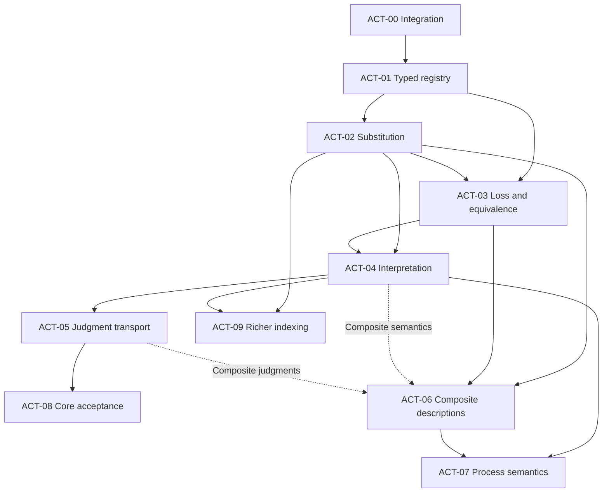

# IDA act classification and categorical transformations

## Proof-first roadmap

**Design status: accepted.** The project owner accepted the context theory and
this implementation roadmap on 2026-11-09. ACT-01 now has a minimal
[registry and bound-source implementation](ida-act-registry.md) and a
[ground context implementation](ida-context-foundation.md). Remaining core work
is planned, and conditional extensions retain their stated triggers. Design
acceptance is recorded separately from implementation and proof completion.

**Implementation status.** ACT-00 is integrated on main through [PR #144][pr144] at
[`ca38f35e32e23169e852fe7d5f8f8b1f3734ed0e`][integrated-main]. Its acceptance
evidence remains bound to the checked revisions. The remaining packages retain their
prerequisites below. This is the uṣūl track's milestone
[M16](../roadmap-hanbali-usul-formalization.md#m16--typed-act-classification-and-categorical-transformations--m2-m5).

The first deliverable is a small calculus of typed descriptions and substitutions,
connected to the existing source-bound judgment machinery. More elaborate
categorical structures are conditional extensions with their own exit criteria.
Formal development can proceed with explicitly candidate interpretations;
interpretive admission remains a separately evidenced decision.

The [accepted context theory](ida-context-theory.md) refines the categorical
integration: typed variables and conditional premises, grounded evidence and
inquiry snapshots, semantic histories, and temporal/authority changes have
distinct interfaces. Its required contracts belong to the ACT packages below;
the note adds no implemented calculus or admitted interpretation.
Its [construction-level integration](ida-context-theory.md#4-categorical-integration-and-transport)
now states the category of descriptions over contexts, explicit interpretation
naturality, separate migration gates, and the
[integration theorem sequence](ida-context-theory.md#integration-theorem-sequence).
These refine accepted contracts while implementation and receipt status remain
separately tracked.

## 1. Baseline and evidence boundaries

### Current integrated baseline and historical prerequisites

Main at `ca38f35` contains structured targets, their complete scope binding in
judgments and derivations, and the candidate reference from #140. See the
[integration contract](ida-target-integration.md) and [merged #144][pr144].
Context and time remain opaque numeric coordinates; the accepted design specifies
their interpretation and evidence bindings. The table and receipts below retain
the earlier baseline that motivated ACT-00; they are not a claim that main still
uses only numeric targets.

The historical documentary baseline is main commit
[`c9743cefe86b9b9c3032c6cc626a51fff1ab8136`][main-baseline].
At that revision:

| Component | Baseline | Consequence for this roadmap |
|---|---|---|
| IDA foundation | `Usul.IDA` has the five-value lattice, omission duality, partial constraints, and a seven-coordinate scope guard. `Key.target` is still `Nat`. | A structured-target integration is a real prerequisite, not completed mainline work. |
| Typed judgments | [`Usul.Typing.IDAJudgment`](../../formal/lean/Usul/Typing/IDAJudgment.lean), with namespace `Usul.IDA.Judgment`, and its independent Quint model are present. | Reuse the question-indexed answers and admission boundary. |
| Source-bound derivations | [`Usul.Typing.IDADerivation`](../../formal/lean/Usul/Typing/IDADerivation.lean), with namespace `Usul.IDA.Derivation`, source authentication fixtures, replay wire contracts, and dedicated verification are present following #141. | Extend the existing derivation/evidence mechanism; do not create a parallel source authority. |
| Categorical layer | `Usul.Cat.Basic`, `Factor`, `Typing`, `Scales`, `Sheaf`, `Interval`, `Institution`, and `Carriers` already exist. | Audit and reuse their exact hypotheses before adding act-specific constructions. |
| Structured targets and act reference | [PR #140][pr140] is a draft against `research/ida-algebra-v1`, at [`a7cf2713c2dfc9cd41e9389bd5db721ef4280db5`][target-head]. | Its scoped results do not establish joint compilation with the later mainline judgment/derivation modules. |

The #140 snapshot carries `perform`, `omit`, and `affect` expressions; complete
operation signatures; named typed operands; and a proof of structural
well-formedness. Its five reference sorts are `person`, `asset`, `obligation`,
`occurrence`, and `proposition`. `affect` is not a generic representation of every
state, object, relation, or nonhuman event.

The [candidate reference at that snapshot][act-reference] preserves:

- 537 legacy concepts: 293 act labels, 173 item labels, and 71 issue labels;
- 57 topic roots and all recorded broader relationships;
- 34 proposed act kinds, including their version, ordered roles, and source loci;
- 12 normalization cases retaining qualifications and distinct senses;
- one restricted proposal, `transfer.pay_zakat`, with a complete mapping to the
  five existing reference sorts; 33 proposals with explicit unresolved roles.

Those are inventory and representability observations, not a verified exhaustive
classification of acts in fiqh. Even the complete payment mapping is candidate.

PR #140 links historical [candidate-reference][reference-run] and
[IDA Lean–Quint][target-run] receipts for `a7cf271`. It reports 23 reference tests,
the 84-contract IDA gate, 14 deterministic Quint tests, 13,499 differential
evaluations, and the required adverse controls. Preserve those receipts as
evidence of that revision. ACT-00's integration evidence belongs to its own
checked head; this roadmap does not reclassify old #140 results as current integration
acceptance. The startup failure discussed in [#136][pr136] is a baseline issue
to re-inspect, not a permanent waiver of any required check.

### Existing results to reuse

| Existing module or document | Relevant result or interface | Boundary to retain |
|---|---|---|
| [`Usul.Cat.Basic`](../../formal/lean/Usul/Cat/Basic.lean) | Categories, functors, thin categories, monotone/antitone maps | Import direction remains types before categories. |
| [`Usul.Cat.Factor`](../../formal/lean/Usul/Cat/Factor.lean) | `factors_iff_functor`, `factors_iff_exists`, `factorsOn_iff_extension`, `not_factorsOn_iff_naqd` | Constant-on-fiber and extension hypotheses must be supplied; observed examples do not prove universal source fidelity. |
| [`Usul.Cat.Typing`](../../formal/lean/Usul/Cat/Typing.lean) | `judge_factors`, `Reads`, `readsCat`, `Reads.factors` | These concern the defined encoders; they do not already interpret all proposed act kinds. |
| [`Usul.Cat.Scales`](../../formal/lean/Usul/Cat/Scales.lean) | `hukmCat`, `sigma`, `sigmaIso`, `sigma_reflects` | The ruling order is not the act-refinement order. |
| [`Usul.Cat.Institution`](../../formal/lean/Usul/Cat/Institution.lean) | `Comorphism.comp`, `entails_map`, `entails_of_map`, `entails_iff` | Preservation and reflection differ; reflection has the explicit model-surjectivity hypothesis. |
| [Categorical architecture](../architecture/category-theory.md) | Existing sheaf, interval, and carrier constructions | Gluing requires matching; it does not resolve juristic disagreement or prove unbounded behavior from finite checks. |
| [Typed judgment records](ida-judgment-records.md), [source derivations](ida-source-derivations.md), [wire contract](ida-derivation-wire.md), [source authentication](ida-source-auth.md) | Question typing, scope, derivation, source and revision binding | Reuse the admission mechanism and report all remaining trust assumptions. |

The existing factorization results already supply the abstract mathematics behind
the specified information-loss test. The new contribution is an act-description
instance, with its relevant qualifications and evidence, and an independent
bounded executable counterpart.

## 2. Design commitments

### Four identities and independent facets

Keep the following identities distinct:

1. **Source mention:** a textual occurrence at a locus in a pinned witness.
2. **Act kind:** a versioned definition with its argument schema.
3. **Qualified description:** an instantiation of that schema with asserted
   qualifications and their evidence or uncertainty.
4. **Conduct occurrence:** a purported particular performance or attempt, with
   its own occurrence evidence.

A mention can have several candidate senses. Represent that ambiguity through
attributed mapping records, rather than an unjustified total mention-to-kind
function. Distinct occurrences can instantiate the same description. A
description can be hypothetical, incomplete, disputed, or unperformed.

Target sort, topic, kind, manifestation, internal structure, participant roles,
qualifications, and legal judgment are separate facets. Preserve the original
catalogue labels and source metadata. In particular, inheritance, intention,
pledge, deposit, entering iḥrām versus being in its state, and livestock damage
require sense distinctions before assigning a human-act constructor.

The source worklist remains the pinned material identified by the
[candidate reference][act-reference]: ʿUmda chapter records for concrete examples,
Rawḍa 1:139–140 for kind/individual and qualification distinctions and 1:173–174
for doing/restraint, and Nūrāniyya 1:163–165 for domain and manifestation.
Retain its exact witness hashes and loci. These passage mappings are interpretive
proposals, not a claim that a classical source states the software signature.

### Distinct relation vocabulary

| Relation | Intended endpoints | Law that may be justified | Inference it must not supply by itself |
|---|---|---|---|
| Specialization | Compatible description schemas or predicates | Reflexivity/transitivity after defining genuine refinement | Inheritance of arbitrary rulings |
| Topic membership | Concept or mention to topic, via membership records | Declared navigation behavior | Subtyping, identity, or legal authority |
| Component membership | Component description to a specified composite position | Typed assembly/substitution laws | A component being the whole or a subtype of it |
| Realization/manifestation | Described conduct to its proposed expression or manifestation | Profile-specific realization conditions | Universal interchangeability of speech, writing, gesture, or conduct |
| Interpretation | Source mention and candidate/admitted definition | Attributed, versioned supported mappings | Unique sense, total interpretation, or admitted judgment |
| Equivalence | Two descriptions at a declared profile/context/question | Equivalence and required congruence laws | Equality of people, property, debts, or occurrences |

A graph may generate a free category of paths. The resulting arrows mean paths
until a semantic interpretation is specified. Do not give every heterogeneous
edge the same transitivity or judgment-transport rule. A thin-category view can
erase distinct evidence paths; retain source witnesses as data even when their
structural consequences agree.

### Typed arguments, roles, and uncertainty

The accepted core design uses the dependent family

\[
  \mathrm{Description}(R)
  = \sum_{k:\mathrm{Kind}(R)} \mathrm{Arguments}(R,k),
\]

extended with qualifications and provenance. This is a design formula, not a
compiled declaration. Describe precisely how it embeds into or refines #140's
self-declared operation/signature representation.

A registry must bind the kind identifier, definition version/digest, ordered
roles, and operand sorts. Separate definition identity from the supporting
citation set: adding a citation need not change a definition, while changing the
meaning cannot silently reuse its version. Changed source bytes invalidate the
corresponding source evidence even when the declared definition is unchanged.

Resolve new operand domains explicitly: utterance content, ritual sequences,
mandates and legal relations, intervals, benefits/services, materials, intention,
restraint descriptions, and causal descriptions. Casting all of them to
`proposition` or `obligation` hides the modeling obligation.

Seller and buyer can both have sort `person`. Swapping them may remain well
typed, but changes the target. A role-preserving transformation needs a stronger
contract than preservation of operand sorts. Formal variables are substitutable;
resolved external references to persons, assets, debts, mandates, sources, and
occurrences are rigid unless a separately specified transformation applies.

Structural validity establishes neither authority, ownership, consent,
eligibility, capacity, intention, occurrence, legal validity, discharge, nor
liability. Unknown qualifications remain unknown. The ability to represent an
attempt must not require proving in advance the judgment being asked about it.

### Different categories serve different levels

| Level | Possible objects | Possible arrows | Status |
|---|---|---|---|
| Schematic syntax | Typed variable contexts | Well-typed substitutions | First categorical implementation target |
| Description representations | Versioned schemas or interpreted representations | Explicit schema/representation transformations | Accepted design; implementation planned, with specified preserved information |
| Ruling scale | The five existing `Hukm` values | The existing order relation | Already represented by `hukmCat` |
| Process semantics | Explicit situation or interface types | Specified transitions or processes | Conditional later work |

Do not silently change what objects and arrows mean within an argument. A
description constructor is not an occurrence or a state transition. The mere
existence of one category does not supply a functor between these levels.

### Context layers and separate preservation claims

The [accepted context design](ida-context-theory.md#2-context-layers-and-inquiry-binding)
separates formal variables, conditional premises, grounding, report evidence,
interpretation/admission policies, inquiry scope, and actual semantic histories.
Conditional derivation and permission to use its premises in a concrete inquiry
have different judgments. Reuse the existing exact-premise admission boundary.

An admissible transformation may preserve a conclusion's soundness without
preserving the evaluator's exact answer or the admission of an old receipt.
Strengthening premises can narrow an answer constraint. Exact equality needs a
complete-dependency/factorization theorem; new concrete admission needs current
scope and evidence checks. More reports, revocation and profile revision are
not automatically premise-context arrows.

## 3. Work packages, dependencies, and status

ACT-00 integrated #140 through [merged #144][pr144]. **The ACT-01 through ACT-09
roadmap is accepted. ACT-01 has a minimal implemented fragment; later
implementation remains planned or conditional.**
ACT-06, ACT-07, and ACT-09 are
conditional extensions and do not block the first core pilot.

| Package | Deliverable | Entry prerequisites | State |
|---|---|---|---|
| ACT-00 | Integrated structured-target and derivation baseline | Existing IDA foundation, judgments, derivations, and #140 | [Integrated on main via #144](ida-target-integration.md); verification claims remain revision-bound |
| ACT-01 | Versioned kinds, typed descriptions, and relation vocabulary | ACT-00 | [Registry and source binding](ida-act-registry.md), [ground context and inquiry binding](ida-context-foundation.md), and exact-revision gates `make ida-registry` and `make ida-context` |
| ACT-02 | Context category and substitution laws | ACT-01 | [Implemented typed substitution and premise-arrow fragment](ida-substitution.md) with `make ida-substitution` |
| ACT-03 | Information-loss witnesses and scoped equivalence | ACT-01, ACT-02 | [First exact frame proof and loss witnesses](ida-projection.md) with `make ida-projection` |
| ACT-04 | Supported interpretations and schema migration | ACT-02, ACT-03 | [Fixed-history semantic fragment](ida-semantics.md) with `make ida-semantics`; sourced interpretation and migration pending |
| ACT-05 | Explicit judgment transport and derived evidence | ACT-04 | [Bounded contextual formula admission implemented](ida-admission.md) |
| ACT-06 | Typed composition of descriptions | ACT-02, ACT-03 | Conditional on a concrete composite use case |
| ACT-07 | Process interfaces and resource-aware composition | ACT-04, ACT-06 | Conditional later work |
| ACT-08 | End-to-end core pilot and reproducible acceptance | ACT-05 | Bounded agency and omission observations implemented; core completion gate remains open |
| ACT-09 | Richer indexing, fibrations, or quotient interfaces | ACT-02, ACT-04 | Conditional on a demonstrated need |

`ACT-08` inherits ACT-00 through ACT-05 transitively. A later claim covering
composites or processes must add ACT-06 or ACT-07 acceptance explicitly.
Solid arrows show entry prerequisites. Dashed arrows add the interpretation and
transport gates when ACT-06 makes semantic or transported-judgment claims.

Parallel development is useful after the shared interfaces stabilize: the
information-loss counterexamples and the supported-interpretation design can be
investigated independently, and composite descriptions can proceed separately
from judgment transport. Keep one owner for the shared wire and registry
contracts; dependent branches must record their exact base and integration head.

### ACT-00 — Integrate the actual prerequisites

**Purpose.** Establish a real common baseline before claiming categorical
properties of targets and derivations together.

**Deliverables.**

- Integrate #140's target representation and candidate reference with current
  main's typed judgment, derivation, authentication, and replay modules.
- Resolve all type, guard, serialization, fixture, exporter, and wire-version
  consequences of changing `Key.target`. Do not retain a numeric proxy that
  drops the new target's structure.
- Preserve complete target comparison across conjunction and replay. Bind the
  participant/`Key.subject` consistency obligation explicitly; the other six
  scope coordinates currently do not gain meaning from becoming equal numbers.
- Inventory the existing contracts and companion documents before updating
  them; preserve their actual statements or document a deliberate replacement.

**Acceptance.** Build the combined modules, run their existing declared Lean and
Quint gates at the same head, verify canonical replay and source bindings, and
retain scoped receipts. Report repository-wide failures separately. A successful
historical #140 run or a successful documentation check is not this exit.

**Implemented slice.** The [integration contract](ida-target-integration.md)
landed through [#144][pr144] at [main `ca38f35`][integrated-main]. It records the
legacy embedding, full target comparison, and retained admission
boundary. Independently reconstructed synthetic repayment descriptions combine.
Swapped roles, changed omission occurrences, and changed affect object sorts
block conjunction. A changed passage, stale interpretation pin, or legacy
admission/evidence blocks the corresponding source. The restricted zakat
proposal remains a candidate for ACT-08, with its source and profile obligations
still explicit. ACT-01 starts after scoped acceptance and owns registry authority.

### ACT-01 — Define the registry and typed descriptions

**Purpose.** Make kind-specific argument requirements and relation semantics
explicit before interpreting transformations categorically.

**Deliverables.**

- Define versioned kind references, canonical definition digests, ordered role
  schemas, and a deterministic registry resolver.
- Define the context predicate and snapshot vocabulary needed by the first
  supported fragment: qualified meanings, rigid references, explicit clocks,
  version pins and inquiry binding. Reject conflicting definitions under one
  identity/version; retain opaque legacy contexts until an evidenced mapping
  supplies a structured replacement.
- Define the relationship between the registry-checked family and the
  structurally well-formed `Target`. Preserve unresolved kinds as data without
  admitting them as supported interpretations.
- Decide whether the description embeds into an extended `Target` or projects
  into a target with omitted fields retained in a separately bound description/
  evidence envelope. State which fields participate in target equality and
  which in scope/evidence binding. A lossy projection is not an embedding.
- Represent candidate qualification assertions separately from established
  premises and from judgments about validity or effect.
- Keep mention, kind, description, and occurrence identifiers distinct; retain
  alternative mappings and the full legacy catalogue.
- Specify each relation's endpoints and admissible composition independently.
- Record a source-linked worklist for each newly required reference sort, rather
  than expanding the sort universe without a use case.

**Required Lean obligations.** Registry validity rejects conflicting definitions
under one versioned key; lookup uniqueness cannot be obtained merely by choosing
the first record. Resolved arguments match the definition, and decoding/
re-encoding preserves the declared semantic fields. Prove preservation of fields
represented in `Target`, injectivity if an embedding is claimed, and exact
admission binding of any omitted qualifications or definition versions.
Candidate lookup alone supplies no admission witness. The latter must follow
from the actual derivation/admission constructors, not an unrelated Boolean flag.

**Quint controls.** Same symbol with another signature; same version with a
changed definition digest; a mandate cast to an obligation; topic membership
used as refinement; an unknown kind forced through a default interpretation.
Also supply two conflicting entries with one identifier/version and change an
omitted qualification while retaining the same projected target.

**Exit.** A minimal registry and its canonical wire agree across carriers, every
unresolved pilot role has an explicit outcome, and no candidate status is
silently promoted.

**Implemented fragment (2026-11-09).** The [ACT-01 contract](ida-act-registry.md)
records global registry-key uniqueness, canonical structural-definition digests,
ordered typed roles, explicit unresolved outcomes, attributed qualifications,
context snapshot pins, and exact envelope/source binding through the existing
source evaluator. The projection into `Target` is explicitly lossy. The core
contains arbitrary-input proofs and fixed contracts; the independent Quint gate
compares 504 structural and 4,320 bound-source cases. Canonical wire checks retain
all 34 catalogue candidates and 64 unresolved role slots across 33 kinds.

The supported resolver fragment is performed actions. Qualification truth,
predicate-definition semantics, authenticated publication of binding authority,
and a serialized admission interface remain separate obligations; none is
inferred from the new structural JSON adapter. Relation endpoints and composition
requirements remain as specified above, with no new graph-based inference rule.

### ACT-02 — Prove the context and substitution calculus

The [implemented fragment](ida-substitution.md) covers typed variables and
rigid references, registered descriptions, inquiry grounding, and a
conjunction calculus with checked premise arrows.

**Purpose.** Make reusable schematic descriptions safe to instantiate.

**Mathematical contract.** A context \(\Gamma\) declares typed formal variables.
A substitution \(\sigma:\Delta\to\Gamma\) supplies terms in \(\Delta\) for the
variables of \(\Gamma\). A description reindexes as
\(d[\sigma]\in\mathrm{Desc}(\Delta)\). With
\(\tau:\Theta\to\Delta\), require

\[
 d[\mathrm{id}_\Gamma]=d,\qquad
 (d[\sigma])[\tau]=d[\sigma\circ\tau].
\]

First prove the substitution category's identity, associativity, and typing
laws; then prove the description action. The presheaf name is justified by
these laws, not by a naming convention.

The [category of elements](ida-context-theory.md#descriptions-over-their-contexts)
has objects \((\Gamma,d)\) and arrows supplied by substitutions with
\(e=d[\sigma]\). Its projection to contexts records the unique reindexing
lift. This is a direct reading of the simple presheaf laws; a generic fibration
library remains outside the core acceptance requirements.

The [context calculus](ida-context-theory.md#4-categorical-integration-and-transport)
also specifies arrows between conditional-premise contexts. Their identity
needs the assumption rule; composition needs substitution admissibility and
simultaneous cut in the fixed rule fragment. Start with proof-irrelevant
admissibility over substitutions and preserve proof-relevant transport/source
certificates separately. Raw derivation trees require additional equality,
normalization or coherence treatment before claiming strict category laws.

**Required Lean obligations.** `subst_wellFormed`, `subst_id`, `subst_comp`,
preservation of dependencies between arguments, role labels and rigid
references, and commuting with projection to a fixed kind/version. These are
planned contract names; implementation must publish exact statements.

Do not mistake specialization for identity preservation: filling variables can
change the instantiated target. It should preserve the schema and its declared
substitution semantics. Alpha-renaming formal variables does not authorize
renaming a resolved external person or occurrence.

Substitution of a description or qualification formula is not substitution of
the truth of a source assertion. Instantiating a genuinely parametric derivation
requires its stated premise rule; an attestation about a concrete person or
event remains bound to that original scope. Syntax substitution must not copy
an attached receipt into a newly admitted judgment. ACT-05 revalidates that
evidence and supplies any justified derived receipt.

**Quint controls.** Compare direct and two-step instantiation; inject a
sort-mismatched replacement; swap two same-sort participants; rewrite a rigid
debt/mandate reference; drop a dependent premise during substitution.

**Exit.** Universal Lean laws plus independent bounded substitution results on a
declared finite domain. A changed same-sort role assignment remains representable
where appropriate but is distinguished from the original target.

### ACT-03 — Account for forgetting and scoped equivalence

The [first implemented projection](ida-projection.md) proves an exact frame law
for one synthetic evaluator. It checks an appended exception, loss of
occurrence identity, equal answers with unequal dependencies, and stale
bindings despite scoped equivalence.

**Purpose.** Specify what each representation map preserves, forgets, or can
reflect.

For \(u:D\to C\), transport of an interpretation \(J:D\to B\) through \(u\)
requires a factorization \(J=\bar J\circ u\). A necessary condition is

\[
 u(x)=u(y)\Longrightarrow J(x)=J(y).
\]

Fix question, profile, and context or include them explicitly in the domain.
The codomain may retain the existing typed answer statuses; \(J\) is not an
unconditional assignment of one `Hukm` to every act kind.

Reuse `Usul.Cat.Factor` for the exact existence/extension hypotheses, including
its inhabited-codomain requirement where used. Construct act-specific
counterexamples in which forgetting a qualification identifies descriptions
distinguished by a declared toy interpretation. The example proves a modeling
failure mode; it must not invent a fiqh ruling about coercion or another case.

Keep two reuse limits explicit: `Reads` compares information dependence and
applicability, not equality of encoder answers, as `Reads.mapRun` illustrates.
`Factor.unattested_free` shows that consistent supplied cases can leave an
unseen feature class unconstrained. Add output-relabeling and unattested-class
controls alongside the existing qualification-loss counterexample; their
[context contracts](ida-context-theory.md#complete-dependencies) specify the
separate obligations.

**Deliverables.**

- Maps from qualified description to core and description to kind, each with an
  explicit information-loss inventory. Project an occurrence to a described
  kind only through an explicitly attributed occurrence-to-description witness;
  an occurrence identifier or occurrence evidence does not itself choose one
  unique description or kind.
- Independent preservation, reflection/injectivity, and round-trip obligations.
  A functor need not be faithful; faithfulness alone is not injectivity on objects.
- Equivalence indexed by profile, definition version, context, question, and any
  other identity-sensitive scope. Distinguish it from structural equality and
  occurrence identity.
- For any normalizer, prove well-formedness preservation, idempotence, intended
  semantic preservation, and the permitted use of discarded information.

**Quotient gate.** Establish equivalence laws and congruence for every operation
that is to descend to a quotient. Agreement on one answer is not sufficient for
global target normalization. Do not define equivalence merely as equal judgments
and then report judgment preservation as a substantive independent result.
If a quotient is to inherit reindexing, additionally prove
\(d\sim_\Gamma e\Rightarrow d[\sigma]\sim_\Delta e[\sigma]\), under the declared
reindexing of profile, question, and assumptions. Otherwise it cannot inherit
the description presheaf action.

**Quint controls.** Remove coercion and reuse a conclusion; merge distinct
occurrences; normalize a qualified sale to its core while retaining its old
validity answer; identify descriptions solely because their kinds or current
ruling tags agree.

**Exit.** Positive factorization witnesses and explicit failures both replay.
Full target equality remains the admission guard unless a separately proved,
versioned replacement is introduced.

**Context relevance.** Extend projections only with a complete dependency
contract covering negative/default premises, potential exceptions, priorities,
queried sets/aggregates, source/definition/profile versions, authority and time,
and transitive dependencies. Derive the frame theorem from an actual evaluator.
Distinguish exact answer equality from sound approximation and from receipt
admission. Add a hidden-defeater/new-matching-row control that preserves all
previous positive reads while changing the answer.

### ACT-04 — Interpret supported fragments and migrate schemas

The [first semantic fragment](ida-semantics.md) proves fixed-history
naturality, satisfaction under substitution, conditional soundness and
finite nonvacuity for the synthetic inquiry.

**Purpose.** Give supported syntax a specified meaning and make changes of
representation checkable.

For each profile/version, define a supported syntactic fragment
\(\mathcal S_{P,v}\), its relevant equations, a semantic domain
\(\mathcal M_{P,v}\), and an interpretation \(I_{P,v}\). If presented as a
functor, the fragment must contain identities and be closed under the
compositions claimed. A collection of partial lookup successes is not
automatically such a fragment.
Require
\(\mathrm{Supported}_\Gamma(d)\land\mathrm{Allowed}(\sigma)
\Rightarrow\mathrm{Supported}_\Delta(d[\sigma])\),
or restrict the substitution category/domain explicitly. Both sides of a
semantic commutation equation must be defined.

Use the explicit [description naturality construction](ida-context-theory.md#semantic-interpretation):
substitution pulls descriptions from \(\Gamma\) to \(\Delta\), while its
semantic assignment map goes from \(\operatorname{Val}(\Delta)\) to
\(\operatorname{Val}(\Gamma)\). Fix the semantic history in this square.
Track [description, derivation, and concrete-application migration](ida-context-theory.md#migration-gates)
as separate gates; a meaning-preserving migration need not pass admission.
Distinguish structural registry kinds from a
[classification derived under contextual premises](ida-context-theory.md#structural-kind-and-contextual-classification).

**Deliverables.**

- Role meanings, source loci, unresolved cases, assumptions, and interpretation
  versions for the admitted fragment. The rest of the catalogue stays candidate
  or unsupported.
- Interpretation of descriptions before source-bound inference of the requested
  answer. Do not interpret every act name directly as a fixed `Hukm`.
- Preservation of the selected syntax operations/equations and compatibility of
  interpretation with substitution.
- Schema migration \(M\) and semantic transport \(T\), when needed, with
  \(I_2(M(d))\simeq T(I_1(d))\) on the declared domain. State the coherence or
  naturality requirements across substitutions, rather than only checking one
  example, and specify the comparison relation and which questions it preserves.
- A provenance-preserving catalogue migration pilot. Treat many-to-many sense
  mappings as mapping records; report absent or ambiguous data. Use categorical
  database methods only where their schema and instance constraints are defined.

**Profile boundary.** Begin with separately indexed profiles and no automatic
arrows between them. Add a bridge only with its supported domain, premise
mapping, source/version bindings, and preservation proof. Bridge composition
must check that domains and assumptions compose. Existing institutional
comorphisms are reusable interfaces, not already-established bridges between
juristic profiles.

**Quint controls.** Missing role semantics; interpretation outside the supported
fragment; two-step migration disagreeing with its declared composite or with a
direct migration subject to an explicit equality/equivalence coherence contract;
source-witness links lost in a join; a translation chosen by shared spelling alone.

**Exit.** A specified fragment with audited interpretation and migration laws.
Entity resolution and source interpretation claims must be stated at their
actual evidence level.

**Context semantics.** Supply the supported fact language and satisfaction law
for substitution, together with the explicit mapping from admitted evidence to
existing typed situations. Keep reports as object-language data; a positive
and negative report must not inject contradictory Lean hypotheses. Robust
conclusions over compatible histories require nonemptiness. Preserve separate
outcomes for unsupported language, missing evidence, contested reports and
inconsistent selected premises. A finite consistency witness does not establish
actual-world truth or reflection from a bounded model to all histories.

### ACT-05 — Transport judgments with explicit evidence

[Bounded implementation and verification](ida-admission.md). The current
route produces checked contextual formula receipts within one fixed
interpretation.

**Purpose.** Connect the transformation calculus to the existing typed
judgment/derivation boundary.

**Deliverables.**

- A transport rule requiring the source derivation, the transformation, its
  supported scope, and a preservation witness for the particular question and
  assumptions.
- Explicit handling of all seven scope coordinates. Any changed subject,
  question, target, context, time, profile, or profile version requires the appropriate
  relationship and evidence; equality of numeric fields is not semantic proof.
- Rechecking of premise applicability when facts or situations change. Formal
  substitution is distinct from discovering coercion, revocation, expiry, or a
  mistaken premise. More evidence need not preserve a defeasible conclusion.
- Derived evidence identifying the original receipt and transformation proof,
  bound to the target description, registry definition, source, profile,
  assumptions, implementation revision, and relevant wire versions.
- Explicit outcomes for missing information, suspension, conflict, and
  out-of-scope transformations, preserving the existing answer distinctions.

**Required Lean obligations.** Transport soundness under stated hypotheses;
composition when premises/domains match; preservation of typed question and
answer; reconstruction of source derivation ancestry; and an inversion theorem
showing that an admitted transported judgment contains the required evidence.

At least one nonidentity transformation must have its preservation theorem
established from independently specified semantics and admitted inference rules.
A witness containing the desired conclusion, an unchecked Boolean, or a supplied
axiom does not by itself establish semantic preservation. Publish the primitive
preservation lemmas and their derivation. The structural inversion theorem
establishes that evidence is present; it is distinct from justifying that evidence.

Semantic equivalence does not transfer a cryptographic signature. Preserve the
old receipt as a historical record; a new derivation or attestation must say
which old evidence and transport proof it consumes.

**Quint controls.** Missing preservation witness; cross-profile transport with
no bridge; changed source bytes, definition, profile, or target under an old
receipt; lost conflicting alternative; expired authority; unknown transformed
into permissibility.

**Exit.** End-to-end derived judgments can be replayed through the existing
source-bound mechanism, and unsupported transports fail with precise reasons.
Structural classification alone cannot create an admitted conclusion.

**Context application.** Implement the [separate derivation/admission judgments](ida-context-theory.md#3-conditional-derivation-and-premise-admission)
through this existing environment. Bind event time, evidence revision and any
actor-awareness premise separately. Reconstruct derived evidence after a
context change; retain the historical receipt without treating it as current
authorization. Conditional soundness, exact computed equality and new concrete
admission are separate acceptance claims.

### ACT-06 — Assemble compound descriptions

**Trigger.** A concrete ritual, declaration, or interaction requires typed
components that cannot be represented adequately by the agreed simple schemas.

**Deliverables.** A multi-sorted grammar; named and ordered component positions;
shared participants; interval/sequence relationships; explicit missing
components; and source-profile constraints distinct from constructor validity.

Use a typed operad or multicategory only after its colors, operations, units,
substitution, and equations are defined. Prove structural nesting laws and
semantic compatibility with ACT-03 equivalence. Reordering components or
exchanging parties must not follow merely from symmetric notation.
Structural assembly may proceed after ACT-02/ACT-03; semantic interpretation
claims additionally require ACT-04, and transported-judgment claims require
ACT-05. The dashed dependency edges record those additional gates.

**Quint controls.** Wrong component sort, hidden reorder, inconsistent shared
participant, dropped intention assertion, and an incomplete description
incorrectly promoted to valid performance.

**Exit.** A composite-description pilot with structural laws and scoped semantic
evidence. Construction remains possible for incomplete/disputed attempts;
validity, occurrence, and discharge are separate questions. This extension has
its own acceptance receipt and does not retroactively enlarge ACT-08's scope.

### ACT-07 — Define processes and independent composition

**Trigger.** A requested application needs effects, execution histories, or
interacting processes rather than description assembly alone.

**Deliverables.** Explicit situation/interface types; transitions, failure and
nondeterminism; occurrence evidence; observations; and an application-refinement
map connecting the process model to the descriptions and judgments it claims.

Sequential composition requires matching interfaces. Parallel monoidal
composition requires a stated independence/resource compatibility contract.
Cartesian records may duplicate a reference without creating another asset,
right, or authorization. Shared assets, authority, obligations, and timing need
explicit interference checks.

If an application separates evaluation from execution, add commit-boundary
authority revalidation or an equivalent atomic protocol. Reuse the existing
Agency execution-pre-state and historical receipt theorems; its execution step
is already atomic within its candidate model. This application extension does
not become an additional gate for the core ACT-08 pilot.

Structured/decorated cospans are an optional interface-composition technique.
Specify the allowed gluing and verify its semantics before using it. A
mathematical pushout alone establishes no legal compatibility.

**Lean obligations.** Transition composition laws under the defined interfaces;
preservation of relevant invariants; independence or noninterference theorems;
and a refinement theorem for any actual runtime claim.

**Quint controls.** Competing use of the same exclusive resource; stale authority
after revocation; mismatched interfaces; an accepted description reported as an
executed event; and a claimed inverse that erases intervening history.

**Exit.** Scoped process proofs and bounded checks, followed by actual runtime
acceptance when a runtime is claimed. Revocation is not automatically the inverse
of appointment. Omission is not an identity transition.

### ACT-08 — Run the first complete pilot

The bounded agency review now replays a fixed appointment and execution with
one revocation report and optional explicit notice to agent A. It keeps the
report cutoff separate from event time and agent awareness. A late report can
block retrospective replay while the earlier as-known replay remains readable.
Later effective revocation preserves execution in replay and changes current
authority according to the selected candidate profile. Tied event times and
inconsistent notice chronology return an invalid input. The review consumes
fixture report data and makes no source-admission decision. Run
`make ida-context` for the Lean audit, independent bounded Quint comparison,
and mutation controls.

The omission observer now distinguishes interval closure from complete
observation. With exact scope, visible coverage from opening through
closing, and no visible in-window performance report, it reports no
recorded performance. Opening is inclusive and closing is exclusive.
This scope binds the act, occurrence, clock and version. Coverage is a
supplied declaration about the report log. Capacity, nonperformance in
the world, and source admission require separate evidence. The remaining
integrated exit below is still open.

**Core structural examples.**

1. The restricted `transfer.pay_zakat` candidate: payer, recipient, and transferred
   property. Label it as a structural illustration; no eligibility, amount,
   ownership, performance, or discharge is inferred.
2. A scoped omission of an agreed act, with occurrence, clock, and interval.
   Increasing bounds do not prove that an opportunity or capacity existed.
3. A deliberately unresolved agency-revocation proposal whose mandate role
   cannot be cast into an existing unrelated sort.
4. Two qualified descriptions with one shared core and a declared toy
   interpretation that distinguishes them.
5. Two distinct occurrences of one kind, preserving identity through all
   indexing and migration views.

Use these to exercise registry resolution, two-stage substitution, interpretation
agreement, information-loss rejection, and conditional judgment transport. Any
source-bound positive judgment example must use the existing authenticated
fixture/admission mechanism or an explicitly supported source profile. Keep
fixture assertions separate from fiqh conclusions.

**Bounded context adapter.** The [context pilot](ida-context-theory.md#9-work-packages-and-execution-order)
connects explicit evidence snapshots to the existing one-task agency semantics,
separating historical execution, current authority, actor knowledge and the
evaluator's evidence perspective. It does not admit an unresolved mandate
target kind. Add one clock, explicit omission boundaries and observation
coverage, one nonidentity premise transport and one complete-dependency frame
example. Required controls include absent evidence used as negation, opposing
reports, an empty compatible-history set, a latent exception and an inadequately
observed omission. The existing structural examples remain part of the exit.

Follow the [integration theorem sequence](ida-context-theory.md#integration-theorem-sequence)
and [worked agency trace](ida-context-theory.md#worked-agency-integration-trace).
Include both revocation effective after an execution and late evidence of
revocation effective before it. Require a positive nonidentity admitted
application as well as rejection of absent or mismatched destination evidence;
an always-rejecting adapter does not meet this pilot's exit.

**Expansion queue.** Prayer, sale, testimony, agency revocation, fasting, an
explicit state, and a nonhuman damage event follow only when their actual role
domains and target sorts are defined. A state/event must not be forced through
`affect` or `perform` for convenience.

**Exit.** All core obligations have exact-head Lean receipts, independent bounded
Quint comparison, required negative controls, source/definition/profile binding,
and reproduction instructions. Report declared bounds, unsupported cases,
remaining interpretation decisions, and any repository-wide failures. This is
core model acceptance; it does not assert a complete ontology or deployed legal
decision service.

### ACT-09 — Add richer indexing only when it solves a demonstrated need

**Trigger.** ACT-02/ACT-04 reveals a concrete dependency or transport requirement
that the simple context/presheaf interface cannot express satisfactorily.

The elementary category-of-elements reading of ACT-02's description presheaf
does not itself trigger this extension. Richer dependent semantics or a reusable
fibration library need the concrete justification specified here.

Possible work includes indexed categories, comprehension/fibration interfaces,
dependent semantic families, or proven quotient interfaces. State base and fiber
objects, reindexing direction, coherence laws, and the exact theorem made easier
or newly expressible. Preserve the kernel's dependency policy; use the existing
separate Mathlib bridge for library-dependent experiments.

Chosen semantic pullbacks generally compose up to coherent isomorphism. State
the split choice/strictification or comparison laws before identifying them
with the strict substitution equations. A proof-relevant arrow category must
also justify equality/coherence of composed certificates while retaining ancestry.

The same discipline applies to richer sheaf constructions: identify contexts,
covers, matching conditions, and obstructions. Neither a colimit nor a glue
construction supplies a source-authority choice or resolves incompatible
positions. Do not make this research a prerequisite for the small core pilot.

Existing sheaf restriction keeps the assigned verdict at each retained
situation. Temporal/evidence reevaluation requires another specified map and
law. Local nonemptiness or pairwise intersections do not guarantee a global
model; supply a global witness or a matching family and applicable gluing theorem.

**Exit.** A concrete verified benefit and a conservative relationship to accepted
core cases. Otherwise retain the conditional extension as deferred.

## 4. Verification and adversarial acceptance

Every implementation PR needs a contract matrix connecting a precise Lean
statement, its executable projection, an independently written Quint relation,
and the expected adverse-control outcome. Reuse the established compiled
axiom/coverage audit and plain-English companion conventions.

| Control | Required observation | Principal package |
|---|---|---|
| Swap distinct payer/recipient or seller/buyer references | May remain well typed; must differ as a role-sensitive target and cannot reuse an unproved preserving map | ACT-02 |
| Replace a debt/mandate by another of the same sort | Rigid identity change is detected; schema validity alone cannot certify preservation | ACT-02, ACT-05 |
| Interpret a topic edge as specialization | Rejected unless a separately justified refinement exists | ACT-01 |
| Remove coercion or another relevant qualification | A counterexample blocks unsupported judgment factorization | ACT-03 |
| Merge distinct occurrences sharing one kind | Original occurrence identity and receipt bindings remain distinct | ACT-03 |
| Change omission interval, clock, or opportunity reference | Exact target/scope comparison or transport evidence rejects silent reuse | ACT-00, ACT-05 |
| Reuse an old definition/source/profile receipt | Historical evidence remains readable but cannot certify the changed inputs | ACT-01, ACT-05 |
| Force an unresolved role or ambiguous sense through a default | Unsupported/candidate outcome; no admission | ACT-01, ACT-04 |
| Change an omitted qualification while keeping the projected target equal | The separately bound description/evidence envelope rejects silent reuse | ACT-01, ACT-05 |
| Translate across profiles without the bridge hypotheses | No transported conclusion | ACT-04, ACT-05 |
| Agree on one ruling and equate the entire targets | Equivalence scope and occurrence identity prevent that conclusion | ACT-03 |
| Compose operations sharing an exclusive resource | Independence guard or refinement obligation exposes the conflict | ACT-07 |
| Replace missing evidence or an empty observation by permission | Existing missing/suspended/out-of-scope semantics remain visible | ACT-05 |
| Break substitution composition or semantic commutation | Independent comparison or universal contract fails | ACT-02, ACT-04 |
| Corrupt wire/export/schema input or detach evidence from the head | Export/replay/source binding check fails | ACT-00, ACT-08 |

### Universal, bounded, and interpretive evidence

Report these independently:

- **Lean:** precise quantification and assumptions, compiled declaration names,
  approved-axiom audit, and module/contract coverage.
- **Quint:** tool version, finite domains, state/trace bounds, deterministic
  vectors, seed where relevant, and observed exploration results.
- **Agreement:** documented common representation and the exact complete declared
  finite comparison domain; no equality claim outside it.
- **Negative controls:** which semantic variants and corrupted inputs were
  rejected, and which property each would have violated.
- **Source evidence:** witness bytes and loci, meaning/role interpretation status,
  reference resolution, and applicability assumptions.
- **Runtime evidence:** present only where an actual adapter/application has been
  exercised; fixture or model behavior is not production behavior.

A finite check does not establish an unbounded Lean theorem merely because the
carriers have a categorical bridge. Any consequence-reflection claim must satisfy
the existing institution's model-map hypotheses and cover the quantified model
class. Keep bounded observations and universal deductions distinct.

### Receipt and implementation record

Each acceptance record should identify repository/head, dirty-input status,
definition and schema digests, interpretation/profile versions, source hashes
and loci, wire version, tool versions, commands, proof contract inventory,
finite domains/bounds, comparison results, adverse controls, artifacts, CI
URLs, unsupported cases, and retained trust assumptions.

A changed field cannot be omitted merely to preserve an old receipt identifier.
Source-byte integrity authenticates bytes; it does not itself establish that a
proposed role schema correctly interprets the passage.

## 5. Integration and execution order

### Ownership and implementation branches

Keep this work in the existing uṣūl track. The manifest owns this document and
the related IDA/architecture notes. Each implementation must update this package
table and M16's milestone/status entry; new Lean modules require their
plain-English companions. Branch names below are suggestions and do not imply
that branches have already been created.

| Planned branch | Scope | Integration condition |
|---|---|---|
| `research/ida-target-main-integration` | ACT-00 | Current main plus the explicitly reconciled #140 changes |
| `research/ida-act-registry` | ACT-01 | ACT-00 receipt and stable definition/wire contract |
| `research/ida-act-substitution` | ACT-02 | Registry interface accepted at a named head |
| `research/ida-act-loss-equivalence` | ACT-03 | Shared substitution contract; independent counterexamples first |
| `research/ida-act-interpretation` | ACT-04 | Supported fragment and loss boundaries specified |
| `research/ida-act-judgment-transport` | ACT-05 and core ACT-08 | Reuse mainline admission/derivation machinery |
| `research/ida-act-composition` | Conditional ACT-06 | A concrete composite case and stable typed interfaces |
| `research/ida-act-processes` | Conditional ACT-07 | Process semantics and application requirement |
| `research/ida-act-indexing` | Conditional ACT-09 | A demonstrated need beyond the simple core |

Separate parallel investigations may propose definitions before a prerequisite
merges. They must not report integrated acceptance until they have replayed the
combined exact head. Shared registry/wire changes need one reconciled version;
do not merge two incompatible definitions under one identifier.

### Definition of the first completed milestone

M16's **core implementation exit** is ACT-00 through ACT-05 plus ACT-08:
an integrated registry, typed substitution, explicit information-loss/equivalence
boundaries, a supported interpretation, and evidence-bearing judgment transport
over the declared pilot.

ACT-06, ACT-07, and ACT-09 retain their conditional scope until their triggers
are met and their implementation acceptance gates are satisfied.
Their absence does not turn a completed small calculus into a claim about
compound rites, concurrent resources, all source profiles, or all fiqh acts.

For each package, use this order:

1. State semantic scope, exact prerequisites, source/interpretation assumptions,
   and accepted contracts awaiting implementation.
2. Write the Lean definitions/proofs and an independent bounded Quint model.
3. Add counterexamples or weakened variants capable of exposing a false claim.
4. Reconcile the shared representation and compare actual outputs.
5. Connect an exporter/adapter only after its semantic contract exists.
6. Record hosted acceptance at the actual integration head and update status.

No step converts candidate source interpretation into an admitted normative
claim by virtue of compilation, category laws, a matching hash, or a merged PR.

## 6. Specific exclusions and decision points

- A `broader` path is not automatically subtyping; a component is not the whole.
- A declared signature is not an authoritative definition registry.
- A same-sort operand substitution is not automatically meaning preserving.
- Structural equality, representation isomorphism, question-specific
  equivalence, and occurrence identity are distinct.
- The five-value ruling order does not impose monotonicity on act refinements.
  A proposed functor into `hukmCat` needs that substantive property proved.
- In the chosen ruling-order category, IDA meet/join have the expected
  product/coproduct interpretation; `sigmaIso` already supplies the scale's
  order-reversing duality. Neither creates an inverse of an act or an omission
  operator on arbitrary processes. These universal properties concern the ruling
  order, separately from conjunction of partial-answer constraints and from
  composing descriptions or processes.
- Deliberate restraint, nonperformance, inability, nonoccurrence, and a missing
  observation are distinct. The `omit` constructor's interval check establishes
  none of their external factual premises.
- A profile change, newly discovered exception, or authority revocation does not
  inherit the substitution laws merely because it is called a context change.
- Gluing compatible data does not choose an authoritative juristic position.
- A semantic equivalence proof does not alter signed bytes or authorize receipt
  reuse under changed inputs.
- Category theory does not discover the correct fiqh ontology. Its value here
  is that chosen transformations, interpretations, and composition rules become
  explicit, reusable, and falsifiable.

## 7. Mathematical references and intended use

These references support the mathematical techniques. The design above is
accepted for implementation. Candidate fiqh interpretations, role signatures,
and source mappings retain their recorded admission status.

1. **Fong and Spivak, _Seven Sketches in Compositionality_**, especially
   preorders/categories, databases, and operads:
   [arXiv:1803.05316](https://arxiv.org/abs/1803.05316).
   Use for relation distinctions and composition laws; no normative authority.
2. **Awodey and Bauer, _Introduction to Categorical Logic_, algebraic theories**
   ([notes](https://awodey.github.io/catlog/notes/catlog1.pdf)):
   syntax, equations, models, and functorial semantics for ACT-04.
3. **Awodey and Bauer, type-theory notes**
   ([notes](https://awodey.github.io/catlog/notes/catlog4.pdf)):
   context substitution, types/terms, and reindexing for ACT-02/ACT-09.
4. **Jacobs, _Categorical Logic and Type Theory_**
   ([author's description and contents](https://www.cs.ru.nl/B.Jacobs/CLT/bookinfo.html)):
   indexed categories and fibrations, only when a concrete dependency requires
   the additional machinery.
5. **Spivak, _Functorial Data Migration_**
   ([arXiv:1009.1166](https://arxiv.org/abs/1009.1166)):
   schemas, instances, and migration for the catalogue/provenance experiment.
6. **Spivak, _The operad of wiring diagrams_**
   ([arXiv:1305.0297](https://arxiv.org/abs/1305.0297)):
   hierarchical typed assembly for ACT-06.
7. **Baez, Courser, and Vasilakopoulou, _Structured versus Decorated Cospans_**
   ([Compositionality 4, 2022](https://compositionality.episciences.org/13517)):
   optional interface composition for ACT-07, subject to its stated hypotheses.

[integrated-main]: https://github.com/larsbx/usul-al-fiqh-deontic-circuits/commit/ca38f35e32e23169e852fe7d5f8f8b1f3734ed0e
[pr144]: https://github.com/larsbx/usul-al-fiqh-deontic-circuits/pull/144
[main-baseline]: https://github.com/larsbx/usul-al-fiqh-deontic-circuits/commit/c9743cefe86b9b9c3032c6cc626a51fff1ab8136
[pr140]: https://github.com/larsbx/usul-al-fiqh-deontic-circuits/pull/140
[target-head]: https://github.com/larsbx/usul-al-fiqh-deontic-circuits/commit/a7cf2713c2dfc9cd41e9389bd5db721ef4280db5
[act-reference]: https://github.com/larsbx/usul-al-fiqh-deontic-circuits/blob/a7cf2713c2dfc9cd41e9389bd5db721ef4280db5/docs/research/ida-act-reference.md
[reference-run]: https://github.com/larsbx/usul-al-fiqh-deontic-circuits/actions/runs/42492272237
[target-run]: https://github.com/larsbx/usul-al-fiqh-deontic-circuits/actions/runs/42492272192
[pr136]: https://github.com/larsbx/usul-al-fiqh-deontic-circuits/pull/136
