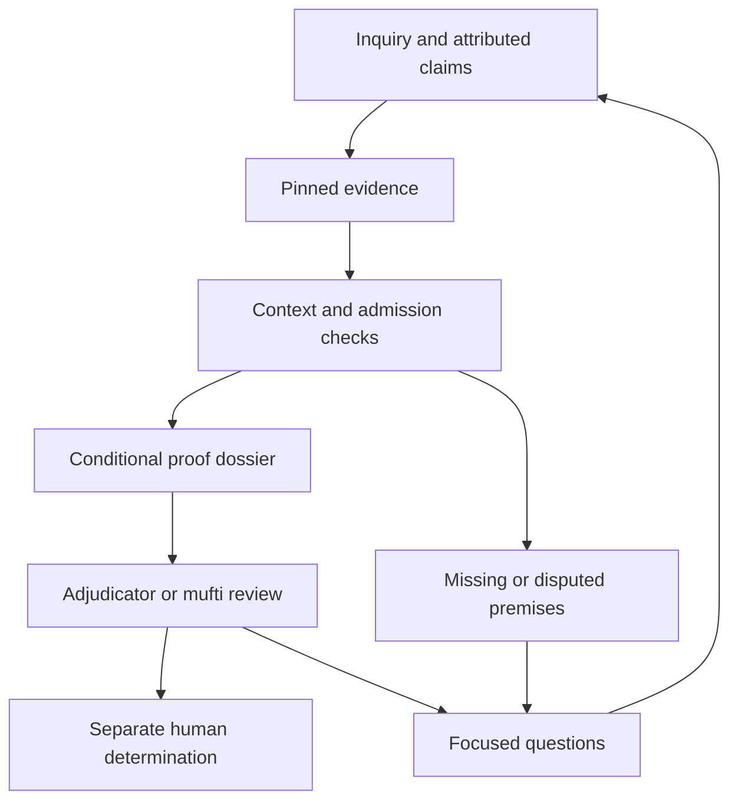

# IDA case workbench: evidence and conditional proofs for human review

## Purpose and status

The workbench presents a case or scenario as an inspectable argument: what is
asserted, which evidence supports each premise, which interpretation is being
used, what the checked derivation establishes, and what still requires a
decision by an adjudicator or mufti. An agent can prepare and explain this
record through a deterministic protocol. The human reviewer retains the
separate responsibilities assigned by the applicable institution and profile.

This is an application of the **accepted** [IDA context theory](ida-context-theory.md),
including its distinction between a conditional derivation and admission of its
premises. It extends the [ACT-08 shared pilot](ida-pilot-trace.md) and
[authenticated premise adapter](ida-premise-ingestion.md) inspected on main
[`a3f257bc90bddb3051a4c57ca9eeb4948dd1d2fa`](https://github.com/larsbx/usul-al-fiqh-deontic-circuits/commit/a3f257bc90bddb3051a4c57ca9eeb4948dd1d2fa).
The accepted theory is the foundation; the general workbench roadmap below
contains further implementation and admission obligations.

The first implementation is bounded to the synthetic repayment fixture. It
provides a local browser interface, a verifier-backed dossier, and read-only
machine-callable operations. Its source files and signing keys are published
test data. It does not ingest arbitrary narratives into admitted premises, run
a deployed language-model service, or publish a human ruling. General case
intake, natural-language orchestration, institutional authority, and signed
decisions remain explicit later stages.

A separate [candidate act intake command](ida-act-intake.md) implements a
bounded part of CW-01. It accepts a catalogue kind and named operands, preserves
qualifications and context, and prepares a structural candidate through Lean.
It exposes all 34 proposed kinds and their source metadata; 33 retain unresolved
roles. This command is not yet a workbench browser intake flow or one of the
five read-only dossier operations. Its results remain unadmitted, and general
case intake and narrative handling remain open.

## 1. What “provable facts” means in this interface

The interface must say exactly what has been established. The following
objects have different warrants and retain different statuses.

| Object | What the reviewer sees | Warrant required |
| --- | --- | --- |
| Assertion | A party, witness, document, or agent reports a proposition about a specified occurrence | Attributed origin and complete scope; assertion alone supplies no admission |
| Source evidence | Exact bytes, passage coordinates, provenance, and authentication outcome | Independent source pins and the applicable authentication procedure |
| Conditional assumption | A typed formula used by an argument or hypothetical scenario | Explicit membership in the premise list; no implication of evidential acceptance |
| Admitted premise | An exact grounded formula accepted for this application | Current evidence decision, interpretation pins, contextual certificate, and application grant |
| Checked consequence | A conclusion derived from the displayed premises under the selected interpretation | Replayed derivation and the relevant semantic theorem |
| Human determination | An attributed decision with reasons and defined scope | A separate authorized human action and its own recording protocol |

The [source authenticator](ida-source-auth.md) establishes correspondence with
the pinned signed bytes. It does not establish that the bytes accurately
describe an external event. The [semantic soundness theorem](ida-semantics.md)
establishes a conclusion **if its interpreted premises hold in the history**.
The [admission checker](ida-admission.md) establishes acceptance under its
supplied authority. None of these steps, by itself, proves actual-world truth
or the fidelity of a source interpretation.

A useful presentation therefore says “source bytes authenticated,” “premise
admitted in this snapshot,” or “conclusion checked under these premises.” A
generic “proved true” badge would conceal the conditions the reviewer needs
to assess. Evaluation diagnostics remain distinct from IDA's ruling categories
and question-indexed answer types.

The synthetic fixture makes this separation particularly clear. Its two source
files contain test bytes, not legal evidence or scholarly texts. The displayed
repayment predicates and their finite histories exercise the protocol; they do
not establish a substantive repayment ruling. The underlying conditional
derivation combines its two required premises. That is a structural result
whose premises and interpretation remain visible.

## 2. The review workflow

The intended general workflow has six stages. Only the bounded replay and
presentation stages are executable in this first slice.

1. **Frame the inquiry.** Specify the question, complete act or omission,
   occurrence, parties and roles, interpretation profile, relevant times, and
   whether this is an actual case or a hypothetical scenario.
2. **Prepare attributed claims.** An agent extracts proposed claims with exact
   source locations, alternative readings, and unresolved references. A reviewer
   or separately authorized process resolves normalization choices.
3. **Authenticate and admit.** Verify the source material, then apply the
   independent interpretation, evidence, and application authorities. Retain
   failures and disputed material as part of the dossier.
4. **Replay the argument.** Check the typed derivation and its scope; expose
   every required premise, exception query, and supported interpretation.
5. **Review alternatives.** Explore explicit changes to evidence, histories,
   or authority. Show which results change and why each branch requires its own
   application check.
6. **Record a determination.** A human supplies the decision and reasons
   through a separate authenticated workflow. Subsequent evidence creates a new
   revision and preserves the earlier record.



### Advisory and adjudicative uses

The product supports two review perspectives without asserting one universal
procedure for every school or institution. An advisory configuration can help a
mufti inspect the questioner's assumptions, applicable interpretation, and
conditions attached to an answer. An adjudicative configuration can organize
contested assertions, evidence-admission decisions, procedural questions, and
the scope of a proposed determination. The relevant institution must define
the authority and evidentiary requirements of each configuration.

In v0 these perspectives change presentation language only. Selecting
“adjudicator” or “mufti” does not confer authority, choose a madhhab, establish a
burden of proof, alter admission rules, or issue a ruling. The only editable
human output is a copyable **draft review note**, bound to the displayed
revision, receipt identity, and selected scenario. Copying it is not an
authenticated decision event.

### Cases and scenarios

A future actual-case dossier will identify attributed observations about an
occurrence and its evidence history. A hypothetical scenario must instead
declare its assumptions and parent snapshot, where one exists. Moving a claim
between these modes is an explicit operation with provenance; changing a UI
label cannot transform an assumption into testimony or an admitted premise.

V0 remains visibly marked **synthetic scenario**. Its explorer selects
precomputed Lean outputs for hypothetical changes. Those cells are model
results, not separately signed evidence attestations. Returning to the baseline
restores the baseline view without rewriting its receipt.

## 3. What the reviewer can inspect

The default screen places the inquiry and its context above the argument.
Claim cards expose supporting sources, required dependencies, proof references,
and unresolved questions. A source inspector preserves the exact passage
coordinates and hashes. A proof inspector identifies the theorem, its scope,
and the implementation revision. These details support substantive review;
internal toolchain information belongs in the inspector rather than the main
decision flow.

Every claim has independent provenance, evidence, interpretation, application,
and proof dimensions. One dimension must not overwrite another: a signed
assertion may remain disputed, a well-typed formula may remain unsupported, and
a valid conditional derivation may have unadmitted premises. Alternatives and
blocked dependencies remain visible rather than being collapsed into the most
favorable conclusion.

### Four report states

For each exact report query, the workbench preserves both polarities.

| Positive report exists | Negative report exists | Report state | Meaning |
| --- | --- | --- | --- |
| No | No | `unknown` | Neither polarity appears in the supplied matching reports |
| Yes | No | `supported` | Positive reports appear without a matching negative report |
| No | Yes | `refuted` | Negative reports appear without a matching positive report |
| Yes | Yes | `conflicted` | Both polarities appear and remain visible |

These are **report states**. In particular, `refuted` means negative-report
presence in this interface, not a theorem that the external proposition is
false. `unknown` does not mean false. `conflicted` does not inject a logical
contradiction into Lean or authorize the agent to choose a side. The existing
[fixed-history semantics](ida-semantics.md) keeps report data separate from
truth assignments.

The baseline guard requires positive support for the accountable person and an
explicit negative exception report for the performer, with no opposing report
for either query. It is therefore insufficient to say “no exception was found”
when the negative exception report is absent. The agent's next questions should
name the exact missing query or conflict.

### Omission and chronology

An absent performance report alone does not establish an omission. The
[omission contract](ida-omission-coverage.md) separately requires the relevant
occurrence, clock, interval, and supported observation coverage. Its signed
schema cannot supply contextual premise certificates by accident. This
workbench's repayment premise replay does not absorb the omission-observation
adapter or claim a new omission result.

Likewise, an as-known assessment and a retrospective assessment are distinct
inquiries. Later evidence can change a retrospective view without rewriting
what was available at the earlier cutoff. The workbench retains these
coordinates even when the screen uses a short human-readable summary.

## 4. How the context theory governs interface behavior

The [accepted theory](ida-context-theory.md#2-context-layers-and-inquiry-binding)
supplies a binding discipline for the entire dossier.

| Context layer | Interface consequence |
| --- | --- |
| Typed variables and grounding | Named operands and rigid references retain their sorts and roles; two people with similar names do not become interchangeable |
| Conditional premises | Each conclusion expands to its complete assumption list; evidence admission remains separately inspectable |
| Evidence | Reports retain attributed source occurrences, polarities, and recording metadata |
| Interpretation | Meaning, exception, rule, and version pins remain visible and exact |
| Admission policy | The dossier identifies which authority admitted the exact application and when replay used that authority |
| Inquiry | Question, structured target, accountable subject, performer, occurrence, and time perspective travel together |
| Semantic history | Scenario truth assignments remain independent of evidence reports and their signatures |

The full target expresses the act, omission, or affect under review. A title or
numeric case identifier cannot substitute for that expression. The accountable
subject and performer remain distinct roles, consistent with the
[structured act reference](ida-act-reference.md). A proof that survives a typed
role substitution does not itself authorize reuse of the destination evidence.

Category theory has operational consequences here. [Typed substitution](ida-substitution.md)
supports consistent renaming and grounding across the whole inquiry.
[Interpretation naturality](ida-semantics.md) explains when interpreting before
or after substitution agrees within a fixed supported fragment.
[Scoped factorization](ida-projection.md) identifies the information that the
specific evaluator actually depends on. Together these results constrain how
the interface can reuse arguments or summarize evidence.

The limits matter equally. The existing loss witnesses show that a bare act
kind or structured core can hide a relevant exception. Equal displayed answers
do not imply equal dependencies. Even a proven irrelevant evidence append can
preserve an observation result while requiring a new exact admission receipt.
Accordingly, a display filter never changes the evaluator's input, and a
summary never becomes a replacement authority for the complete snapshot.
Cross-profile transport and general schema migration retain their separate
proof and admission obligations.

## 5. The agent-facing protocol

An external agent is a client of deterministic operations. It may request
explanations and prepare prose with citations to returned claims and sources.
The verifier supplies admission and proof results. The agent has no operation
for declaring a claim verified, selecting trusted keys, granting application
authority, or recording a human ruling.

The v0 request envelope is:

```json
{
  "schema": "ida-case-workbench-request-v1",
  "method": "claim.explain",
  "params": { "claimId": "<claim ID returned by dossier.read>" }
}
```

Pass one request on standard input to
`node formal/ida-case-workbench.mjs request`. The implementation reconstructs
and reverifies the fixed fixture using the project's independently pinned test
trust and a fresh Lean export before returning a successful operation. A
caller-supplied status field or dossier is never a verification input.

| Operation | Parameters | Result and boundary |
| --- | --- | --- |
| `dossier.read` | Empty object | Current replayed fixture dossier, including scope, claims, sources, proofs, and limitations |
| `dossier.reverify` | Empty object | Fresh reconstruction and replay against the exact clean implementation revision and configured fixture trust |
| `claim.explain` | `claimId` returned by the dossier | Exact claim, dependencies, source/proof references, and qualifications; unknown IDs fail |
| `scenario.explore` | `mask`, `population`, `authorityMode` | The selected bounded Lean scenario cell, visibly hypothetical; unsupported selectors fail |
| `questions.next` | Optional complete scenario selection | Deterministic questions tied to missing support, conflict, incompatible histories, or failed admission stages |

The selectors are fixture coordinates, not an arbitrary logical language.
`mask` selects the four supplied report signs; `population` selects one of four
declared history populations; `authorityMode` selects one of six application
authority cases. The explorer covers 16 × 4 × 6 cells. It does not claim that
these histories exhaust external possibilities or that all selected authority
states could arise in a real institution.

The next-question operation exposes a reproducible review agenda. It can ask
for an explicit exception assessment, identification of a contradictory report,
a missing destination premise, or clarification of the intended snapshot. It
does not contact witnesses, solicit external material, or silently alter the
case. Future language-model orchestration can explain and prioritize that
agenda while retaining its source identifiers and reasons.

Untrusted narrative text is evidence or a proposal, never a tool instruction.
A future intake adapter must reject attempts to use document contents to
change trust roots, profiles, authorizations, or execution paths. V0 avoids
that unresolved boundary by exposing the fixed typed fixture only.

## 6. Binding, replay, and trust

The [existing premise adapter](../../formal/ida-premise-ingestion.mjs) binds its
Ed25519 attestation to the schema, fixture, clean Git revision, source manifest,
issuer, and ordered certificate tokens `[1, 2, 3, 4]`. Those selectors resolve
only the four compiled certificates: two source premises and two destination
premises. The exact revision fixes their typed meanings. Independent ACT-05
grants remain necessary after signature verification.

The workbench obtains a receipt through that adapter and rechecks it with
`verifyReceipt`. Its formal presentation retains the checked snapshot and
conditional proof boundary. A receipt digest helps identify the displayed
record. A dossier digest, where provided, identifies the generated encoding;
neither digest authenticates an externally supplied copy on its own.

The generated browser view reports **replayed at generation**. It is an offline
presentation of that event, not a live revocation monitor or an independently
signed certification. Changes to source material, implementation revision,
authority, interpretation, or context require fresh replay. A browser badge
cannot extend the validity of an old receipt.

The workbench also requires its executable source, complete Lean source tree,
fixture inputs and renderer assets to be tracked and byte-equal to the named
Git revision. An otherwise clean worktree cannot attribute untracked verifier
code to an old commit. It rechecks this inventory after replay and before
publishing the package marker. The browser requires that marker's revision,
receipt identity, scenario coverage and exact dossier-byte digest to agree
before showing the review. A failed rebuild removes the marker; an old dossier
alone cannot supply a successful view. This is package consistency, not a
signature by an external authority.

The inherited trust assumptions remain explicit: Lean checks the modeled
properties; native Node crypto checks hashes and signatures; the filesystem,
runtime, toolchain, and pinned trust inputs participate in the execution
boundary. There is no new proof of Ed25519, SHA-256, operating-system integrity,
or an end-to-end refinement of arbitrary host executions. Source semantic
fidelity, witness reliability, and qualified juristic authorization remain
separate substantive questions.

The adapter's SQLite insertion is unique per fixture and revision within one
database. It supplies neither cross-database uniqueness nor an external
timestamp. Rebuilding a local review dossier is not evidence of a new human
admission event. Production recording requires a separately defined authority
service, revocation semantics, durable history, and decision identity.

## 7. Running and checking the bounded interface

Use the repository's pinned Lean toolchain and a supported Node runtime with
`node:sqlite` (Node 22 or later). Install the pinned model tools with
`npm --prefix formal/quint ci` and run `make ida-case-workbench` for formal
acceptance, host controls and packaging. The ordinary replay/package command
when the tools are already available is:

```sh
node formal/ida-case-workbench.mjs build .cache/ida-case-workbench
python3 -m http.server 8765 --bind 127.0.0.1 --directory .cache/ida-case-workbench
```

Open `http://127.0.0.1:8765/`. The browser reads the generated dossier; it does
not accept uploaded “verified” records. An unavailable or failed verifier
prevents a successful dossier build. Use the dedicated `make ida-case-workbench`
gate for the integrated checks. Evidence belongs to the exact checked revision;
record local and hosted results separately.

The acceptance boundary includes four classes of checks:

- **Formal presentation:** report-state classification retains both signs;
  a successful review view retains the admitted snapshot; nonempty compatible
  histories and the conditional soundness antecedent remain explicit.
- **Authentication and binding:** modified source bytes, signatures, pins,
  certificate sets, or receipts fail; current scope and grants are rechecked.
- **Adversarial scenarios:** absent exception evidence, opposing reports,
  missing premises, stale contexts, absent grants, and incompatible or empty
  history populations retain their distinct outcomes.
- **Presentation and protocol:** source text is rendered as data; unsupported
  methods and selectors fail; scenario controls do not mutate the baseline;
  draft notes never become signed human decisions.

Passing these checks establishes the bounded interface contract. It does not
complete all ACT-08 examples, repository-wide acceptance, general case
ingestion, or scholarly source review.

## 8. Implementation roadmap

These packages extend M16 and its existing ACT-05/ACT-08 obligations. Each
requires a reviewable result and its own acceptance evidence before the next
package can use its authority-bearing outputs.

| Package | Deliverable | Exit condition |
| --- | --- | --- |
| CW-00: replayable review | This bounded fixture workbench and read-only protocol | Actual adapter replay, formal presentation, scenario controls, and inspectable output at one revision |
| CW-01: typed case intake | **Partially implemented:** [candidate act CLI](ida-act-intake.md) for catalogue keys, named operands, qualifications, and context. General case schema, source occurrence tracking, normalization review, narrative handling, and evidence upload remain open | Candidate preparation retains its source metadata and cannot mint checked premises; complete case intake must also handle duplicate names, role swaps, unsupported language, and injection attempts without granting admission |
| CW-02: authenticated admission | General canonical contextual certificate and application-grant adapters | Independent authorities bind the entire supported payload; substitution, staleness, revocation, and concurrent updates are rejected or explicitly resolved |
| CW-03: human decision record | Authenticated review actions, reasons, dissent, and institution-specific advisory/adjudicative policies | Human authorship and scope are independently checked; agent proposals and copied notes cannot issue a decision |
| CW-04: historical review | Versioned dossiers, retractions, changed evidence, and reopening/review links | Earlier as-known records remain reconstructible; later evidence triggers explicit reevaluation without retrospective rewriting |
| CW-05: language-model orchestration | Guided intake, source retrieval, explanations, and proposed next questions | Every consequential statement resolves to typed claims or marked proposals; the model cannot broaden authority or hide blocked alternatives |

The first production profile must identify who admits interpretations, who
admits evidence, who grants contextual applications, and who may issue a
determination. These can be different roles. It must also define disclosure and
access rules for case material, challenge and correction procedures, retention,
and the treatment of changed authority. Those requirements cannot be inferred
from a successful synthetic signature check.

The result to pursue is a case record whose reasoning can be inspected and
replayed: evidence and unresolved issues are visible, every checked consequence
states its conditions, and the human determination has a distinct origin and
scope.
