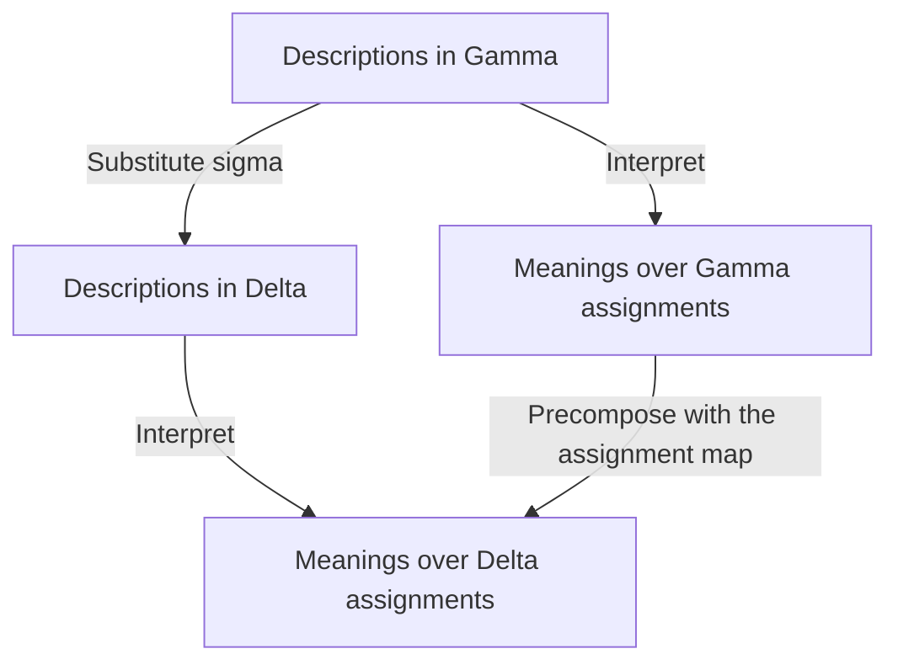

# IDA context theory and categorical integration

**Status: accepted design and proof-first implementation plan.** The project
owner accepted this context theory and its integration with
[M16's act-classification roadmap](ida-act-classification-roadmap.md) on
2026-11-09. This is the adopted development baseline, especially for ACT-02
through ACT-05 and the ACT-08 pilot.

Design acceptance, implementation progress, proof evidence and source admission
are tracked separately. [ACT-01's registry fragment](ida-act-registry.md) implements
structural descriptions and exact source bindings. The [ACT-01 ground context
fragment](ida-context-foundation.md) adds typed predicates, canonical snapshots,
clock identity, and exact inquiry binding. [ACT-02](ida-substitution.md)
implements typed reindexing, grounding, and the conjunction premise calculus.
[ACT-03](ida-projection.md) implements one exact scoped projection and
synthetic loss witnesses. [ACT-04](ida-semantics.md) implements fixed-history
description naturality, satisfaction under substitution and conditional
soundness for a synthetic fragment. Source-backed interpretation and migration
retain separate obligations. [ACT-05](ida-admission.md) implements bounded
contextual admission. ACT-08 has bounded candidate agency review and omission observation. ACT-06, ACT-07 and ACT-09 retain their
accepted conditional scope and triggers. Source interpretations retain their
recorded admission status.
The implemented baseline inspected for this design is main
[`ca38f35e32e23169e852fe7d5f8f8b1f3734ed0e`][integrated-main], which landed
structured-target integration through [PR #144][pr144].

## 1. Purpose and existing foundations

A context specifies what a description refers to, which conditions a derivation
assumes, what evidence supports their use, and the scope in which an answer
applies. A context theory must identify the operations that change these things
and prove what each operation preserves.

The immediate objective is one complete, small path from a typed description
and an evidence snapshot to a scoped, question-indexed judgment. The new work
connects existing mechanisms rather than replacing them with a universal
uninterpreted `Context` record.

| Existing mechanism at the inspected baseline | What it establishes | Missing connection addressed here |
|---|---|---|
| [`Usul.IDA`](../../formal/lean/Usul/IDA.lean) and [ACT-00 integration](ida-target-integration.md) | Structured perform/omit/affect targets, named typed operands, rigid references, and omission occurrence/clock/bounds | Interpretation of contextual predicates and evidence of actual opportunity or performance |
| [`Usul.IDA.Judgment`](../../formal/lean/Usul/Typing/IDAJudgment.lean) | Question-indexed answers, complete scope, exact registry binding; `context` and `time` remain `Nat` | Versioned interpretation of a context snapshot and its temporal coordinates |
| [`Usul.IDA.Derivation`](../../formal/lean/Usul/Typing/IDADerivation.lean) | Exact premise evidence decisions, source and interpretation checks, scope guards, provenance and replay | Justified contextual premise construction and reconstruction after changes |
| [`Usul.Typing`](../../formal/lean/Usul/Typing.lean) and [`Typing.Qaida`](../../formal/lean/Usul/Typing/Qaida.lean) | Partial rule-specific factual records; a local projection fails when required data are missing | Evidence and interpretation supporting the supplied field values |
| [`Usul.Cat.Typing`](../../formal/lean/Usul/Cat/Typing.lean) and [`Factor`](../../formal/lean/Usul/Cat/Factor.lean) | Encoder dependence, factorization, and information-loss counterexamples under stated hypotheses | Complete contextual dependencies including defaults, exceptions and admission |
| [`Usul.Cat.Sheaf`](../../formal/lean/Usul/Cat/Sheaf.lean) | Restriction of verdict assignments on subsets of situations, matching, gluing and obstruction witnesses | Explicit adapters from interpreted context specifications; separate temporal/evidence reevaluation |
| [`Usul.Agency`](../../formal/lean/Usul/Agency.lean) | Candidate revocation profiles, distinct agent-knowledge states, authorization at execution and historical receipt witnesses | The evidence available to an evaluator about historical or current authority |

The import direction remains qawaid to types to categories. The small Lean core
stays Mathlib-free; experiments requiring richer categorical libraries belong
in the existing separate bridge. Existing theorems apply only with their stated
hypotheses. Finite executable agreement does not expand a theorem's model class.

## 2. Context layers and inquiry binding

The word context covers several mathematically different objects. Keep them
separate and bind them in an immutable evaluation snapshot.

| Layer | Specified object | Meaning |
|---|---|---|
| Variables | `Gamma`, written \(\Gamma\) | A finite typed variable context over a fixed declaration registry \(R\) |
| Conditional premises | `Phi`, written \(\Phi\) | Object-language formulas under which a conditional derivation holds |
| Grounding | \(\rho\) | A sort-correct assignment of variables to resolved references or interpreted terms |
| Evidence | \(E\) | Attributed reports with proposition, scope, provenance, effective time and recording metadata |
| Interpretation | \(P\) | Pinned meanings, rules, exceptions, precedence and declared default semantics |
| Admission policy | \(A\) | The pinned procedure and authority for accepting particular evidence as premises; linked to \(P\) where appropriate |
| Inquiry | \(\Omega\) | Question, full target, accountable subject, domain, clocks, effective time and evidence perspective |
| Actual circumstances | \(\omega\) | A semantic world or history in which interpreted claims have truth conditions |

An evidence log is not the actual history, and a conditional assumption is not
an admitted report. The implementation must distinguish an object-language
formula from Lean's meta-level `Prop`. A report containing a formula is ordinary
data; accepting the data format does not inject that formula as a Lean theorem.

### Snapshot identity

Define an explicit binding between the existing opaque context identifier and
a versioned snapshot. Snapshot records must pin the vocabulary, interpretation,
admission policy, evidence revision, grounding and query coordinates needed for
replay. The initial boundary should retain exact identity checks.

A digest identifies the supplied encoding under its hashing assumptions. It
does not establish semantic equivalence, source authority, or actual truth.
Specify canonical encoding and reject conflicting snapshot definitions under
one identity/version. A lookup must not silently select the first of several
incompatible definitions. Preserve legacy opaque contexts; conversion to a
structured snapshot requires a declared mapping and newly checked evidence.

The snapshot is a validated dependent collection, not a freely interchangeable
tuple. References in the target, premises, source decisions and temporal scope
must agree where the selected interpretation requires them to agree. A changed
qualification cannot retain an old admission merely because the act kind or
display label remains unchanged.

### Identity and authority

Preserve source-mention, act-kind, qualified-description and occurrence identity.
An occurrence can instantiate several descriptions; a source mention can have
several candidate senses. Those relations require attributed interpretation
witnesses rather than a name-based equality test.

The performer and accountable subject remain distinct fields. A profile may
require equality, or may require an agency relation between different persons.
The condition belongs to that rule and inquiry. The same applies to principal,
recipient, creditor, and other named same-sort roles.

Distinguish three authorities: interpretation admission, evidential admission,
and an actor's authorization to perform an act. Source-byte authentication does
not establish all three. Legal statuses used as premises, such as ownership or
mandate authority, should identify their prior derivations and effective states.
Prevent circular justification of a transaction by a status derived only from
that same transaction. A finite first fragment can require an acyclic dependency
graph; recursive definitions need separately justified semantics.

## 3. Conditional derivation and premise admission

Use separate relations for a conditional result and the right to apply its
premises to a particular inquiry. The notation below specifies the accepted
interface; its Lean declarations and proofs are implementation work.

Let \(\Omega\) be a well-typed schematic inquiry containing description
\(a\), question \(q\), accountable subject and all other relevant scope
coordinates. Write

\[
 P;\Gamma;\Phi\vdash\Omega\Rightarrow r
\]

when the fixed interpretation's rule calculus derives answer \(r\) to that
inquiry, conditionally on \(\Phi\). Retain question-indexed answer types, as
in the existing `Judgment.Answer`. Define \(\operatorname{ground}(\Omega,\rho)\)
by consistently grounding every reference-bearing inquiry field, including the
target and subject; fixed definition/profile pins and clock identities retain
their declared binding rules.

\[
 (P,A,E,\Omega,\rho)\Vdash_{\mathrm{adm}}\Phi
\]

means that the specified admission procedure accepts the exact grounded premises
for \(\operatorname{ground}(\Omega,\rho)\). This relation records a justified
decision under supplied
authority; its soundness assumptions and trust boundary must be explicit.

The semantic theorem has a different antecedent:

\[
 (\omega,\rho\models_P\Phi)
 \land (P;\Gamma;\Phi\vdash\Omega\Rightarrow r)
 \Longrightarrow \operatorname{Holds}_P(\omega,\operatorname{ground}(\Omega,\rho),r).
\]

It is conditional on the interpreted premises holding in the semantic history
and on soundness of the supported rule calculus. A theorem about an admitted
record's shape is not a theorem that its real-world assertions hold.

Use the existing derivation environment, exact `Premise`, `EvidenceDecision`,
source/interpretation pins, and registry admission. Extend their interfaces
rather than introducing a second source authority. An evidence decision must
remain bound to the full substituted or reconstructed premise. Preserve all
source occurrences, including blocked ones, in the resulting provenance.

The current missing, suspended, disputed, unauthenticated and out-of-scope
outcomes remain distinct. New unsupported-language or inconsistent-context
diagnostics belong to evaluation status, not to a sixth `Hukm`. Permission,
validity, attribution and discharge retain distinct question families; introduce
additional families only through explicit typed extensions and source-supported
bridges.

### Structural kind and contextual classification

The registry kind selects a description's constructor and argument schema. A
further classification can instead be an object-language conclusion
\(\operatorname{Classifies}_{P,k}(a)\), whose derivation requires contextual
premises under the selected interpretation. Keep construction, conditional
classification, and admission of those premises for an occurrence distinct.
The same occurrence can support several attributed descriptions or
classifications; this interface does not require a unique total
occurrence-to-kind function. A classification alone supplies no permission,
validity, attribution or discharge answer without the corresponding rule.

## 4. Categorical integration and transport

### Formal contexts and descriptions

For a fixed registry \(R\), start with typed variables and rigid constants.
A useful description family is

\[
 \operatorname{Desc}_R(\Gamma)
   =\sum_{k:\operatorname{Kind}(R)}\operatorname{Args}_R(\Gamma,k).
\]

A substitution \(\sigma:\Delta\to\Gamma\) supplies well-typed terms in
\(\Delta\) for the variables of \(\Gamma\). Descriptions and formulas reindex
contravariantly. For \(\tau:\Xi\to\Delta\), prove

\[
 a[\mathrm{id}]=a,\qquad (a[\sigma])[\tau]=a[\sigma\circ\tau],
\]

and the analogous formula laws. Prove the category's identity, associativity,
typing, role and dependency laws before using the presheaf interface. A
kind-indexed argument family alone does not require full dependent type theory.

Formal instantiation can change a target while preserving its schema and
substitution semantics. Replacing a resolved person, obligation or occurrence
is not alpha-renaming. Same-sort role swaps may remain representable but must
be distinguished when the schema gives those roles different meanings.

### Descriptions over their contexts

Write \(\mathcal C_R\) for the substitution category above. Once its laws and
the description action are proved, the family is a presheaf
\(\operatorname{Desc}_R:\mathcal C_R^{op}\to\mathbf{Set}\). Its category of
elements makes the attachment of a description to its context explicit:

- Objects are \((\Gamma,a)\) with \(a\in\operatorname{Desc}_R(\Gamma)\).
- An arrow \((\Delta,b)\to(\Gamma,a)\) is a substitution
  \(\sigma:\Delta\to\Gamma\) with \(b=a[\sigma]\).
- The projection \(p(\Gamma,a)=\Gamma\) forgets the description and maps the
  arrow to \(\sigma\).

For each \(\sigma:\Delta\to\Gamma\) and \((\Gamma,a)\), the reindexed
object \((\Delta,a[\sigma])\) gives the unique lift with that codomain over
\(\sigma\). This is the discrete-fibration reading of the proved presheaf,
with proof-irrelevant equality witnesses. It adds no interpretation, evidence
admission, or identification of distinct grounded occurrences.

ACT-02 may expose this small construction directly from its substitution laws.
A generic fibration library is not a new core acceptance gate. ACT-09 retains
its conditional trigger for richer dependent families, comprehension, semantic
coherence and quotients. See the [type-theory notes][awodey] and
[Jacobs's treatment of indexed categories and fibrations][jacobs].

### Premise-context arrows

For a fixed interpretation, use objects \((\Gamma,\Phi)\). The premise-context
arrow

\[
 (\sigma,h):(\Delta,\Psi)\longrightarrow(\Gamma,\Phi)
\]

contains a substitution and evidence that every formula of \(\Phi[\sigma]\)
is derivable from \(\Psi\). This is a conditional-premise transport relation.
Identity requires the assumption rule; composition additionally requires
admissible substitution and simultaneous cut in the chosen calculus. Substitute
the first arrow's premise derivations along the second substitution, discharge
their premises with the second arrow's witnesses, and use substitution
composition. Syntax substitution laws alone
do not establish composition of premise witnesses. Defeasible admission is
outside this structural relation unless a specific stable fragment is proved.

For the first category, use a proof-irrelevant admissibility predicate over the
underlying substitutions. Preserve proof-relevant derivation trees, source
occurrences and transport certificates separately in receipt data. Raw
derivation trees do not automatically satisfy strict categorical identity and
associativity. A later proof-relevant category must state the required
normalization or equivalence and prove the laws; it must not erase provenance
by silently identifying all paths.

An external attestation about one concrete occurrence is not a universally
quantified rule schema. Instantiate only genuinely parametric derivations under
their stated premise rule. Reconstruct and re-admit concrete source leaves;
do not substitute through source bytes or copy an old evidence decision.

### Semantic interpretation

Declare the supported syntax fragment and its allowed substitutions. It must
be closed under those substitutions, or the interface must restrict the arrows.
For formulas, prove a satisfaction/substitution law of the form

\[
 \omega,\delta\models_P\varphi[\sigma]
 \quad\Longleftrightarrow\quad
 \omega,\llbracket\sigma\rrbracket_\omega(\delta)\models_P\varphi.
\]

Give descriptions the corresponding commuting interpretation law. The induced
map from a new context's compatible histories/valuations to the old context's
compatible histories/valuations must be total on the supported domain. This
supports preservation; reflection needs additional coverage, such as the
appropriate surjectivity hypothesis, and does not follow from a one-way map.

For an explicit first construction, fix \(P\) and a semantic history
\(\omega\), and write \(\operatorname{Val}_{P,\omega}(\Gamma)\) for
sort-correct assignments. Interpreting a substitution gives the covariant map

\[
 \operatorname{Val}_{P,\omega}(\sigma):
 \operatorname{Val}_{P,\omega}(\Delta)\longrightarrow
 \operatorname{Val}_{P,\omega}(\Gamma).
\]

It evaluates the terms supplied for \(\Gamma\)'s variables in a
\(\Delta\)-assignment; it must satisfy the corresponding identity and
composition laws. For a supported fragment with fixed denotation type
\(B_{P,\omega}\), set
\(S_{P,\omega}(\Gamma)=
(\operatorname{Val}_{P,\omega}(\Gamma)\to B_{P,\omega})\).
Precomposition with the assignment map makes \(S_{P,\omega}\) contravariant.
The description interpretation is a natural transformation from the supported
description presheaf to \(S_{P,\omega}\) exactly when

\[
 I_{P,\omega,\Delta}(a[\sigma])(\delta)
 = I_{P,\omega,\Gamma}(a)
   \bigl(\operatorname{Val}_{P,\omega}(\sigma)(\delta)\bigr).
\]

Thus descriptions reindex from \(\Gamma\) to \(\Delta\), while valuations
map from \(\Delta\) to \(\Gamma\). The history is fixed throughout this
square: evidence arrival or a changed world is not a substitution law. Keep
unsupported entries outside the declared fragment, or specify partial semantics
and prove its laws explicitly. A denotation family genuinely dependent on the
context needs the corresponding indexed interface rather than this fixed
codomain construction. Apply grounding consistently to the full inquiry, not
only its target, as specified in section 3.

The existing `Factor`, `Typing` and `Institution` results supply useful
interfaces with their own hypotheses. They do not already instantiate these
maps for every candidate act kind or every Quint state space.

### Four different preservation claims

| Claim | Required result | What remains separate |
|---|---|---|
| A conditional derivation transports | Reconstruct the derivation using the permitted substitution and premise witnesses | Semantic soundness and concrete premise admission |
| A conditional conclusion remains sound | Sound rule semantics and preservation under interpreted premises that hold | Exact evaluator output and applicability to a concrete case |
| Computed answer remains exactly equal | A complete dependency/frame or factorization theorem for the stated evaluator and domain | Receipt identity and current admission |
| A new concrete application is admitted | Current exact scope, evidence, version and authority checks plus the justified derivation | Truth of external assertions beyond the model's assumptions |

Strengthening a context can narrow an answer constraint from two possible
rulings to one. The old constraint may remain sound as an upper bound without
remaining the evaluator's exact answer. State whether a transport theorem
preserves satisfaction, inclusion of possibilities, exact payload equality, or
admission; never infer the other guarantees from one preservation result.

### Migration gates

Vocabulary/schema translation changes the language, whereas substitution above
works within a fixed vocabulary. A migration may pass one of these gates while
another remains unproved or blocked:

| Migrated object | Required preservation |
|---|---|
| Description | Meaning and compatibility with permitted substitutions on the supported fragment |
| Conditional derivation | The translated premises and rules establish the translated full inquiry and typed answer |
| Concrete application | Exact destination scope, current premise admission, retained provenance, and a newly bound receipt |

The institution satisfaction condition supplies the semantics interface for
sentence translation and model reducts ([Goguen and Burstall][institutions]). It
does not supply a cross-profile rule or evidence policy. Use the actual
`Usul.Cat.Institution` hypotheses when claiming consequence preservation or
reflection; a finite check is not universal entailment in the target model
class, and reflection additionally needs the stated model coverage.

### Operations with different contracts

| Operation | Representation | Obligation |
|---|---|---|
| Variable renaming/instantiation | Syntactic substitution | Type and interpretation laws |
| Stronger conditional premises | Substitution plus premise derivability | Substitution admissibility and cut |
| Restrict possible situations | Inclusion/reduct under fixed semantics | Satisfaction preservation and nonvacuity for admitted robust conclusions |
| Append/correct a report | Evidence transition | Preserve history and recompute affected support/admission |
| Advance time or revoke authority | Temporal transition | Reevaluate the specified guards |
| Forget detail | Projection | Exact factorization, sound approximation, or explicit unsupported transport |
| Change profile/schema | Declared translation on a supported fragment | Interpretation and premise correspondence; no default cross-profile arrow |

Richer dependent indexing belongs to conditional ACT-09. If semantic
reindexing uses chosen pullbacks, distinguish coherent isomorphisms from strict
syntactic substitution equalities. Specify a split choice or strictification
before claiming equality of the corresponding functors. Quantifiers,
adjunctions, quotients and more general sheaves need their own demonstrated
use cases and laws.

## 5. Evidence, conflict and semantic consistency

### Evidence summaries and admission

Record positive and negative support independently for a fully scoped formula.

| Positive support | Negative support | Summary |
|---|---|---|
| Absent | Absent | Unresolved |
| Present | Absent | Affirmative reports |
| Absent | Present | Opposing reports |
| Present | Present | Contested |

This pair is a summary of reports. It is not truth, a probability, a `Hukm`, or
the existing environment's `supported` decision. Keep provenance, source grade,
authentication, admissibility and interpretation as additional coordinates.
Duplicate copies or correlated sources must not be counted automatically as
independent corroboration or as an increase in epistemic grade.

Direct opposition is not a complete consistency test. Selected premises
\(p\), \(p\to q\), and \(\neg q\) have no raw opposing pair for one formula
but have no classical compatible history. The separate semantic consistency
contract must catch such indirect contradictions in its supported fragment.

Opposing report records must remain object-language data. Injecting both a
Lean proposition and its negation as assumptions yields `False` and permits
arbitrary conclusions. The finite pilot should block a required contested
premise or retain separately attributed alternatives under an explicit policy.
An unrelated dispute need not block every inquiry in the snapshot.

Compare the complete proposition, references, occurrence, interpretation and
temporal scope before calling two reports contradictory. Authority at one time
and its absence at a later time can both be correctly reported.

No observed support for a proposition is different from support for its
negation. A negative premise requires explicit evidence, a scoped completeness
certificate, or a declared default with defeat/revalidation conditions. The
absence of a row, event or Lean proof does not establish negation.

### Compatible histories and nonvacuity

Let \(\mathcal M_P(X)\) denote the histories/valuations compatible with the
explicitly selected interpreted premises and scope of snapshot \(X\). Do not
construct it by treating all raw reports as simultaneously true. Admission or
scenario selection must retain the history of conflicting or rejected reports.

For a supported question, define a robust conclusion by

\[
 \operatorname{Robust}_P(X,r)\iff
 \mathcal M_P(X)\ne\varnothing\ \land
 \forall\omega\in\mathcal M_P(X),
   \operatorname{Holds}_P(\omega,\Omega_X,r).
\]

Here \(\Omega_X\) is the full grounded inquiry of \(X\), with its typed
question and all scope coordinates; `Holds` has the same signature as in
section 3.

The nonempty condition prevents inconsistent premises from licensing every
answer by vacuous universal quantification. It establishes compatibility within
the chosen model, not truth of the premises in the actual world. Conditional
theorems with impossible antecedents may remain valid as conditional theorems;
they do not justify an admitted concrete application.

Keep unsupported vocabulary, unresolved facts, contested evidence, inconsistent
selected premises, missing rulings and non-singleton answer constraints
distinct. A world on which the supported interpretation supplies no answer
must not silently yield permission or a fabricated total classification.

The first implementation can decide compatibility over a declared finite
domain or carry an explicit witness. Do not promise an executable decision
procedure for arbitrary formulas and histories. Later reflection claims need
a proof that the finite abstraction covers the relevant semantic situations.

### Nonmonotonic applicability

An append-only report history can grow while current admission and applicability
change nonmonotonically. A new impediment, corrected premise, changed source
status or expired condition may block a formerly usable derivation. Record the
new decision and its dependencies. Preserve the historical computation without
treating it as current authorization. Hypothesis strengthening inside the
conditional calculus and revision of case evidence remain separate operations.

## 6. Time, history and authority

| Coordinate | Meaning |
|---|---|
| Effective/event time | When a modeled circumstance held or an event occurred |
| Recording time/evidence revision | When evidence became available to the system and which immutable view is queried |
| Actor awareness | Whether and when a relevant actor knew the fact under the selected interpretation |
| Query perspective | Historical as-known evaluation or retrospective evaluation with later evidence |
| Opportunity interval | Clock, bounds and occurrence relevant to a prospective act or omission |
| Profile applicability | The pinned interpretation used for the inquiry and any declared applicability interval |

A clock name is not a conversion theorem. Time comparison across clocks needs
an explicit map with ordering and interval-preservation obligations. The first
pilot may use one clock and finite ticks. State boundary conventions, including
whether closing-time events count as performance inside the opportunity.

In a stipulated example, revocation occurs at \(t_1\), the actor becomes aware
at \(t_2\), and the evaluator records evidence at \(t_3\). Evaluating an act
between \(t_1\) and \(t_2\) with evidence available before \(t_3\) is a
different inquiry from a retrospective evaluation after \(t_3\).

The existing [agency pilot](agency-pilot.md) keeps `immediate` and `onKnowledge`
candidate interpretations separate. Its knowledge flags are supplied facts,
not a delivery-to-awareness proof. Reuse those profiles without turning either
candidate into a universal source claim or treating system recording as the
actor's knowledge.

### Historical execution and current admission

`Usul.Agency` already proves `step_execution_authorized`,
`run_receipt_persistent` and `run_execution_witness`. These identify authority
at the actual execution pre-state and retain the historical receipt through
later events. They concern its fixed-task candidate transition model, not
physical performance or every legal consequence of termination.

The context adapter should connect historical execution state, current authority
state, and the evidence currently available about either. An old receipt stays
historical even if current replay rejects it or later evidence changes what can
be established about the old event. Separate historical issuance, present
replay/admission, and actual-world correctness.

### Optional runtime refinement

The current agency execution is atomic within its model. If an application
splits evaluation from execution, ACT-07 must specify a commit-boundary
revalidation protocol, authority epoch, or equivalent atomic mechanism. The
adverse trace is read authority, evaluate, revoke, then attempt execution with
the stale result. Prove authorization in each accepted execution's own
pre-state. Do not demand that every historical execution remain authorized in
the current state after later valid revocation.

A split-phase application adapter is conditional work. It does not become an
extra prerequisite for ACT-02's substitution calculus or ACT-08's core
description/evidence pilot.

## 7. Relevance, forgetting and gluing

### Complete dependencies

For a fixed profile and question, a projection \(u\) can forget contextual
details only under an explicit contract. Exact preservation requires

\[
 J_{P,q}=\bar J_{P,q}\circ u
\]

on a declared supported domain. Prove constancy on the projection's fibers and
the relevant existence/extension hypotheses before reusing `Usul.Cat.Factor`.
An observed match on examples is insufficient.

Two existing results make the boundary concrete. `Usul.Cat.Typing.Reads E F`
specifies local information dependence and applicability; it does not establish
equality of `E.judge` and `F.judge`. In particular, `Reads.mapRun` preserves the
information requirements while relabeling the output, even when the output
type changes. An output-relabeling countercontrol must therefore distinguish
an information-preserving map from an answer-preserving map.

`Usul.Cat.Factor.unattested_free` addresses a different gap: even if all supplied
cases factor consistently, a feature value unattested by those cases can be
assigned any answer in a compatible mathematical extension under the theorem's
hypotheses. Finite consistency therefore supplies no classification of an
unseen feature class. Such an application needs its independently justified
rule and premises; existence of an extension is not source authority.

The dependency set for a judgment must include positive premises, negative
guards, completeness assumptions, potential defeaters, priorities, definition
and interpretation pins, source admission, authority and temporal scope, and
their transitive dependencies. Queries over sets or aggregates must declare
their scope: a previously unseen matching entry can change the result without
changing any formerly read positive row.

A frame theorem may then show that changes outside this complete dependency
set preserve the specified result. State whether it concerns a conditional
answer, exact evaluator payload, or admission; environment-wide validity checks
must be included if the claim concerns the whole evaluator. Issue a newly
bound derived receipt when the snapshot changes. Semantic equivalence never
transfers a signature to different bytes.

### Approximation and scoped equivalence

If a qualification cannot be forgotten exactly, a projection may still support
a sound overapproximation. State the semantic direction: forgetting constraints
can enlarge compatible possibilities, and the answer must retain that increased
uncertainty. Do not confuse this inclusion with exact answer equality.

Scope any equivalence by profile/version, supported language, question, target,
and relevant temporal/inquiry coordinates. Define a useful observation or
dependency relation and prove the behavior it preserves. Defining equivalence
as equal answers and then restating that definition proves no substantive
contextual irrelevance. Quotients additionally require congruence under the
operations and allowed reindexing; keep them conditional until needed.

### Combining contexts

Shared references, predicate meanings, clocks and profile interpretations must
be compatible before combining local specifications. A naive union can create
inconsistent premises; preserve the conflict and the nonvacuity check. An
amalgamation or pullback description is justified only after defining the
objects, maps, compatibility conditions and universal property. Nonempty local
model sets or pairwise nonempty intersections do not establish a nonempty global
compatible-history set. Require a direct global witness or an actual matching
family together with the applicable existence theorem.

`Usul.Cat.Sheaf` works with `Ctx X := X -> Prop` and assignments
`Section B U := forall x, U x -> B`. Restriction retains the same assignment at
every retained situation. It does not recompute that point's verdict after new
evidence, changed circumstances or a new profile. Those operations require a
separate evaluator/transition and preservation or reevaluation law.

Its matching/gluing theorem can combine compatible assignments on a genuine
cover. It does not supply missing coverage, choose a preferred source, or resolve
juristic disagreement. The obstruction witness remains an attributed
disagreement. A context adapter must identify the semantic situation space and
fixed interpretations to which this existing construction is applied.
The assignment-gluing theorem does not itself prove that a source-admitted
evaluator or its evidence-bearing receipts form a sheaf.

## 8. Omission, capacity and resources

The existing omission syntax carries the act, occurrence, clock and ordered
opportunity bounds. Its structural validation does not establish that the
opportunity occurred or that performance was absent.

An interpreted omission inquiry may require the responsible subject and
prospective performer, feasible opportunity, capacity/resources/authorization,
interval closure, performance or nonperformance evidence, observation coverage,
and intention or awareness. The selected rule determines the premises. These
are not universal requirements merely to represent an act description.

Before closure, an omission may remain pending. After closure, an incomplete
log establishes at most the absence of a recorded completion within its declared
coverage. It does not establish unobserved physical nonperformance. Deliberate
abstention needs an additional intentional relation. Include alternate modes
of performance, duplicate observations and events exactly at interval boundaries
in the pilot's declared observation semantics.

Capacity data must be bound to a subject, effective scope and evidence. Reuse
existing typed gates while specifying how supplied facts are justified.
Qualified predicates for intention, coercion, ownership, custom or negligence
must retain their source-specific meanings. The existing distinction between
negligence in safekeeping and negligence in inquiry is a concrete precedent;
matching English labels do not justify merging predicates.

Logical reuse of a premise does not duplicate a consumable asset, a one-use
authorization or a limited mandate. Begin with explicit resource state and
transition guards where the application needs consumption. Linear or other
resource-sensitive composition belongs to ACT-07 only after a concrete use
case requires it. Preserve the separation between the proposition that a
resource exists and the operational right to consume it again.

For the conditional ACT-06 extension, a constructor whose components share
\(\Gamma\) should satisfy
\(\operatorname{Compose}(a_1,\ldots,a_n)[\sigma]
=\operatorname{Compose}(a_1[\sigma],\ldots,a_n[\sigma])\).
This is a structural compatibility contract. Binding constructors, independent
execution and shared-resource consumption require their additional specified
interfaces; this equation supplies none of their operational guarantees.

## 9. Work packages and execution order

This note refines the existing ACT packages; it adds no new top-level milestone
or dependency on unfinished M8-M11 extensions. ACT-00 is integrated on main;
its previous head-specific evidence remains historical. The core exit remains
ACT-00 through ACT-05 plus ACT-08. ACT-06, ACT-07 and ACT-09 stay conditional.

| Package | Context deliverable | Exit addition |
|---|---|---|
| ACT-01 | Versioned contextual predicates, rigid references, snapshot/clock identity, and declared inquiry binding | Reject duplicate conflicting definitions and ambiguous snapshot mappings; retain legacy contexts |
| ACT-02 | Typed variable contexts, grounding, formula/description substitution, and conditional premise arrows | Prove identity/composition/typing plus the calculus's substitution and cut hypotheses; keep certificate provenance separate |
| ACT-03 | Relevant-information projections, scoped equivalence and loss counterexamples | State exact versus approximate preservation and complete dependency sets |
| ACT-04 | Supported fact language, satisfaction, evidence-to-situation interpretation and declared profile translation | Prove supported-fragment closure and interpretation/substitution laws; expose consistency and missing-language limits |
| ACT-05 | [Bounded exact premise admission, contextual reconstruction, and derived receipts](ida-admission.md) | The synthetic nonidentity case uses independent fixed-history semantics and revalidates the concrete destination |
| ACT-08 | Existing structural payment/omission pilot plus a bounded context adapter to the agency example | Reproduce the context contracts and adverse controls; preserve the unresolved mandate-role rejection |
| Conditional ACT-07 | Split-phase execution and resource/clock interaction when required | Application-specific refinement, atomic revalidation and resource safety |
| Conditional ACT-09 | Richer dependent indexing, semantic coherence or quotients when needed | Demonstrated need and exact coherence/congruence hypotheses |

### First bounded context pilot

Keep a tiny fixed vocabulary, typed variables and constants, a finite fact
language, and one clock. Connect evidence snapshots to the existing one-task,
two-agent candidate model. Distinguish historical execution, current authority
and as-known versus retrospective evaluation. Preserve the source model's
restrictions and candidate labels.

Add one omission opportunity with explicit boundary and observation-coverage
rules. Do not require a new admitted mandate act kind: use the existing agency
state model as a semantic case study, while the structural pilot continues to
reject unresolved target-role mappings. A future joint act-kind interpretation
must satisfy ACT-01/ACT-04 separately.

Define one independently interpreted guarded rule, one nonidentity syntactic
instantiation, one justified premise transport, one irrelevant-context extension,
and one projection that loses a relevant qualification. Require agreement on
what the two implementations compare before extending the vocabulary.

Lean must state universal laws for the supported calculus. Quint must declare
its own finite transition/interpretation relation and test the relevant
evidence-arrival, evaluation, time and opportunity scenarios. Record an explicit
abstraction relation. A bounded pass is conformance evidence for that fragment;
it is not a universal theorem about all histories, source fidelity or the tools.

### Integration theorem sequence

The first integration result combines the interfaces below; these are accepted
implementation obligations, not additional claims of completed Lean proofs.
Publish the actual declaration names and scopes as each fragment lands.

| Stage | Required result | Owning package |
|---|---|---|
| Typed instantiation | The description and every reference-bearing inquiry field reindex coherently; rigid references retain identity | ACT-02 |
| Interpretation | Description naturality and formula satisfaction/substitution hold on the same supported fragment | ACT-04 |
| Conditional reconstruction | The substituted old premises follow from the new premises and the conditional derivation reconstructs using the supported rules | ACT-02, ACT-05 |
| Conditional soundness | When the interpreted premises hold, the reconstructed conclusion holds for the grounded full inquiry | ACT-04, ACT-05 |
| Concrete admission | Every emitted admitted application binds that derivation, exact grounding/inquiry, required premise certificates, and destination snapshot/policies | ACT-05 |
| Integrated witness and controls | At least one nonidentity application is admitted, while missing or mismatched destination evidence blocks the application | ACT-08 |

The positive witness prevents an always-rejecting adapter from satisfying the
pilot through a vacuous safety claim. Derive the transport from independently
defined semantics and rules; a certificate type containing the desired
preservation proposition is an interface, not its substantive implementation.
Record separately whether the theorem preserves a conditional conclusion, an
exact computed answer, or admission of the new application.

### Worked agency integration trace

Use the selected candidate profile's premises and awareness conditions at every
step. This trace specifies the pilot; it adds no new source interpretation.

| Step or change | Required behavior |
|---|---|
| Instantiate a formal agent with agent A | Preserve types and named roles; ground the complete inquiry consistently |
| Interpret the instance | Obtain the same denotation by either path in the naturality square |
| Admit appointment and authority premises | Bind evidence to agent A, the principal, task, effective time, and selected evidence perspective |
| Apply the conditional derivation | Emit the scoped answer and a receipt carrying the actual derivation and premise dependencies |
| Revocation effective after historical execution | Reevaluate current eligibility under the selected profile; retain the historical execution witness and original issuance record |
| Late evidence of revocation effective before execution | Reevaluate retrospective premise admission and what can be established about that event; retain the original receipt as a record of issuance |
| Replace agent A by agent B | Reconstruct the conditional instance and require agent B's own admissible premise evidence |
| Change information outside a proved complete dependency set | Preserve exactly the result stated by the frame theorem and issue an appropriately bound new receipt |

The late-evidence case changes the evaluator's justified account of the event.
It does not refute `run_execution_witness` for its fixed modeled input history;
the adapter must recheck whether that history remains an adequate representation
of the case. The ordinary later-revocation case must not demand that a previously
authorized execution remain authorized in the current state.

## 10. Acceptance contracts and countermodels

The following are required implementation and proof obligations. Implementation
PRs must publish the final theorem statements and connect each to an executable
projection, independent oracle/control, and receipt.

| Contract | Required evidence |
|---|---|
| Typing and grounding | Sort-correct substitution, preserved role labels/dependencies, and rigidity of resolved references |
| Substitution laws | Identity/composition for descriptions and formulas; substitution admissibility and cut for premise transport |
| Interpretation | Satisfaction/substitution commutation on a closed or explicitly restricted supported fragment |
| Evidence admission | Every accepted application has the exact required premise certificates and current binding |
| Conflict containment | Opposing report data do not create arbitrary object-language derivations through meta-level contradiction |
| Nonvacuity | Robust concrete conclusions require a compatible history witness or declared finite nonemptiness check |
| Context dependence | One useful complete-dependency frame theorem and a counterexample to an unsound projection |
| Nonidentity transport | Derive preservation from independently defined rule/semantic structure, not a field containing the desired conclusion |
| Receipts | New scope/snapshot needs new checked derivation evidence; old receipt remains historically identifiable |
| Temporal meaning | Distinguish event, recording and awareness coordinates; preserve historical execution witnesses |
| Omission | Explicit opportunity closure and adequate observation under the selected rule |

| Adverse case | Required result |
|---|---|
| Missing fact used as its negation | Reject the premise unless an explicit default/completeness rule applies |
| Opposing support for one scoped formula | Retain conflict or separately attributed alternatives; no explosion |
| Similar assertions at different times/occurrences | Preserve scopes; do not report a false contradiction |
| Same-sort role swap or wrong accountable subject | Distinguish target/binding where the rule distinguishes them |
| Changed qualification with the same act kind | Reevaluate; kind identity does not transfer the judgment |
| Relabel an encoder's outputs while preserving its projection | Information dependence may remain valid; exact answer preservation must fail where the relabeling changes the answer |
| Query a feature class absent from all supplied consistent cases | Retain underdetermination unless an independently justified rule supplies the new result |
| New matching row activates a latent exception | Invalidate any frame claim that omitted the relevant query/defeater dependency |
| Stronger premises narrow an answer constraint | Preserve only the claimed soundness/inclusion; do not assert exact output equality |
| Conflicting snapshot definition under one version | Reject ambiguity, never first-match selection |
| Profile migration without a supported bridge | Reject automatic transport |
| Empty compatible-history set | Diagnose inconsistent premises rather than admit all answers |
| Indirect inconsistency without a raw opposing pair | Check supported semantic compatibility; support-pair summaries alone cannot admit the context |
| Open opportunity or boundary-time performance | Follow the explicit interval semantics; do not infer premature omission |
| Closed opportunity with incomplete observation | Leave nonperformance unresolved |
| Authenticated source bytes with an unsupported contextual claim | Block the required premise at admission |
| Split-phase stale authorization, if ACT-07 is implemented | Reject the new execution at its commit boundary |

Keep universal Lean proofs, finite executable comparisons, source/interpretation
evidence, and runtime refinement in separate acceptance fields. Mutation controls
must fail for the intended semantic weakening, not for a parse error or missing
tool. Report the exact code, schema, definition, profile, source and evidence
revisions used. This documentation change does not satisfy these future gates.

## 11. Decision points and mathematical references

The first implementation must record these choices before claiming the relevant
contracts: the supported formula/rule fragment; treatment of contested premises;
negative-evidence and default policy; interval boundary and observation semantics;
snapshot canonicalization; and the exact relation between conditional soundness,
answer equality and admission. Choose a finite tractable fragment rather than
leaving these choices implicit behind Boolean fields.

The following primary/author-hosted references motivate mathematical techniques.
Their use here does not establish a fiqh interpretation or complete a project
proof obligation.

- [Awodey and Bauer, *Introduction to Categorical Logic*, chapter 4][awodey]:
  contexts, substitutions and presheaf actions; sections 4.11-4.12 also explain
  the coherence distinction between strict syntax and pullback semantics.
- [Jacobs, *Categorical Logic and Type Theory*][jacobs]: indexed categories and
  fibrations; the category-of-elements reading above does not require a general
  dependent-type implementation for the first pilot.
- [Goguen and Burstall, *Institutions: Abstract Model Theory for Specification
  and Programming*][institutions]: sentence/model translation and satisfaction
  compatibility, subject to the concrete translation's hypotheses.
- [McCarthy and Buvac, *Formalizing Context (Expanded Notes)*][contexts]:
  context-relative assertions and explicit lifting rules between contexts.
- [Santos, *A Four-Valued Dynamic Epistemic Logic* (2020)][evidence]:
  evidence can be incomplete or conflicting while remaining distinct from the
  facts it concerns. The specified support-pair record does not adopt the entire
  logic or its modal operators.
- [Snodgrass et al., *A TSQL2 Tutorial* (1994)][temporal]: effective/valid time
  and recording/transaction time as separate temporal coordinates. Actor
  awareness and the query/admission policy require additional project semantics.

The first completed context milestone is a supported classification whose
premises, evidence, interpretation, temporal scope, and permitted transformations
are all inspectable, with preservation claims matched to their exact proofs.

[integrated-main]: https://github.com/larsbx/usul-al-fiqh-deontic-circuits/commit/ca38f35e32e23169e852fe7d5f8f8b1f3734ed0e
[pr144]: https://github.com/larsbx/usul-al-fiqh-deontic-circuits/pull/144
[awodey]: https://awodey.github.io/catlog/notes/catlog4.pdf
[jacobs]: https://www.cs.ru.nl/B.Jacobs/CLT/bookinfo.html
[institutions]: https://courses.grainger.illinois.edu/cs522/sp2016/InstitutionsAbstractModelTheory.pdf
[contexts]: https://www-formal.stanford.edu/jmc/mccarthy-buvac-98/context/context.html
[evidence]: https://link.springer.com/article/10.1007/s10849-020-09313-8
[temporal]: https://rts.cs.arizona.edu/pubs/SIGMODRecordMar94p27.pdf
