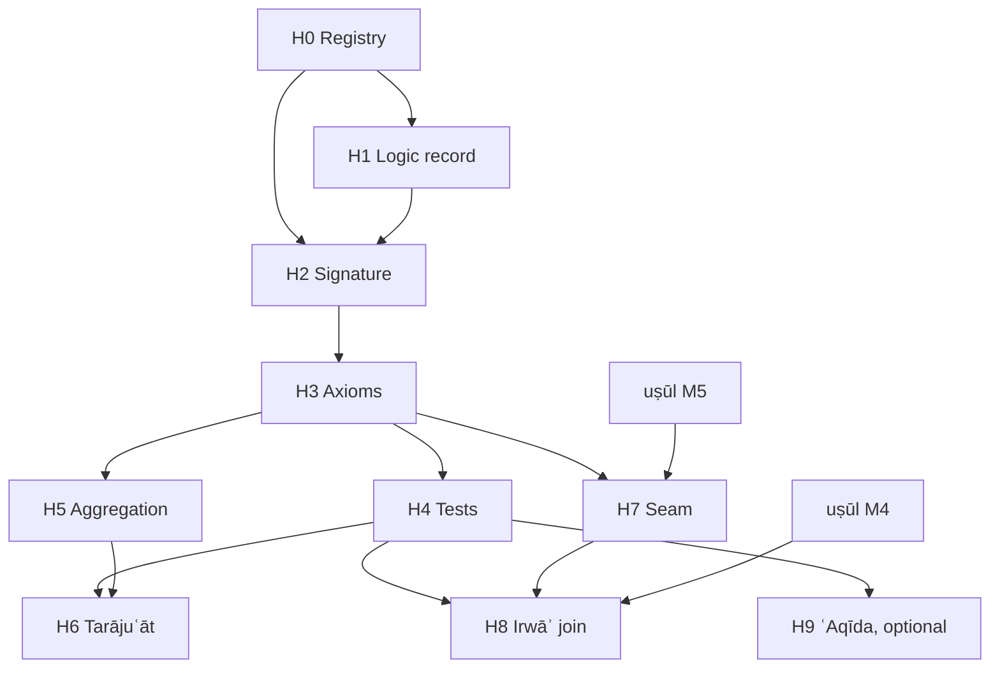

# al-Albānī's Ḥadīth Methodology — Roadmap and Milestones

## 0. Scope and thesis

**Goal.** Formalize the critical method of Muḥammad Nāṣir al-Dīn al-Albānī (d. 1420) as a checkable evidential calculus, and connect its output to the Ḥanbalī uṣūl kernel ([`roadmap-hanbali-usul-formalization.md`](roadmap-hanbali-usul-formalization.md)) at exactly one typed seam.

**The silsila is textual, not personal.** al-Albānī had Ḥanafī schooling under his father, an ijāza from Rāghib al-Ṭabbākh, and then worked on his own, prompted by Riḍā's *al-Manār* and al-ʿIrāqī's takhrīj of the *Iḥyāʾ*. So the genealogy runs through books:

```text
muḥaddithūn:      Ibn al-Ṣalāḥ → al-Dhahabī → Ibn Ḥajar          (muṣṭalaḥ, rijāl)
dalīl-first fiqh: Ibn Ḥazm, al-Shawkānī, Ṣiddīq Ḥasan Khān        (uṣūl, tarjīḥ by ṣiḥḥa)
                         ↘                    ↙
                          al-Albānī
```

**The formal object changes.** The uṣūl track derives aḥkām from adilla. This track decides *whether a text is a dalīl at all*: a verdict over an isnād graph. The two meet at one point:

```text
Hadith.Verdict ──grade──▶ Usul.Grade ──▶ (Ḥanbalī deontic kernel)
ṣaḥīḥ, ḥasan ↦ ẓann      ḍaʿīf ↦ shakk      ḍaʿīf jiddan, mawḍūʿ ↦ wahm
```

`Hadith.Verdict.hujja_iff_yaqin` proves that a verdict is usable as dalīl exactly when its image reaches yaqīn-for-action. No other edge exists between the namespaces.

**Non-authority clause** (as in the uṣūl roadmap §0). Every output reads *"the verdict v is derivable from ṭuruq T and grades G under encoding E, version k"*. It is not a taṣḥīḥ or a taḍʿīf. When al-Albānī and another critic disagree, both are kept as data.

### 0.1 Design constraint: the mutaqaddimūn critique (read before fixing the logic)

Ibn Rajab, *Sharḥ ʿIlal al-Tirmidhī*, is the standing reference for the critique made of al-Albānī under the name *manhaj al-mutaqaddimīn*: early critics judged by qarāʾin, not by rules that compose. His central rule

```text
ḍaʿīf ⊕ ḍaʿīf  (independent, not shadīd)  ⟹  ḥasan li-ghayrihi
```

is the contested axiom. This fixes three decisions before any axiom is written:

1. **Aggregation is an argument, not an inference rule.** The lift is argument 0 of a finite AF. ʿIlla, shudhūdh, a hidden shared madār and a critic's explicit iʿlāl attack it; a jawāb attacks its objection. The lift stands iff it is in the grounded extension (`Usul.Grounded`, proved against `Usul.Dung`). Soundness is claimed only for the rule's *guards* (§2.3), never for the lift itself.
2. **The prima-facie chain verdict is the weakest link; ʿilla and shudhūdh are not.** The *Nuzha* defines ṣaḥīḥ as ʿadāla, tamām al-ḍabṭ and ittiṣāl, plus the absence of ʿilla and shudhūdh. The first three compose over links. The last two are judged from qarāʾin, so they enter only as defeaters.
3. **Reversals are data.** al-Albānī's tarājuʿāt are non-monotonicity witnesses: the same ṭuruq with a richer evidence file get a lower (or higher) verdict. A monotone theory could not represent them; the AF can (`Hadith.judge_not_monotone`).

### Status (2026-10-08)

| Milestone | State | Evidence |
|---|---|---|
| H0 registry | **done for the kernel** | 22 works added to `corpus/registry.json` (`track: albani_hadith`), pinned to OpenITI commits or Shamela ids; 14 witnesses fetched and locked (`corpus/lock.json`). The three recalled counts are **confirmed** against the text: 12 marātib (*Taqrīb*, v01:p074–075), 5 tadlīs tiers (*Taʿrīf*, v01:p013–014), 15 qawāʿid (*Tamām al-Minna*, v01:p015–041). Every rung is quoted verbatim in `corpus/hadith/kernel_scales.json` and checked by `test_hadith.py` (see §1.1) |
| H1 logic record | **decided in §0.1**, ADR prose open | reuses `Usul.Dung` / `Usul.Grounded`; no new semantics |
| H2 signature | **seeded; marātib verified** | `Hadith.Grade`: the 12 marātib match the *Taqrīb* wording rung for rung, each linked to its constructor (generated `HadithTest/ScaleMap.lean`); 5-valued verdict; bands (ḥujja 1–4, iʿtibār 5–9, shadīd 10–12) proved by `hujja_iff` / `shadid_iff`; bridge `grade` monotone, never `qat`. The *Nuzha* partition tree is not yet extracted |
| H3 axioms | **15 qawāʿid classified; 6 linked** | `kernel_scales.json`: 2 defeaters (Q1 shudhūdh, Q2 iḍṭirāb), 3 valuations (Q3 tadlīs, Q4 jahāla, Q5 Ibn Ḥibbān's tawthīq), 5 guards (Q6–Q10), 2 presentation rules (Q11, Q13), 3 seam rules (Q12, Q14, Q15). Linked to Lean: Q1–Q4, Q10, Q12. `Hadith.Isnad`: tadlīs tolerance as a `Policy` (the *Taʿrīf* records the tier-3 dispute itself); weakest link proved; monotone in links and in policy |
| H5 aggregation | **seeded** | `Hadith.Turuq`: the lift as a defeasible argument; Q10's criterion (sūʾ al-ḥifẓ repairs, tuhma does not) is the shadīd band, proved inert (`liftable_cons_shadid`, `aggregate_of_shadid`); one madār never lifts; at most one rung; worked defeat / reinstatement; non-monotonicity witness |
| H4 tests | **synthetic only** | `HadithTest.Chains`: 15 `#guard` vectors, each naming its rule; *al-Ḍaʿīfa* is registered (on demand), no entries transcribed yet |

All of this builds with `make lean` and carries no `sorry`; CI's `sorry` check covers `Hadith` and `HadithTest`.

---

## 1. Source → layer map

Counts are from recall and vary by edition. H0 checks each against a pinned witness, as M0 did for the uṣūl track.

| Layer | Sources | Formal role |
|---|---|---|
| **Σ — signature** (ḥudūd, taqāsīm) | Ibn Ḥajar, *Nukhbat al-Fikar* + *Nuzhat al-Naẓar* (the whole of muṣṭalaḥ as one partition tree, close to a type hierarchy as written); Ibn al-Ṣalāḥ, *Muqaddima* + Ibn Ḥajar's *Nukat*; Ibn Kathīr, *Ikhtiṣār* + Shākir's *al-Bāʿith al-Ḥathīth* (annotated by al-Albānī); al-Dhahabī, *al-Mūqiẓa* | Sorts; each taqsīm proved exhaustive ∧ disjoint |
| **Ax — axioms** | al-Albānī, muqaddima of *Tamām al-Minna* (15 explicit qawāʿid, his most axiomatic text); Ibn Ḥajar, *Taqrīb al-Tahdhīb* muqaddima (12 marātib, his default valuation); Ibn Ḥajar, *Taʿrīf Ahl al-Taqdīs* (5 tiers of mudallisīn, each with its own acceptance rule); al-Muʿallimī, *al-Tankīl* (al-Albānī's taḥqīq), qawāʿid section (conflict in jarḥ wa-taʿdīl) | Valuations, guards, a jarḥ/taʿdīl resolution order |
| **T — tests** | *Silsilat al-Aḥādīth al-Ṣaḥīḥa* and *al-Ḍaʿīfa* (each entry a worked derivation from ṭuruq and grades to a verdict); *Irwāʾ al-Ghalīl* (≈2,700 takhrījāt on a Ḥanbalī fiqh text); *Ṣaḥīḥ Abī Dāwūd* (al-Umm), reasoning shown; the tarājuʿāt | Golden entailments; reversals as non-monotonicity cases |
| **U — uṣūl and fiqh method** | al-Albānī, *al-Ḥadīth Ḥujja bi-Nafsihi*, *Manzilat al-Sunna*, muqaddima of *Ṣifat Ṣalāt al-Nabī*; Ibn Ḥazm, *al-Iḥkām* (the most deductive uṣūl text in the tradition, and criticised by al-Albānī); al-Shawkānī, *Irshād al-Fuḥūl* and *al-Rawḍa al-Nadiyya* + al-Albānī's taʿlīqāt; al-Shāfiʿī, *al-Risāla* (Shākir's ed.) | The seam: how a verdict becomes a dalīl; āḥād in ʿaqīda and aḥkām |
| **⊢ — proof theory** | Ibn Rajab, *Sharḥ ʿIlal al-Tirmidhī* | Fixes §0.1: which rules are defeasible |
| **ʿAq — ʿaqīda** (optional, firewalled) | *Mukhtaṣar al-ʿUluww*; takhrīj of *Sharḥ al-Ṭaḥāwiyya* | Test corpus only; same firewall as uṣūl M12 |

### 1.1 What H0 found

- **Counts.** All three recalled counts hold. Q10 of *Tamām al-Minna* states the shadīd criterion in the terms the kernel uses: a ḍaʿīf is strengthened by its ṭuruq only when the weakness comes from *sūʾ al-ḥifẓ*, «لا من تهمة في صدقهم أو دينهم».
- **Witness defect.** The Shamela 8609 *Taqrīb* (ʿAwwāma, Dār al-Rashīd) on OpenITI starts at the ṭabaqāt, without the marātib. JK 121 (same taḥqīq) carries them and is the primary witness for the scale.
- **Dispute recorded at the source.** The *Taʿrīf* says of tier 3 that some rejected their ḥadīth outright and some accepted it. That supports keeping tadlīs tolerance a parameter, not an axiom. *Tamām al-Minna* Q3 states the general rule (only what is explicitly heard is accepted) and defers to Ibn Ḥajar's tafṣīl.
- **Shared works.** *al-Risāla* (Shākir) and Ibn Ḥazm's *Iḥkām* (Shākir) were already registered as qiyās sources (`shafii.risala`, `ibn_hazm.ihkam`). This track reuses those entries and does not duplicate them.
- **Editions to check.** *al-Tankīl*: Shamela 12767 is the al-Maktab al-Islāmī edition, the one carrying al-Albānī's work. *al-Bāʿith al-Ḥathīth*: the OpenITI witness is Shākir's sharḥ without al-Albānī's taʿlīqāt, so the annotated edition is still to be located.
- **Not located.** al-Albānī's takhrīj of *Sharḥ al-Ṭaḥāwiyya* has no separate witness yet.
- **Rights.** Modern works (al-Albānī, al-Muʿallimī, Shākir, Ṣiddīq Ḥasan Khān) are `modern_cache_only` with excerpts of at most 160 characters. The large ones (*al-Ḍaʿīfa*, *al-Ṣaḥīḥa*, *al-Irwāʾ*, the *Taqrīb*) are `fetch: on_demand`.

**Minimal kernel:** *Nuzhat al-Naẓar* for Σ, the *Taqrīb* marātib plus the 15 qawāʿid for Ax, *al-Ḍaʿīfa* for T.

**Why *al-Irwāʾ* matters to this repo.** Its base text is a Ḥanbalī fiqh matn (Ibn Ḍūyān's *Manār al-Sabīl* on *al-Dalīl*), so each takhrīj attaches a verdict to a farʿ the uṣūl track can already state. It is the natural first join between the two tracks (H8).

---

## 2. Formal kernel (what is built, what is planned)

### 2.1 Signature — `Hadith.Grade` (built)

```text
Martaba ::= ṣaḥābī | awthaq | thiqa | ṣadūq | ṣadūq yahim | maqbūl
          | mastūr | ḍaʿīf | majhūl | matrūk | muttaham | kadhdhāb       -- ranks 1…12
Verdict ::= mawḍūʿ < ḍaʿīf jiddan < ḍaʿīf < ḥasan < ṣaḥīḥ
verdict : Martaba → Verdict,  antitone in rank
bands:  Hujja v ⇔ rank ≤ 4,   Shadid v ⇔ rank ≥ 10,   iʿtibār otherwise
grade  : Verdict → Usul.Grade,  monotone, never qaṭʿ (tawātur is not a chain property)
```

The *Taqrīb* valuation is a default. A per-narrator override by al-Albānī (or a conflict between critics) is data resolved in H3 by al-Muʿallimī's rules, never an edit to this table.

### 2.2 Isnād — `Hadith.Isnad` (built)

```text
Link   = (rāwī : Martaba, muttaṣil : Bool, tadlīs : Option Tier, ṣīgha : taṣrīḥ | ʿanʿana)
accept p t s = (t = none) ∨ (s = taṣrīḥ) ∨ p.tolerated t          -- Ibn Ḥajar: tiers 1–2
link v = verdict rāwī,           if muttaṣil ∧ accept
       = verdict rāwī ⊓ ḍaʿīf,   otherwise
chain  = ⨅ links                                                     -- weakest link
```

Proved: chain ≤ every link and equals one of them; monotone in each link and in the policy (more tolerant ⇒ never weaker); a kadhdhāb anywhere ⇒ mawḍūʿ; a gap anywhere ⇒ not ḥujja.

**Planned (H3):** the isnād *graph*. A ḥadīth is a DAG of ṭuruq meeting at common links (*madār*). Chain evaluation stays a path functional; the graph supplies the independence relation that §2.3 currently takes as a `madar : Nat` label.

### 2.3 Ṭuruq — `Hadith.Turuq` (built)

```text
best ts      = ⨆ verdicts
supports ts  = distinct madār among ṭuruq ≥ ḍaʿīf
Liftable ts  = best ∈ {ḍaʿīf, ḥasan} ∧ |supports| ≥ 2               -- the rule's guards
judge ts AF  = bump best   if Liftable ts ∧ 0 ∈ grounded(AF)
             = best        otherwise
```

Guards, proved: aggregation never lowers `best` and never climbs more than one rung; a shadīd best is never lifted; adding a shadīd ṭarīq changes neither `supports` nor `Liftable` (*taqwiyat al-ḥadīth bi-kathrat al-ṭuruq laysa ʿalā iṭlāqihi*); a single madār never lifts.

Defeasibility, shown on worked AFs: no objection ⇒ ḥasan li-ghayrihi; an ʿilla ⇒ ḍaʿīf; a jawāb ⇒ ḥasan again; a second unanswered ʿilla ⇒ ḍaʿīf. `judge_not_monotone` states the existence of a file where adding an objection lowers the verdict.

**Not claimed:** that the lift is truth-preserving. Whether a given lift *should* stand is the mutaqaddimūn question, and the AF represents it without answering it.

### 2.4 Jarḥ wa-taʿdīl conflict (planned, H3)

Given critics' statements about one narrator, resolve to a martaba. The candidate order (al-Muʿallimī, *al-Tankīl*; the classical *al-jarḥ al-mufassar muqaddam ʿalā al-taʿdīl*) is a `resolveD` chain of the same shape as `Usul.Taarud`: explained jarḥ ≻ taʿdīl ≻ unexplained jarḥ, with the competence and the tashaddud/tasāhul of each critic as parameters. Exit: the order is total and well-founded, and each disputed step is a parameter with its established positions cited.

---

## 3. Milestones

Notation as in the uṣūl roadmap: **Exit** criteria are machine-checkable unless marked *(review)*; `⟵` lists hard dependencies.

#### H0 · Registry ⟵ —
- Add the §1 works to `corpus/registry.json` with pinned witnesses (Shamela / OpenITI / archive.org). Most are modern (al-Albānī d. 1420, al-Muʿallimī d. 1386, Shākir d. 1377): `rights: modern_cache_only` and 160-character excerpts. **Done** (§1.1).
- Verify the counts: 12 marātib, 5 tiers, 15 qawāʿid (**confirmed**, `kernel_scales.json`); ≈2,700 *Irwāʾ* entries (open: needs the on-demand fetch and a numbered segmenter).
- **Exit:** schema-valid entries; each count confirmed verbatim or the witness defect recorded. Met for the kernel; the *Irwāʾ* count remains.

#### H1 · Logic record ⟵ H0
- The ADR states §0.1 and its rejection of a monotone calculus, with Ibn Rajab cited.
- **Exit:** the ADR is merged *(review)*. No new semantics: `Usul.Dung` / `Usul.Grounded` are reused.

#### H2 · Signature ⟵ H0, H1
- Extract the *Nuzha*'s partition tree; every taqsīm becomes a decidable predicate with ≥1 positive and ≥1 negative fixture.
- **Exit:** each partition proved exhaustive ∧ disjoint; the twelve marātib checked against the pinned *Taqrīb*.

#### H3 · Axioms ⟵ H2
- The 15 qawāʿid of *Tamām al-Minna*, each classified `valuation | guard | defeater | seam` and stated in Lean.
- Isnād graph with the madār as a common link; jarḥ/taʿdīl resolution (§2.4); tadlīs policy as al-Albānī applies it, recorded against Ibn Ḥajar's default.
- **Exit:** every qāʿida has a Lean statement and ≥1 vector; Isnad theorems lift from paths to the graph.

#### H4 · Test suite ⟵ H3
- Encode entries from *al-Ḍaʿīfa* (then *al-Ṣaḥīḥa*): ṭuruq, grades as al-Albānī states them, objections and jawābs, and his verdict as the expected output.
- Failure classes, as in uṣūl M4: `missing_fact | missing_rule | genuine_ikhtilāf | encoding_error`, plus `qarīna` for a verdict that rests on a critic's iʿlāl not reducible to a rule.
- **Exit:** a CI coverage report; `encoding_error = 0`; the `qarīna` share is reported, because it directly measures the mutaqaddimūn critique.

#### H5 · Aggregation metatheory ⟵ H3
- Generalize §2.3 from labels to the graph. Prove the guards on the graph: independence is graph-theoretic (no shared weak node), and a shadīd node blocks every path through it.
- **Exit:** the §2.3 guard theorems hold over graphs; vectors agree with the label version on tree-shaped inputs.

#### H6 · Tarājuʿāt ⟵ H4, H5
- Each documented reversal is a pair of evidence files (before, after) with both verdicts.
- **Exit:** every reversal is reproduced as an AF change, or classified as a change of grade data (an H2/H3 override) instead.

#### H7 · Seam to uṣūl ⟵ H3, uṣūl M5
- *al-Ḥadīth Ḥujja bi-Nafsihi*: āḥād ṣaḥīḥ is ḥujja in ʿaqīda and aḥkām. In this encoding that means the seam has one gate (`Hujja`), not one per domain. Ibn Ḥazm's *Iḥkām* is the comparison point.
- **Exit:** a Lean theorem that `Usul` derivations consume only `Verdict.grade` values; no other import edge (checked like the ʿaqīda firewall).

#### H8 · *al-Irwāʾ* join ⟵ H4, H7, uṣūl M4
- Attach *Irwāʾ* verdicts to the furūʿ of the Ḥanbalī matn. Report where a ḍaʿīf verdict removes the only dalīl of a farʿ the uṣūl track derives.
- **Exit:** a cross-track coverage table; each removal classified, never silently patched.

#### H9 · ʿAqīda corpus (optional, firewalled) ⟵ H4
- *Mukhtaṣar al-ʿUluww*, takhrīj of *Sharḥ al-Ṭaḥāwiyya* as test data only.



**Critical path:** H0 → H2 → H3 → H4 → H6. **Minimal kernel:** H0–H4.

---

## 4. Risks

| Risk | Mitigation |
|---|---|
| Treating ḥasan li-ghayrihi as sound | It is an argument (§0.1); only its guards are theorems |
| Hiding the qarāʾin critique in an encoding error | `qarīna` is a separate failure class with its own metric (H4) |
| Freezing the *Taqrīb* as truth | It is the default valuation; overrides are data (H3) |
| Disputed tadlīs tolerance | `Policy` is a parameter; Ibn Ḥajar's default is named, not assumed |
| Counts from recall | H0 verifies against pinned witnesses |
| Verdicts read as taṣḥīḥ | Non-authority clause; every output carries (T, G, E, k) |
| Leakage into the deontic kernel | One seam (`grade`), checked in H7 |
