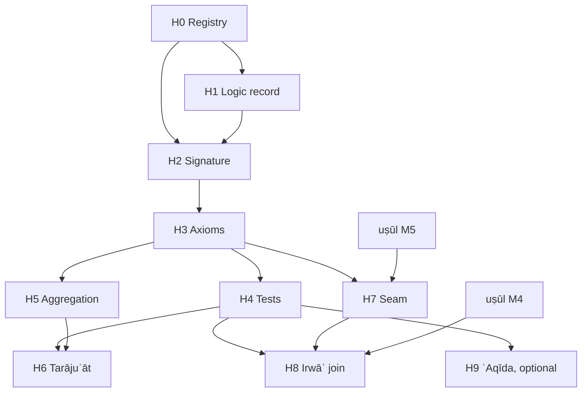

# al-Albānī's Ḥadīth Methodology — Roadmap and Milestones

## 0. Scope and thesis

**Goal.** Formalize the critical method of Muḥammad Nāṣir al-Dīn al-Albānī (d. 1420) as a checkable evidential calculus, and connect its output to the Ḥanbalī uṣūl kernel ([`roadmap-hanbali-usul-formalization.md`](roadmap-hanbali-usul-formalization.md)) at exactly one typed seam.

**The silsila is textual, not personal.** al-Albānī had Ḥanafī schooling under his father, an ijāza from Rāghib al-Ṭabbākh, and then worked on his own, prompted by Riḍā's *al-Manār* and al-ʿIrāqī's takhrīj of the *Iḥyāʾ*. So the genealogy runs through books:

```text
muḥaddithūn:      Ibn al-Ṣalāḥ → al-Dhahabī → Ibn Ḥajar          (muṣṭalaḥ, rijāl)
dalīl-first fiqh: Ibn Ḥazm, al-Shawkānī, Ṣiddīq Ḥasan Khān        (uṣūl, tarjīḥ by ṣiḥḥa)
                         ↘                    ↙
                          al-Albānī
```

**The formal object changes.** The uṣūl track derives aḥkām from adilla. This track decides *whether a text is a dalīl at all*: a verdict over an isnād graph. The two meet at one point:

```text
Hadith.Verdict ──grade──▶ Usul.Grade ──▶ (Ḥanbalī deontic kernel)
ṣaḥīḥ, ḥasan ↦ ẓann      ḍaʿīf ↦ shakk      ḍaʿīf jiddan, mawḍūʿ ↦ wahm
```

`Hadith.Verdict.hujja_iff_yaqin` proves that a verdict is usable as dalīl exactly when its image reaches yaqīn-for-action. No other edge exists between the namespaces.

**Non-authority clause** (as in the uṣūl roadmap §0). Every output reads *"the verdict v is derivable from ṭuruq T and grades G under encoding E, version k"*. It is not a taṣḥīḥ or a taḍʿīf. When al-Albānī and another critic disagree, both are kept as data.

### 0.1 Design constraint: the mutaqaddimūn critique (read before fixing the logic)

Ibn Rajab, *Sharḥ ʿIlal al-Tirmidhī*, is the standing reference for the critique made of al-Albānī under the name *manhaj al-mutaqaddimīn*: early critics judged by qarāʾin, not by rules that compose. His central rule

```text
ḍaʿīf ⊕ ḍaʿīf  (independent, not shadīd)  ⟹  ḥasan li-ghayrihi
```

is the contested axiom. This fixes three decisions before any axiom is written:

1. **Aggregation is an argument, not an inference rule.** The lift is argument 0 of a finite AF. ʿIlla, shudhūdh, a hidden shared madār and a critic's explicit iʿlāl attack it; a jawāb attacks its objection. The lift stands iff it is in the grounded extension (`Usul.Grounded`, proved against `Usul.Dung`). Soundness is claimed only for the rule's *guards* (§2.3), never for the lift itself.
2. **The prima-facie chain verdict is the weakest link; ʿilla and shudhūdh are not.** The *Nuzha* defines ṣaḥīḥ as ʿadāla, tamām al-ḍabṭ and ittiṣāl, plus the absence of ʿilla and shudhūdh. The first three compose over links. The last two are judged from qarāʾin, so they enter only as defeaters.
3. **Reversals are data.** al-Albānī's tarājuʿāt are non-monotonicity witnesses: the same ṭuruq with a richer evidence file get a lower (or higher) verdict. A monotone theory could not represent them; the AF can (`Hadith.judge_not_monotone`).

### Status (2026-10-10)

| Milestone | State | Evidence |
|---|---|---|
| H0 registry | **done for the kernel** | 22 works added to `corpus/registry.json` (`track: albani_hadith`), pinned to OpenITI commits or Shamela ids; 14 witnesses fetched and locked (`corpus/lock.json`). The three recalled counts are **confirmed** against the text: 12 marātib (*Taqrīb*, v01:p074–075), 5 tadlīs tiers (*Taʿrīf*, v01:p013–014), 15 qawāʿid (*Tamām al-Minna*, v01:p015–041). Every rung is quoted verbatim in `corpus/hadith/kernel_scales.json` and checked by `test_hadith.py` (see §1.1) |
| H1 logic record | **decided in §0.1**, ADR prose open | reuses `Usul.Dung` / `Usul.Grounded`; no new semantics |
| H2 signature | **Nukhba tree in; marātib verified** | `Hadith.Grade`: the 12 marātib match the *Taqrīb* rung for rung; bands proved; bridge `grade` never `qat`. `Hadith.Nukhba` (§2.5): number of ṭuruq (only tawātur yields qaṭʿ: `knowledge_qat_iff`), saqṭ (muʿallaq / mursal / muʿḍal / munqaṭiʿ; tadlīs vs irsāl khafī), the ten ṭaʿn causes in the text's severity order (5 ʿadāla + 5 ḍabṭ), the *Nuzha*'s jabr list; muʿāraḍa reuses `Usul.resolve`. All 20 classes quoted and linked |
| H3 axioms | **15 + 9 qawāʿid; jarḥ/taʿdīl resolution built** | *Tamām al-Minna*: 15 qawāʿid classified, 7 linked (Q1–Q5, Q10, Q12). *al-Tankīl*: 9 qawāʿid quoted, 4 linked (Q4, Q5, Q7, Q8). `Hadith.JarhTadil` (§2.4): what counts, strength as remoteness of error, the resolution, bias as a qarīna only, narrator ≠ witness. `Hadith.Isnad`: tadlīs `Policy`, weakest link |
| H5 aggregation | **seeded** | `Hadith.Turuq`: the lift as a defeasible argument; Q10's criterion (sūʾ al-ḥifẓ repairs, tuhma does not) is the shadīd band, proved inert (`liftable_cons_shadid`, `aggregate_of_shadid`); one madār never lifts; at most one rung; worked defeat / reinstatement; non-monotonicity witness |
| H4 tests | **tranches 1–4 in (al-Ḍaʿīfa 1–45)** | `corpus/hadith/daifa_tranche{1,2,3,4}.json`, contiguous from entry 1; generated Lean guards (`HadithTest/Daifa.lean`). Coverage by rules 33/45 = 0.733; with an isnād 19/31 = 0.613; qarīna share 11/45 = 0.244; 0 encoding errors. Reported apart (D2): with the cited rulings 44/45 = 0.978. All quotes and rulings verified against the downloaded pages |
| H7 seam | **gate in (D4)** | `Usul.Seam.admitted d ↔ d.verdict.Hujja`, equivalently `grade.IsYaqin` (`admitted_iff_yaqin`); the only `Usul → Hadith` import edge, and it reaches `Hadith.Grade` alone (`test_seam_is_the_only_import_edge`) |
| H8 join | **widened and reviewed** | 61 candidates (prefix or shared content-word 3-gram), each classified in `corpus/hadith/irwa_join_review.json` (46 accepted); 13 links in `corpus/hadith/irwa_join.json`. One removal: Q24's dalīl (IQ-22, adopted under D4) |
| Oracle | **Prolog mirror in CI** | `formal/oracle/`: an independent SWI-Prolog model of the kernel, sharing no code with Lean. It covers: martaba → verdict; the weakest link with gaps and Ibn Ḥajar's tadlīs policy; route floors; the lift under strict and lax muʿtabar; the grounded extension, computed as a fixpoint; rulings as caps; jarḥ/taʿdīl resolution; the ḥujja gate. It reads the corpus JSON directly and recomputes 503 vectors: the grounded vectors, every al-Ḍaʿīfa kernel with its rulings, objection-free, lax and dispute values, and the seam. It also covers the uṣūl track's tanāquḍ pairs: a separate model of the ten pairs, built from al-Saʿdī's qayd sentences, recomputes each pair's truth table (`corpus/tanaqud/sadi.json`, 28 rows; Lean checks the same rows in the generated `UsulTest/TanaqudTable.lean`), and checks each clash and that each resolution is jamʿ. It also checks al-Saʿdī's furūq: each item's madhhab ruling and his own ruling are recomputed from his grade (`furuq_oracle.pl`; Lean: `UsulTest/FuruqTable.lean` and `Furuq.confirms_iff_sahih`). Self-tests add synthetic vectors, one per rule. A mutation test disables 26 clauses one at a time: 23 are killed by the corpus. 3 are killed only by the self-tests (the lax-only guards, and a qāṭiʿ jarḥ); no corpus vector exercises those yet, and the runner says so. `make oracle`; CI step in `fixtures.yml` |

All of this builds with `make lean` and carries no `sorry`; CI's `sorry` check covers `Hadith` and `HadithTest`.

---

## 1. Source → layer map

Counts are from recall and vary by edition. H0 checks each against a pinned witness, as M0 did for the uṣūl track.

| Layer | Sources | Formal role |
|---|---|---|
| **Σ — signature** (ḥudūd, taqāsīm) | Ibn Ḥajar, *Nukhbat al-Fikar* + *Nuzhat al-Naẓar* (the whole of muṣṭalaḥ as one partition tree, close to a type hierarchy as written); Ibn al-Ṣalāḥ, *Muqaddima* + Ibn Ḥajar's *Nukat*; Ibn Kathīr, *Ikhtiṣār* + Shākir's *al-Bāʿith al-Ḥathīth* (annotated by al-Albānī); al-Dhahabī, *al-Mūqiẓa* | Sorts; each taqsīm proved exhaustive ∧ disjoint |
| **Ax — axioms** | al-Albānī, muqaddima of *Tamām al-Minna* (15 explicit qawāʿid, his most axiomatic text); Ibn Ḥajar, *Taqrīb al-Tahdhīb* muqaddima (12 marātib, his default valuation); Ibn Ḥajar, *Taʿrīf Ahl al-Taqdīs* (5 tiers of mudallisīn, each with its own acceptance rule); al-Muʿallimī, *al-Tankīl* (al-Albānī's taḥqīq), qawāʿid section (conflict in jarḥ wa-taʿdīl) | Valuations, guards, a jarḥ/taʿdīl resolution order |
| **T — tests** | *Silsilat al-Aḥādīth al-Ṣaḥīḥa* and *al-Ḍaʿīfa* (each entry a worked derivation from ṭuruq and grades to a verdict); *Irwāʾ al-Ghalīl* (≈2,700 takhrījāt on a Ḥanbalī fiqh text); *Ṣaḥīḥ Abī Dāwūd* (al-Umm), reasoning shown; the tarājuʿāt | Golden entailments; reversals as non-monotonicity cases |
| **U — uṣūl and fiqh method** | al-Albānī, *al-Ḥadīth Ḥujja bi-Nafsihi*, *Manzilat al-Sunna*, muqaddima of *Ṣifat Ṣalāt al-Nabī*; Ibn Ḥazm, *al-Iḥkām* (the most deductive uṣūl text in the tradition, and criticised by al-Albānī); al-Shawkānī, *Irshād al-Fuḥūl* and *al-Rawḍa al-Nadiyya* + al-Albānī's taʿlīqāt; al-Shāfiʿī, *al-Risāla* (Shākir's ed.) | The seam: how a verdict becomes a dalīl; āḥād in ʿaqīda and aḥkām |
| **⊢ — proof theory** | Ibn Rajab, *Sharḥ ʿIlal al-Tirmidhī* | Fixes §0.1: which rules are defeasible |
| **ʿAq — ʿaqīda** (optional, firewalled) | *Mukhtaṣar al-ʿUluww*; takhrīj of *Sharḥ al-Ṭaḥāwiyya* | Test corpus only; same firewall as uṣūl M12 |

### 1.1 What H0 found

- **Counts.** All three recalled counts hold. Q10 of *Tamām al-Minna* states the shadīd criterion in the terms the kernel uses: a ḍaʿīf is strengthened by its ṭuruq only when the weakness comes from *sūʾ al-ḥifẓ*, «لا من تهمة في صدقهم أو دينهم».
- **Witness defect.** The Shamela 8609 *Taqrīb* (ʿAwwāma, Dār al-Rashīd) on OpenITI starts at the ṭabaqāt, without the marātib. JK 121 (same taḥqīq) carries them and is the primary witness for the scale.
- **Dispute recorded at the source.** The *Taʿrīf* says of tier 3 that some rejected their ḥadīth outright and some accepted it. That supports keeping tadlīs tolerance a parameter, not an axiom. *Tamām al-Minna* Q3 states the general rule (only what is explicitly heard is accepted) and defers to Ibn Ḥajar's tafṣīl.
- **Shared works.** *al-Risāla* (Shākir) and Ibn Ḥazm's *Iḥkām* (Shākir) were already registered as qiyās sources (`shafii.risala`, `ibn_hazm.ihkam`). This track reuses those entries and does not duplicate them.
- **Editions to check.** *al-Tankīl*: Shamela 12767 is the al-Maktab al-Islāmī edition, the one carrying al-Albānī's work. *al-Bāʿith al-Ḥathīth*: the OpenITI witness is Shākir's sharḥ without al-Albānī's taʿlīqāt, so the annotated edition is still to be located.
- **Not located.** al-Albānī's takhrīj of *Sharḥ al-Ṭaḥāwiyya* has no separate witness yet.
- **Rights.** Modern works (al-Albānī, al-Muʿallimī, Shākir, Ṣiddīq Ḥasan Khān) are `modern_cache_only` with excerpts of at most 160 characters. The large ones (*al-Ḍaʿīfa*, *al-Ṣaḥīḥa*, *al-Irwāʾ*, the *Taqrīb*) are `fetch: on_demand`.

**Minimal kernel:** *Nuzhat al-Naẓar* for Σ, the *Taqrīb* marātib plus the 15 qawāʿid for Ax, *al-Ḍaʿīfa* for T.

**Why *al-Irwāʾ* matters to this repo.** Its base text is a Ḥanbalī fiqh matn (Ibn Ḍūyān's *Manār al-Sabīl* on *al-Dalīl*), so each takhrīj attaches a verdict to a farʿ the uṣūl track can already state. It is the natural first join between the two tracks (H8).

---

## 2. Formal kernel (what is built, what is planned)

### 2.1 Signature — `Hadith.Grade` (built)

```text
Martaba ::= ṣaḥābī | awthaq | thiqa | ṣadūq | ṣadūq yahim | maqbūl
          | mastūr | ḍaʿīf | majhūl | matrūk | muttaham | kadhdhāb       -- ranks 1…12
Verdict ::= mawḍūʿ < ḍaʿīf jiddan < ḍaʿīf < ḥasan < ṣaḥīḥ
verdict : Martaba → Verdict,  antitone in rank
bands:  Hujja v ⇔ rank ≤ 4,   Shadid v ⇔ rank ≥ 10,   iʿtibār otherwise
grade  : Verdict → Usul.Grade,  monotone, never qaṭʿ (tawātur is not a chain property)
```

The *Taqrīb* valuation is a default. A per-narrator override by al-Albānī (or a conflict between critics) is data resolved in H3 by al-Muʿallimī's rules, never an edit to this table.

### 2.2 Isnād — `Hadith.Isnad` (built)

```text
Link   = (rāwī : Martaba, muttaṣil : Bool, tadlīs : Option Tier, ṣīgha : taṣrīḥ | ʿanʿana)
accept p t s = (t = none) ∨ (s = taṣrīḥ) ∨ p.tolerated t          -- Ibn Ḥajar: tiers 1–2
link v = verdict rāwī,           if muttaṣil ∧ accept
       = verdict rāwī ⊓ ḍaʿīf,   otherwise
chain  = ⨅ links                                                     -- weakest link
```

Proved: chain ≤ every link and equals one of them; monotone in each link and in the policy (more tolerant ⇒ never weaker); a kadhdhāb anywhere ⇒ mawḍūʿ; a gap anywhere ⇒ not ḥujja.

**Planned (H3):** the isnād *graph*. A ḥadīth is a DAG of ṭuruq meeting at common links (*madār*). Chain evaluation stays a path functional; the graph supplies the independence relation that §2.3 currently takes as a `madar : Nat` label.

### 2.3 Ṭuruq — `Hadith.Turuq` (built)

```text
best ts      = ⨆ verdicts
supports ts  = distinct madār among ṭuruq ≥ ḍaʿīf
Liftable ts  = best ∈ {ḍaʿīf, ḥasan} ∧ |supports| ≥ 2               -- the rule's guards
judge ts AF  = bump best   if Liftable ts ∧ 0 ∈ grounded(AF)
             = best        otherwise
```

Guards, proved: aggregation never lowers `best` and never climbs more than one rung; a shadīd best is never lifted; adding a shadīd ṭarīq changes neither `supports` nor `Liftable` (*taqwiyat al-ḥadīth bi-kathrat al-ṭuruq laysa ʿalā iṭlāqihi*); a single madār never lifts.

Defeasibility, shown on worked AFs: no objection ⇒ ḥasan li-ghayrihi; an ʿilla ⇒ ḍaʿīf; a jawāb ⇒ ḥasan again; a second unanswered ʿilla ⇒ ḍaʿīf. `judge_not_monotone` states the existence of a file where adding an objection lowers the verdict.

**Checked against the text** (`Hadith.Nukhba`, §2.5). The *Nuzha* names what a muʿtabar follower repairs: sūʾ al-ḥifẓ (and the unsorted mukhtaliṭ), the mastūr, the mursal, and the mudallas whose omitted narrator is unknown. Every martaba whose cause is on that list sits in the kernel's iʿtibār band (`liftable_in_itibar`), and kadhib/tuhma are shadīd (`kadhib_tuhma_shadid`). The kernel is **wider** in one place: majhūl al-ʿayn (martaba 9) is liftable in the kernel but not named in the text (`majhul_gap`). **Decided: kept repairable** (decision D1 below); the theorem stays as the record of the divergence. Two refinements for H5:
- **the follower must be «فوقه أو مثله لا دونه»** (decision D3: **strict**). `Isnad.floor` gives each route's weakest narrator as a *Taqrīb* rank; a gap or unaccepted tadlīs counts as an unknown narrator (rank 9). `judgeI` reads the condition two ways: `lax` (any independent supporter; equal to `judge`, `judgeI_lax`) and `strict` (the strongest route needs a supporter no weaker than itself), the project default (`Itibar.default`). Proved: `strict_le_lax`. Checked against the dogfooded bank: its displacement rule `Usul.Qawaid.update` (a challenger displaces only at equal or greater strength) is strict in form (`bank_weaker_never_displaces` beside `strict_weaker_follower_never_lifts`, while `lax_weaker_follower_lifts`). On the bank's own four-grade scale all iʿtibār marātib are shakk (`bank_scale_blind_in_itibar`), so the bank is neutral there and gives no support to lax. All recorded kernel values hold under strict; the only change is #2's undefeated value (ḥasan under lax, ḍaʿīf under strict: the mursal follower at 9 is weaker than Layth at 8). Strict does not derive #24's second objection, because ʿAṭiyya's rejected ʿanʿana puts his own route at 9 too;
- ~~the *Nuzha* says the lifted ḥadīth is «منحط عن رتبة الحسن لذاته»~~ **done:** `Basis` (dhātī / ghayrī) with `ghayri_iff` (li-ghayrihi exactly when aggregation moved the verdict off the best route) and `refinedRank`, which places the lifted grade strictly below the same grade li-dhātihi without reordering different verdicts.

The *Nuzha*'s justification of the lift is itself evidential: each weak route is equally likely right or wrong, and an agreeing route «رجح أحد الجانبين … فارتقى من درجة التوقف إلى درجة القبول». That supports the design choice of an argument, not an axiom.

**Rulings (D2).** A critic's ḥukm («باطل منكر», «هو موضوع») or a matn criterion is an argument with a *ceiling*: if it survives in the AF the verdict is capped there, and a jawāb removes the cap (`judgeR`). Proved: a ruling only lowers (`judgeR_le`), a surviving ruling bounds the verdict (`capWith_le_ceiling`), and with no rulings `judgeR = judge`. Rulings are attached only to qarīna cases, and coverage with rulings is reported apart from coverage by rules.

**Not claimed:** that the lift is truth-preserving. Whether a given lift *should* stand is the mutaqaddimūn question, and the AF represents it without answering it.

### 2.4 Jarḥ wa-taʿdīl conflict — `Hadith.JarhTadil` (built)

From al-Muʿallimī, *al-Tankīl* (al-Albānī's edition), qawāʿid 4, 5, 7, 8, with *Tamām al-Minna* Q5:

```text
counts q    = q made «على وجه الحكم» ∧ critic relied on for it (Tamām Q5: not Ibn Ḥibbān's tawthīq of a majhūl)
strength    = mujmal | mufassar | qāṭiʿ            -- qāṭiʿ: rejecting it imputes deliberate falsehood
resolve j t = majrūḥ    if j, no t                  -- Q5: an unexplained jarḥ suffices without taʿdīl
            = ʿadl      if t, no j
            = tawaqquf  if neither                  -- majhūl
            = winner    if exactly one side is qāṭiʿ -- «وإن كثر المعدلون»
            = tarjīḥ by qarīna, else tawaqquf        -- Q7: the side whose error is more remote
```

Proved: `qati_jarh_wins` and `qati_tadil_wins` hold for every qarīna, so bias (Q4) cannot defeat an established statement; `qarina_only_in_tarjih`; jarḥ antitone, taʿdīl monotone; statements that do not count change nothing (`not_counting_ignored`). The number of critics never enters, only the strongest statement on each side.

**Correction to the earlier plan.** I had planned the order «explained jarḥ ≻ taʿdīl ≻ unexplained jarḥ». The *Tankīl* rejects its middle step for narrators. Taʿdīl beats an unexplained jarḥ by default only for a *witness*, where the judge can question the critic. For a narrator the result is tarjīḥ, or tawaqquf «حتى يسفر البحث» (`rawi_not_shahid`). Tawaqquf is the mastūr's status, so it lands in the iʿtibār band (`tawaqquf_itibar`).

### 2.5 The *Nukhba* tree — `Hadith.Nukhba` (built)

Each taqsīm is a total function into an inductive type, so exhaustive ∧ disjoint hold by construction; the `_iff` lemmas fix each class to the text's definition. See the H2 row and §2.3 for what it checks.

---

## 3. Milestones

Notation as in the uṣūl roadmap: **Exit** criteria are machine-checkable unless marked *(review)*; `⟵` lists hard dependencies.

#### H0 · Registry ⟵ —
- Add the §1 works to `corpus/registry.json` with pinned witnesses (Shamela / OpenITI / archive.org). Most are modern (al-Albānī d. 1420, al-Muʿallimī d. 1386, Shākir d. 1377): `rights: modern_cache_only` and 160-character excerpts. **Done** (§1.1).
- Verify the counts: 12 marātib, 5 tiers, 15 qawāʿid (**confirmed**, `kernel_scales.json`); ≈2,700 *Irwāʾ* entries (**confirmed as the numbering's extent, with a witness defect**: `corpus/hadith/irwa_audit.json` reads the headers as the longest increasing chain. Numbers run to 2,683; 2,106 entries are present; 577 numbers are absent from Shamela 22592 (e.g. #1,650 appears only as a citation of Abū Dāwūd's numbering). Verdict lines: صحيح 1,297, ضعيف 312, حسن 121, others below 25; 148 entries have no «* verdict» line. A second witness is needed for the missing entries).
- **Exit:** schema-valid entries; each count confirmed verbatim or the witness defect recorded. **Met.**
- **Volumes in Shamela locators.** `fetch.py` writes every Shamela page as `PageV01…`, so multi-volume books repeated page numbers across volumes. `arabic.revolume` now infers the volume at read time: Shamela numbers pages per volume, so a page number that goes back starts the next one. It applies only to texts whose markers all read V01, so OpenITI volumes are untouched. Checked against Shamela's own volume field on *al-Irwāʾ* (page ids 1, 500, 2000, 2927 → volumes 1, 2, 6, 8), and every existing locator is unchanged (all in volume 1). Cached files and their locks did not have to change.

#### H1 · Logic record ⟵ H0
- The ADR states §0.1 and its rejection of a monotone calculus, with Ibn Rajab cited.
- **Exit:** the ADR is merged *(review)*. No new semantics: `Usul.Dung` / `Usul.Grounded` are reused.

#### H2 · Signature ⟵ H0, H1
- Extract the *Nuzha*'s partition tree; every taqsīm becomes a decidable predicate with ≥1 positive and ≥1 negative fixture.
- **Exit:** each partition proved exhaustive ∧ disjoint; the twelve marātib checked against the pinned *Taqrīb*.

#### H3 · Axioms ⟵ H2
- The 15 qawāʿid of *Tamām al-Minna*, each classified `valuation | guard | defeater | seam` and stated in Lean.
- Isnād graph with the madār as a common link; jarḥ/taʿdīl resolution (§2.4); tadlīs policy as al-Albānī applies it, recorded against Ibn Ḥajar's default.
- **Exit:** every qāʿida has a Lean statement and ≥1 vector; Isnad theorems lift from paths to the graph.

#### H4 · Test suite ⟵ H3
- Encode entries from *al-Ḍaʿīfa* (then *al-Ṣaḥīḥa*): ṭuruq, grades as al-Albānī states them, objections and jawābs, and his verdict as the expected output.
- Failure classes, as in uṣūl M4: `missing_fact | missing_rule | genuine_ikhtilāf | encoding_error`, plus `qarīna` for a verdict that rests on a critic's iʿlāl not reducible to a rule.
- **Exit:** a CI coverage report; `encoding_error = 0`; the `qarīna` share is reported, because it directly measures the mutaqaddimūn critique.
- **Tranche 1 (entries 1–16, none skipped).** 12 derivable, 3 qarīna, 1 missing rule, 0 encoding errors. Coverage is 0.75 overall and 0.6 on the 10 entries with an isnād; the 6 no-isnād entries («لا أصل له») are the kernel's empty file. What the data show:
  - **The ʿilla on real data.** #2: the marfūʿ has two independent routes, both on the *Nuzha*'s list. Under the lax reading the guard would allow ḥasan li-ghayrihi (`kernel_lax_undefeated`); under the strict default (D3) the mursal follower is weaker than Layth, so no lift arises at all. The ṣaḥīḥ mawqūf versions, al-Albānī's own ʿilla, are recorded as an objection either way. #24 is the case where a lift arises under both readings and is defeated.
  - **Rules at work.** #11 has one madār, so no lift. In #13 every narrator is thiqa, but al-Walīd b. Muslim (tier 4) uses ʿanʿana: *Tamām* Q6 in action. In #14, takdhīb against a partisan tawthīq is `JarhTadil` in action.
  - **Qarīna class (#1, #2, #12).** In all three, al-Albānī's verdict falls *below* the best route, through a critic's iʿlāl («باطل منكر», «هو موضوع») or naqd al-matn. The kernel can lower a verdict only by defeating a lift, never below the best route. The missing piece is an ʿilla that attacks a single chain or the matn itself.
  - **Missing rule (#8).** Matn identity by meaning (siyāq): a weak marfūʿ route exists, but al-Albānī says «لا أصل له مرفوعا» because its siyāq is not the popular saying's sense.
- **Tranche 2 (entries 17–25, none skipped).** 6 derivable, 3 qarīna, 0 encoding errors. What the data show:
  - **JarhTadil on real data, both branches.** #23: the lenient critics' tawthīq «لا يقام له وزن», so the explained jarḥ stands alone. #24: Fuḍayl b. Marzūq and ʿAṭiyya reach tarjīḥ (explained jarḥ against unexplained taʿdīl), and the qarīna is the jumhūr's explained jarḥ.
  - **A second real defeat.** #24 has two independent ḍaʿīf routes, so the guard allows ḥasan li-ghayrihi. Two objections defeat it: iḍṭirāb in rafʿ/waqf, and a follower «لا قيمة له لجهالة الراوي عنه». The second is **D1's revisit trigger firing once** (§3.1).
  - **A pattern in the qarīna class.** In #18 and #20, the best route runs through a narrator described as «يروي الموضوعات» or «حدث بالبواطيل». The kernel, with the *Nukhba* (tuhma ⇒ matrūk), values that route ḍaʿīf jiddan; al-Albānī says mawḍūʿ, following Ibn al-Jawzī, Ibn al-Qayyim and others. In #25 al-Albānī himself gives the craft floor («ضعيفا جدا على أقل الأحوال»), which matches the kernel, and reaches bāṭil through naqd al-matn. Across both tranches the six qarīna cases split evenly: three are one rung below his verdict (#18, #20, #25: ḍaʿīf jiddan vs mawḍūʿ) and three are two rungs below (#1, #2, #12: ḍaʿīf vs bāṭil or mawḍūʿ). In every case the kernel is *above* al-Albānī, never below, and the missing step is the same: a critic's ḥukm bi'l-waḍʿ or a matn criterion.
- **Tranche 3 (entries 26–35, none skipped).** 7 derivable, 3 qarīna, 0 encoding errors.
  - **#26 shows shadīd routes counting for nothing.** Three routes: a muttaham, a kadhdhāb («فلا يفرح بمتابعته»), and a mursal. The kernel ignores the first two (`liftable_cons_shadid`) and lands on al-Albānī's «ضعيف لإرساله».
  - **Qarīna #29, #32, #34.** #32 rests on naqd al-matn (the matn forbids what the Qurʾān permits). #29 and #34 rest on al-Dhahabī's ḥukm («خبر باطل», «منكر لا أصل له»), endorsed by Ibn Ḥajar. #34, like #8, says «لا أصل له» although a weak route exists; here the cited ḥukm carries it, so it is qarīna rather than a missing rule.
  - Across 35 entries the nine qarīna cases are still all *above* al-Albānī's verdict: 4 by one rung (#18, #20, #25, #29), 5 by two (#1, #2, #12, #32, #34).
- **Tranche 4 (entries 36–45, none skipped).** 8 derivable, 2 qarīna, 0 encoding errors.
  - **A defeat by naqd al-matn alone.** #43 has two independent majhūl routes (Jarīr; Anas via Baqiyya). They are muʿtabar for each other under strict D3 (equal floors, 9), so the guard allows ḥasan li-ghayrihi, which rests on D1. al-Albānī does not reject the follower for jahāla, so D1 is not triggered. He defeats the lift by the matn: read literally, the fast is accepted only once zakāt al-fiṭr is paid, «ولا أعلم أحدا من أهل العلم يقول به». This is the third real defeat after #2 and #24, and the first whose only objection is a matn criterion.
  - **One madār, many wajhs.** #38 (al-Ḥajjāj b. Arṭāt: mursal and mistaken mawṣūl) and #39 (Ibn Lahīʿa's three wajhs) both stay at ḍaʿīf, because the kernel does not lift a single madār. The kadhdhāb routes in #39 are inert.
  - **Qarīna #42, #45**, both one rung (ḍaʿīf jiddan vs mawḍūʿ), and both carried by a critic's ḥukm (al-Qārī; al-Dhahabī) plus al-Albānī's naqd al-matn. That makes eleven qarīna cases across 45 entries, all above his verdict: 6 by one rung, 5 by two.
  - **#41: a bound term, settled by the bank (D5).** The only route runs through ʿAmr b. al-Ḥuṣayn («كذاب كما سبق مرارا»), so the kernel gives mawḍūʿ, as in #40 for the same narrator. al-Albānī's term is «لا يصح». That is an upper bound (below ḥasan), recorded as `albani_bound: upper`, not a rung. The kernel is within it, so the case is derivable. An earlier draft mapped the gloss «إسناد ساقط» to ḍaʿīf jiddan and reported the kernel as *below* al-Albānī. That was my attribution, not his, and it is withdrawn.

#### H5 · Aggregation metatheory ⟵ H3
- Generalize §2.3 from labels to the graph. Prove the guards on the graph: independence is graph-theoretic (no shared weak node), and a shadīd node blocks every path through it.
- **Exit:** the §2.3 guard theorems hold over graphs; vectors agree with the label version on tree-shaped inputs.

#### H6 · Tarājuʿāt ⟵ H4, H5
- Each documented reversal is a pair of evidence files (before, after) with both verdicts.
- **Exit:** every reversal is reproduced as an AF change, or classified as a change of grade data (an H2/H3 override) instead.

#### H7 · Seam to uṣūl ⟵ H3, uṣūl M5
- *al-Ḥadīth Ḥujja bi-Nafsihi*: āḥād ṣaḥīḥ is ḥujja in ʿaqīda and aḥkām. In this encoding that means the seam has one gate (`Hujja`), not one per domain. Ibn Ḥazm's *Iḥkām* is the comparison point.
- **Exit:** a Lean theorem that `Usul` derivations consume only `Verdict.grade` values; no other import edge (checked like the ʿaqīda firewall).

#### H8 · *al-Irwāʾ* join ⟵ H4, H7, uṣūl M4
- Attach *Irwāʾ* verdicts to the furūʿ of the Ḥanbalī matn. Report where a ḍaʿīf verdict removes the only dalīl of a farʿ the uṣūl track derives.
- **Exit:** a cross-track coverage table; each removal classified, never silently patched.

- **Gate (2026-10-10, D4).** `Usul.Seam`: a ḥadīth dalīl in the uṣūl track is admitted iff its verdict is ḥujja (ḥasan or above); `q24_dalil_not_admitted` applies it to Q24. IQ-22 is adopted: Aḥmad's fourth aṣl is read with Ibn al-Qayyim's gloss, so it does not reopen the gate. Q24's remaining support (ibāḥa aṣliyya with S8) is left for review.
- **Widened join (2026-10-10).** `hadith.join_candidates` proposes a pair when the quoted matn's prefix appears in the excerpt, or when the two share a 3-gram of content words. Content words exclude the 40 commonest words, and a 3-gram found in more than 3 matns counts as a formula. A candidate is a proposal only. Each one carries an accept/reject reason in `irwa_join_review.json`, and `test_every_candidate_is_reviewed` fails on any unreviewed pair. 61 candidates, 46 accepted. 6 new links: Ibn al-Laḥḥām Q45 (camel meat, *al-Irwāʾ* 118), Ibn Rajab Q56 (Ṣafiyya, 1856) and Q147 (ʿaqīqa, 1166), the *Manẓūma* q071 (Wābiṣa, 541), *al-Ṭarīq* q636 («من عمل عملا ليس عليه أمرنا فهو رد»), and Q24's second wording (1553). Every one passes the gate except Q24's two wordings (#1553 and #1555, both ḍaʿīf).

- **Seed (2026-10-09).** `hadith.irwa_join` matches the quoted matn of every *al-Irwāʾ* entry against the uṣūl track's qāʿida records; `corpus/hadith/irwa_join.json` holds 7 links, and the generated `HadithTest/Seam.lean` checks each verdict against the one seam and that the qāʿida's Lean constants exist. Outcome: the ḥadīth dalīls of al-Saʿdī Q22 (two ḥadīths), Q47 and Q57 pass (ṣaḥīḥ or ḥasan); **Q24's does not**: «من سبق إلى ما لم يسبق إليه مسلم فهو أحق به» is ḍaʿīf (*al-Irwāʾ* 1555). This is not a ruling on Q24. It is surfaced as **IQ-22** in the uṣūl register, with the evidence on both sides: Aḥmad's fourth aṣl (*Iʿlām*: the non-fabricated ḍaʿīf before qiyās) against *Tamām al-Minna* Q12, and Ibn al-Qayyim's gloss that Aḥmad's ḍaʿīf is «قسم من أقسام الحسن», which may make the disagreement terminological. The match is lexical (the quoted matn's first 24 letters, or all of it if shorter, at least 12), so paraphrased dalīls are missed; Ibn Rajab's and Ibn al-Laḥḥām's furūʿ rarely quote within their excerpts.

#### H9 · ʿAqīda corpus (optional, firewalled) ⟵ H4
- *Mukhtaṣar al-ʿUluww*, takhrīj of *Sharḥ al-Ṭaḥāwiyya* as test data only.



**Critical path:** H0 → H2 → H3 → H4 → H6. **Minimal kernel:** H0–H4.

---

## 3.1 Decisions

**Method (project owner, 2026-10-10).** Before raising a question, apply the bank to it: the uṣūl track's qawāʿid, and al-Albānī's own statements and usage. Raise it only if that leaves it open. The kernel does not contradict al-Albānī; where he and the encoding seem to differ, the encoding is suspect first.

| # | Date | Question | Decision | Basis | Record |
|---|---|---|---|---|---|
| D1 | 2026-10-09 | Should another route repair a majhūl al-ʿayn (martaba 9)? The *Nuzha*'s jabr list names only the mastūr (majhūl al-ḥāl), sūʾ al-ḥifẓ, the mursal and the mudallas. | **Yes, kept repairable**, as the kernel already had it (iʿtibār band = marātib 5–9). | *Tamām al-Minna* Q10 withholds repair only where the weakness is «تهمة في صدقهم أو دينهم»; jahāla is unknown status, not tuhma. The kernel follows al-Albānī's own criterion here, not the narrower *Nuzha* list. | `Hadith.Nukhba.majhul_gap` states the divergence from the *Nuzha*; `Hadith.Grade.Martaba.shadid_iff` fixes the band. Revisit if H4 tranches show al-Albānī refusing a majhūl al-ʿayn as a shāhid. **Triggered once:** al-Ḍaʿīfa #24 rejects a follower «لجهالة الراوي عنه» (Ibn Dhakwān, unknown to Ibn Maʿīn; ʿayn or ḥāl not stated). Encoded as an objection, so the verdict matches either way; the decision stands until the project owner reopens it |
| D2 | 2026-10-09 | How should a critic's ruling (ḥukm bi'l-waḍʿ, buṭlān) or a matn criterion enter the kernel? | **As a capping argument, counted apart.** Cases it decides keep `class: qarina`; the kernel's result with the rulings is recorded as `kernel_with_rulings` and reported as `coverage_with_rulings`, never folded into rule coverage. | Folding the rulings into the rules would make the qarīna share (the measure of the mutaqaddimūn critique, §0.1) vanish by construction. | `Hadith.judgeR`, `judgeR_le`, `capWith_le_ceiling`; `test_rulings_only_on_qarina_cases` |
| D3 | 2026-10-09 | How strictly to read the *Nuzha*'s «فوقه أو مثله لا دونه»? | **Strict** (project owner: strict unless the dogfooded bank shows lax is aligned). `Itibar.default = .strict`; the H4 kernel is `judgeI .strict` / `judgeRI .strict`, with the lax value recorded beside it as `kernel_lax_undefeated`. | The bank's displacement rule (`Usul.Qawaid.update`; Ibn Rajab's `zahirPrevails`: a weaker ẓāhir never prevails) is strict in form. Lax lets a weaker follower displace the base's tawaqquf. The bank's own scale cannot separate marātib 5–9, so it is neutral there, not evidence for lax. | `strict_weaker_follower_never_lifts`, `bank_weaker_never_displaces`, `lax_weaker_follower_lifts`, `bank_scale_blind_in_itibar`; no final verdict in entries 1–35 changes |
| D4 | 2026-10-10 | Does the ḥadīth gate apply to the ḥadīth dalīls of the uṣūl track (IQ-22)? | **Yes.** A ḥadīth dalīl counts in an uṣūl derivation only if `Verdict.Hujja`; Q24's ḥadīth (ḍaʿīf, *al-Irwāʾ* 1553/1555) is not a dalīl. | One gate, not one per domain (*al-Ḥadīth Ḥujja bi-Nafsihi*, H7). Aḥmad's fourth aṣl is read per Ibn al-Qayyim («قسم من أقسام الحسن»), so it is a difference of terms, not an exception. Failing dalīls are surfaced, never dropped. | `Usul.Seam.admitted`, `admitted_iff_yaqin`, `daif_not_admitted`, `mursalDaif_admits_only_hasan_up`, `q24_dalil_not_admitted`; IQ-22 `adopted` |
| D5 | 2026-10-10 | Does «لا يصح … إسناد ساقط» with a lone kadhdhāb route (#41) contradict the kernel's kadhdhāb ⇒ mawḍūʿ? | **No; settled by the bank.** The kernel keeps al-Albānī's scale and his kadhdhāb ⇒ mawḍūʿ (#5, #10, #16, #40). A term that only bounds the verdict is recorded as a bound (`albani_bound: upper`), and agreement means the kernel is within it (`hadith.agrees`). A two-branch encoding (mawḍūʿ outside the scale, reached only by a finding) was built and **revoked by the project owner**: it contradicts al-Albānī, who files mawḍūʿ as a kind of ḍaʿīf («الموضوع من أنواع الحديث الضعيف», #16) and applies the kadhdhāb step himself. | Al-Saʿdī Q57 (read a speaker by his intent, so by al-Albānī's own usage), Q29 (read the word with what is attached to it: «عمرو هذا كذاب»), Q11 (only the bound is certain; a rung is not). | `test_class_matches_kernel`, `test_coverage_report` |

## 4. Risks

| Risk | Mitigation |
|---|---|
| Treating ḥasan li-ghayrihi as sound | It is an argument (§0.1); only its guards are theorems |
| Hiding the qarāʾin critique in an encoding error | `qarīna` is a separate failure class with its own metric (H4) |
| Freezing the *Taqrīb* as truth | It is the default valuation; overrides are data (H3) |
| Disputed tadlīs tolerance | `Policy` is a parameter; Ibn Ḥajar's default is named, not assumed |
| Cherry-picking test cases | Tranches are consecutive runs of entries, none skipped (`test_tranches_are_consecutive`) |
| The kernel wider than the text | Stated as a theorem (`majhul_gap`) and decided explicitly (D1), not patched silently |
| Counts from recall | H0 verifies against pinned witnesses |
| Verdicts read as taṣḥīḥ | Non-authority clause; every output carries (T, G, E, k) |
| Leakage into the deontic kernel | One seam (`grade`), checked in H7 |
