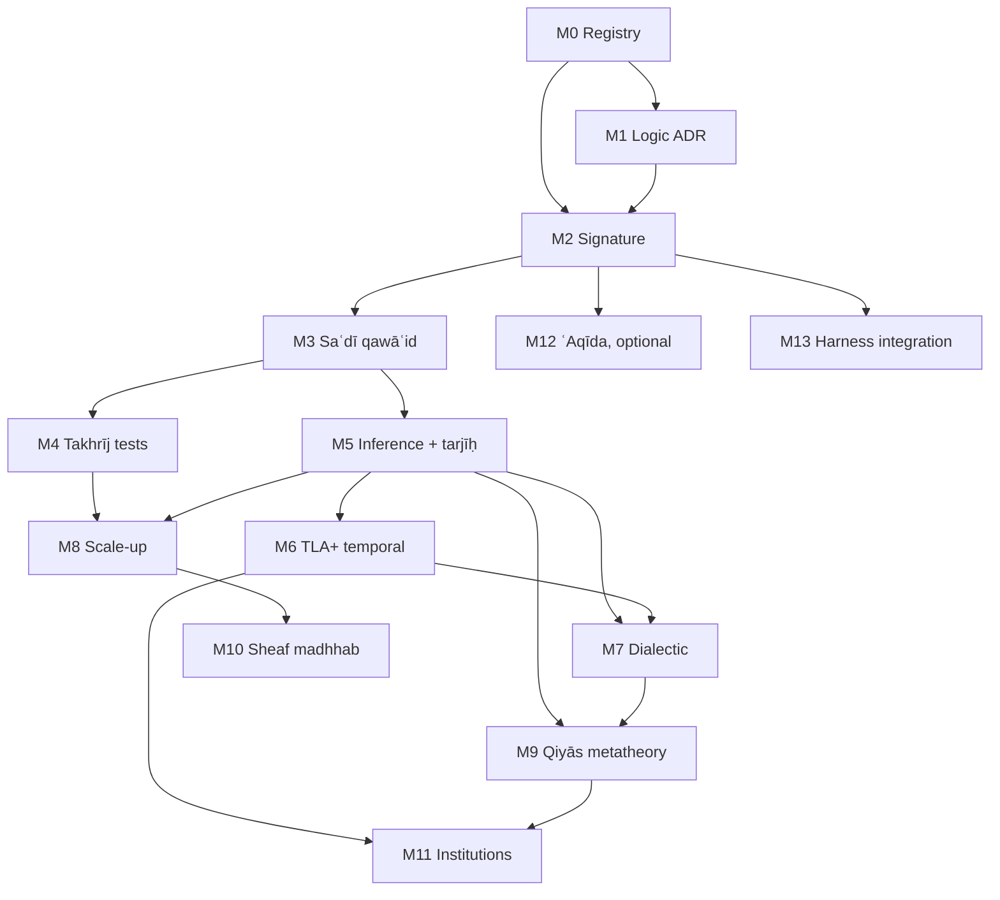

# Ḥanbalī Uṣūl Formalization — Roadmap and Milestones

## 0. Scope and thesis

**Goal.** Build a machine-checkable formalization of Ḥanbalī uṣūl al-fiqh along the silsila

```text
Ḥanbalī uṣūl line (Ibn Qudāma, al-Ṭūfī, Ibn Rajab, Ibn al-Laḥḥām, Ibn al-Najjār)
  → Ibn Taymiyya, Ibn al-Qayyim
  → al-Saʿdī, al-Shinqīṭī
  → Ibn ʿUthaymīn
```

The formalization uses five carriers, and each has one job:

| Carrier | Job | Authority (per `semantic-categorical-oracle/docs/authority-boundary.md`) |
|---|---|---|
| **Type theory** (Lean 4 core) | Signature: ḥudūd, aḥkām, adilla, judgement forms | Proof authority for stated theorems |
| **Lean 4** (+ Mathlib) | Metatheory: consistency, partitions, preference orders, argumentation semantics | Proof authority |
| **Haskell** | Executable reference interpreter, property tests, differential oracle | `advisory_oracle` until a contract is registered as `normative_semantic` |
| **TLA+** (TLC / Apalache) | Temporal and protocol structure: naskh, taklīf state, istiṣḥāb, munāẓara, review pipeline | Model-checked invariants within declared bounds only |
| **Category theory** | Compositional semantics: qiyās as factorization, sheaf gluing of local verdicts, institutions across carriers | Specification language; checked through Lean statements and Haskell laws |

**Non-authority clause.** Every output reads as *"ψ is derivable from sources S under encoding E, version v"*. None is a fatwā. Ikhtilāf is kept as data and is never collapsed by the encoding. This extends the existing repo rule that the LLM may propose but is never the deontic authority (`docs/architecture/deontic-circuits-harness.md`).

### 0.1 The logic-choice constraint (from *al-Radd ʿalā al-Manṭiqiyyīn*)

Ibn Taymiyya's critique fixes three design decisions **before** any axiom is written:

1. **No essentialist ḥadd.** A definition is a *distinguishing mark* (tamyīz). It does not capture an essence. ⇒ Definitions are discriminating predicates `d : Entity → Prop` with decidability and coverage obligations. No "real definition" is built into the kernel.
2. **Qiyās al-tamthīl is not inferior to qiyās al-shumūl.** ⇒ Analogy is a primitive inference rule. It is not encoded as a degraded syllogism. One milestone proves that the two forms are inter-convertible when the ʿilla is general (§3, L-QIY-2).
3. **Uṣūl reasoning is defeasible and proof-relevant.** ⇒ The core is a structured argumentation framework (ASPIC⁺-style) with a preference order from tarjīḥ. It is not a monotone axiomatic theory, and *which* dalīl supports a ḥukm matters, not only *that* one exists.

This rejects Standard Deontic Logic (KD) as the core: it has no defeasibility and is open to the Chisholm/Ross paradoxes. KD remains a possible *fragment*, valid for strict (qaṭʿī) rules only.

### Status (2026-10-13)

| Milestone | State | Evidence |
|---|---|---|
| M0 registry | **done for located texts** | `corpus/registry.json` (20 works, pinned witnesses), `corpus/lock.json`, `corpus/audit.json`: Ibn Rajab's 160, Ibn al-Laḥḥām's 66, al-Saʿdī's 60, the *Manẓūma*'s 103 abyāt and *Ṭarīq al-Wuṣūl*'s 1015 paragraphs confirmed (al-Saʿdī via the [OCR pipeline](architecture/ocr-pipeline.md)) |
| M1 logic core | **Abstract Lean exit proved; structured layer proposed** | `Usul.Dung`: admissibility preserved by `F`, grounded ⊆ every complete extension. [ADR 0001](architecture/adr-0001-logic-core.md) chooses structured argumentation over Dung AFs (SDL/KD only for the strict fragment), awaiting review; for finitary AFs `grounded` is proved the unique least complete extension (`grounded_complete`, `grounded_unique`), and for finite AFs every admissible set extends to a preferred one (`exists_preferred_superset`) |
| M2 signature | **seeded** | 26 ḥudūd extracted from *al-Uṣūl*; `Usul.Hukm` / `Usul.Signature`; Σ map checked on both sides |
| M3 qawāʿid | **al-Saʿdī catalogued; 60 of 60 formalised** | `corpus/proposals/sadi_qawaid.json` (all 60: statement, gloss, kind, domain; candidate status, awaiting human review); `Usul.Sadi`: Q1, 2, 4, 6, 8, 11, 16, 22/23, 27, 28, 33, 38, 40, 52, 58, 59, 60, with proved theorems; `Usul.Muamalat`: Q10, 12–14, 18–21, 24–26, 30, 32, 35–37, 42–47, 49, 51, 53–56 (possession, liability, contract), with consistency theorems Q13 ⇔ Q36, Q43 ⊑ Q26, Q51 ∥ Q54 and Q42 as an instance of Q21; `Usul.Kulliyyat`: Q5, 9, 15, 17, 29, 31, 34, 39, 41, 48, 50, 57 (custom, intent, utterance, cause and condition in time); `Usul.Schema`: 39 (rule, schema) pairs, 38 rules, over eight transportable shapes, pinned in `UsulTest/Schemata.lean`; 12 interpretive commitments surfaced for the Sharīʿah-authority gate, each with cited established answers (the cited answers contradict the reading in 2 questions, refine it in 8, agree in 2) and analogies (`corpus/review/`); the review runs on its own principles where stratified (`Usul.Process`); `Usul.Qiyas`: masālik al-ʿilla and qawādiḥ with soundness theorems, disputed points as parameters with established positions cited (IQ-13 to IQ-16), and 23 classical qiyās sources pinned; `Usul.Jadal`: the eighteen objections as one gate with «all reduce to manʿ or muʿāraḍa» proved as `debateGate_holds_iff`; 241 verified citations ground every theorem of the qiyās modules (`corpus/citations/`); `Usul.QiyasLimits`: fallibility, scope, jalī/khafī, tamthīl ≡ shumūl ([`schemata.md`](architecture/schemata.md)); Haskell mirror `Oracle.Usul.Sadi` |
| M4 tests | **first tranche checked** | harness (`usul_corpus/takhrij.py`, Lean-guarded); 204 furūʿ for 15 readings (Ibn Rajab under the qawāʿid al-Saʿdī compresses, Ibn al-Laḥḥām 52–54 for generality): coverage 0.873, madhhab coverage 0.534, after four self-application rounds (ʿahd-aware generality; conservative refinements; the open gaps' own principles, twice, all in `Usul.Refinements`): 214 cases, coverage 0.977, madhhab coverage 0.648, 0 encoding errors (from 7), 5 open gaps in the ledger (naming and policy points, and one case with no transmitted ruling), 29 cases revisited, see [`takhrij.md`](architecture/takhrij.md). Every closure is cited in the [dossier](architecture/dossier.md); terms in the [glossary](glossary.md) (75 terms, 159 verified excerpts). Ibn al-Laḥḥām's uṣūl rules wait for M5 |
| M8 scale-up | **tranches 1–11 and lane A rounds 1–4 encoded; human review open** | lane A round 4 (parallel, four shards): qawāʿid 119–131 (89 records, `rajab_m8_rajab_a13…a16_furu.json`): coverage 1.000, madhhab coverage 0.753, no new gaps; lane A round 3 (parallel, four shards): qawāʿid 107–118 (89 records, `rajab_m8_rajab_a9…a12_furu.json`): coverage 1.000, madhhab coverage 0.764, no new gaps; lane A round 2 (parallel, four shards): qawāʿid 94–102, 104, 105 (89 records, `rajab_m8_rajab_a5…a8_furu.json`): coverage 1.000, madhhab coverage 0.888, no new gaps; lane A round 1 (parallel, four shards): qawāʿid 53, 60, 67, 69, 71, 72, 73, 74, 77, 78, 79, 80, 81, 90, 92 (91 records, `rajab_m8_rajab_a1…a4_furu.json`): coverage 1.000, madhhab coverage 0.813, no new gaps; tranche 11: qawāʿid 55, 57, 59 (22 records, `rajab_m8_tranche11_furu.json`): coverage 1.000, madhhab coverage 0.909, no new gaps; tranche 10: qawāʿid 52, 54, 56, 58, 61, 62 (19 records, `rajab_m8_tranche10_furu.json`): coverage 1.000, madhhab coverage 0.737, no new gaps; tranche 9: qawāʿid 36, 42, 43, 46, 49, 50, 51 (16 records, `rajab_m8_tranche9_furu.json`): coverage 1.000, madhhab coverage 0.938, no new gaps; tranche 8: qawāʿid 4, 11, 14, 15, 19 (27 records, `rajab_m8_tranche8_furu.json`): coverage 1.000, madhhab coverage 0.852, no new gaps; tranche 7: qawāʿid 3, 5, 9, 10, 12 (24 records, `rajab_m8_tranche7_furu.json`): coverage 1.000, madhhab coverage 0.667 after reconciliation, no new gaps; tranche 6: qawāʿid 35, 37, 38, 39, 41 (24 records, `rajab_m8_tranche6_furu.json`): coverage 1.000, madhhab coverage 0.417 (on 38 the marked madhhab follows the wording), no new gaps; tranche 5: qawāʿid 25, 29, 30, 32, 33, 34 (27 records, `rajab_m8_tranche5_furu.json`): coverage 1.000, madhhab coverage 0.704, no new gaps; tranche 4: qawāʿid 2, 20, 21, 24 (21 records, `rajab_m8_tranche4_furu.json`): coverage 1.000, madhhab coverage 0.571, no new gaps; unified tranche 3: all 29 candidates under qawāʿid 1, 17, 31, 47, 66, 91, 93; PR #32's list-and-division segmentation and PR #31's hash-pinned worklist, source receipts and contrast guards are preserved. Tranche 2 (merged #30): qawāʿid 7, 27, 28, 64, 65, 25 records; tranche 1: qawāʿid 6, 22, 68, 26 records with opening examples. Current aggregate metrics and remaining counts come from the generated scope table below; exact IDs and source obligations are in `corpus/worklists/`. After tranche 3, round 5 applied the bank to its own gaps: 8 of 14 closed, each cited in the dossier (see [`takhrij.md`](architecture/takhrij.md)). All interpretation questions remain open; [reconciliation audit](architecture/m8-tranche3-reconciliation-2026-10-08.md) |
| M5 tarjīḥ | **schemata in; differential exit met** | the carriers agree on 10⁴ generated AFs: Python, Lean (`UsulTest/GroundedStress.lean`, `#guard`) and the Haskell oracle (`usul.af.grounded-stress-v1`) regenerate them from one seeded LCG (`formal/fixtures/grounded-stress-v1.json`) and reproduce the digest of every grounded extension; `Usul.Taarud` resolution order, applied by `Usul.Reconcile` to the bank's own 232 apparent contradictions (graded tarjīḥ, with 568 verbatim taṣḥīḥ/jazm items imported from al-Inṣāf, Taṣḥīḥ al-Furūʿ and the later muʿtamad: 19 jamʿ (qāʿidas 3, 5, 10, 16, 37, 50, 52, 59, 61, 64–65 refined by cited farqs), 1 naskh, 199 tarjīḥ, 13 tawaqquf; the 134 residues are the refinement worklist, see [`taarud-reconciliation.md`](architecture/taarud-reconciliation.md); lane D verified every earlier on-madhhab side: 90 of 100 agree, 6 entered the ledger); `Usul.Dalala`: ʿahd-aware generality, takhṣīṣ (not naskh), muṭlaq/muqayyad, amr/nahy defaults, al-amr bi'l-shayʾ nahy ʿan ḍiddih from σ, mafhūm with blockers, ≺ strict and well-founded; applied back to M4 (4 gaps closed, see [`takhrij.md`](architecture/takhrij.md#the-bank-applied-to-itself)) |
| M6 TLA+ | started | Istishab, Taklif, Naskh, Review: all pass TLC, and each was mutation-checked |
| M11 oracle | started | `semantic-categorical-oracle` `Oracle.Usul.*` advisory laws; three-way agreement on `grounded-v1.json` |

<!-- BEGIN GENERATED M8 SCOPE -->
**Current M8 inventory (generated).** 1,179 segmented Ibn Rajab furūʿ records = 814 annotated + **365 awaiting annotation**. Of 160 qawāʿid, 154 have segmented records: 121 are fully annotated and **33 await annotation**. The other **6 need source segmentation review**; zero emitted records does not establish zero examples in the text.

The unit is a committed farʿ record, which can contain multiple examples. Annotated gaps and disagreements are already counted as annotated; annotation does not mean independently reviewed or scholarly accepted. No count is imputed for unsegmented examples. The exact ID worklist and input hashes are in `corpus/worklists/rajab_m8.json`; rebuild with `python -m usul_corpus m8-worklist`.

| Current scope (generated) | Cases | Coverage | Madhhab coverage | Encoding errors | Open gaps |
|---|---|---|---|---|---|
| Combined M8 tranche 3 | 29 | 1.000 | 0.759 | 0 | 0 |
| All annotation suites | 841 | 0.993 | 0.738 | 0 | 6 |

Coverage counts derivability under the candidate encoding. Madhhab coverage uses candidate source attributions; neither metric establishes scholarly acceptance.
<!-- END GENERATED M8 SCOPE -->

Pipeline details: [`architecture/formalization-pipeline.md`](architecture/formalization-pipeline.md).

**M5 command capabilities (2026-10-09).** Four candidate schemata now express the named
readings in Ibn al-Laḥḥām 43.f001, f003, f004 and f007, with full-source replay, original
case receipts and explicit open interpretation questions. The four live command gaps
and the other two gaps remain open; capability fixtures add no annotations to the
generated aggregate above. Writing is not extended to gesture, conditional imitation is
preserved, and command naming does not change a given intended ruling. See the
[source contrasts and replay instructions](architecture/m5-command-schemata-2026-10-09.md).

---

## 1. Source → layer map

| Layer | Primary sources | Formal role |
|---|---|---|
| **Σ — signature** | Ibn ʿUthaymīn, *al-Uṣūl min ʿIlm al-Uṣūl* + sharḥ; Ibn Qudāma, *Rawḍat al-Nāẓir*; al-Ṭūfī, *Sharḥ Mukhtaṣar al-Rawḍa*; Ibn al-Najjār, *Sharḥ al-Kawkab al-Munīr* | Sorts, constructors, ḥudūd as predicates |
| **Ax — qawāʿid** | al-Saʿdī, *al-Qawāʿid wa'l-Uṣūl al-Jāmiʿa* (≈60, + furūq, taqāsīm); Ibn ʿUthaymīn, *Manẓūma* + sharḥ; Ibn Rajab, *Taqrīr al-Qawāʿid* (≈160); Ibn Taymiyya, *al-Qawāʿid al-Nūrāniyya*; al-Saʿdī, *Ṭarīq al-Wuṣūl* | Defeasible rules + exceptions; partitions as proved case splits |
| **⊢ — inference** | *Rawḍa*, *al-Uṣūl*, Ibn al-Qayyim's *Iʿlām* (Aḥmad's five uṣūl, qiyās, ḥiyal) | Rule schemata: qiyās, ʿāmm/khāṣṣ, muṭlaq/muqayyad, naskh, amr/nahy, mafhūm, taʿāruḍ → tarjīḥ |
| **T — tests** | Ibn al-Laḥḥām, *al-Qawāʿid wa'l-Fawāʾid al-Uṣūliyya* (takhrīj al-furūʿ ʿalā al-uṣūl); *Iʿlām* (≈99 sadd al-dharāʾiʿ instances); *al-Sharḥ al-Mumtiʿ* | Golden entailments `rule ⊢ farʿ`; regression corpus with explicit tarjīḥ |
| **Dial — dialectic** | al-Shinqīṭī, *Ādāb al-Baḥth wa'l-Munāẓara*, *Mudhakkira*; qawādiḥ chapter of the *Rawḍa* | Dialogue game; objections as attack types |
| **ʿAq — ʿaqīda** (optional, firewalled) | Ibn ʿUthaymīn, *al-Qawāʿid al-Muthlā*; Ibn Taymiyya, *al-Tadmuriyya* + *Taqrīb* | Separate theory; predication constraints |

**Suggested addition (flagged, not from the source list):** al-Mardāwī, *al-Inṣāf* / *Taṣḥīḥ al-Furūʿ*, as the intra-madhhab tarjīḥ oracle. It distinguishes the riwāyāt from Aḥmad from the muʿtamad. That distinction maps directly onto *preferred extensions* versus a *selection function* (M5).

---

## 2. Formal kernel sketch

### 2.1 Signature (type theory)

Taklīfī status, with an involution for the status of omission (*al-amr bi'l-shayʾ nahy ʿan ḍiddih*):

```text
Ḥukm  ::= W | N | M | K | Ḥ          -- wājib, mandūb, mubāḥ, makrūh, ḥarām
σ : Ḥukm → Ḥukm,  σW = Ḥ, σN = K, σM = M, σK = N, σḤ = W
Law:  σ ∘ σ = id,  σ antitone on the valence order  Ḥ < K < M < N < W
```

Waḍʿī structure as a dependent precondition:

```text
applies : (a : Act) → (s : Subject) → Sabab a s → Sharṭ a s → ¬ Māniʿ a s → Ḥukm
Mukallaf s  :≡  Bāligh s ∧ ʿĀqil s            -- refinement type, not a flag
```

Judgement form (proof-relevant):

```text
Γ ⊢ d : H(a, s) @ g
  d : Dalīl     -- the evidence term (naṣṣ, ijmāʿ, qawl ṣaḥābī, qiyās, istiṣḥāb, …)
  g : Grade     -- epistemic strength: qaṭʿ > ẓann_ghālib > shakk > wahm
```

`Derivation : Type` is used, not `Prop`. Tarjīḥ compares derivations, so proof irrelevance would erase the object of study.

Sort-indexed defaults: one qāʿida with two domains.

```text
default : Domain → Ḥukm
default ʿĀda   = M     -- al-aṣl fī'l-ashyāʾ al-ibāḥa
default ʿIbāda = Ḥ     -- al-aṣl fī'l-ʿibādāt al-tawqīf
```

### 2.2 Adilla precedence (Aḥmad's uṣūl per *Iʿlām*)

```text
naṣṣ  ≻  fatwā ṣaḥābī (no known dissent)  ≻  closest ṣaḥābī view to naṣṣ
      ≻  mursal / ḍaʿīf (non-fabricated)  ≻  qiyās (by necessity)
istiṣḥāb : fallback default (frame axiom)
```

### 2.3 Argumentation core

```text
AF   = (Args, ⇀, ≺)               -- ⇀ attack, ≺ preference from tarjīḥ
Rule = Strict  (φ₁…φₙ → ψ)        -- qaṭʿī only
     | Defeas  (φ₁…φₙ ⇒ ψ) ∖ E     -- E = mustathnayāt (exceptions)
Semantics:
  grounded extension  ↔  the uncontested core
  preferred extensions ↔  admissible aqwāl / riwāyāt
  selection function  ↔  muʿtamad (al-Mardāwī)
```

### 2.4 Conflict resolution (taʿāruḍ), as an ordered fallback

```text
resolve = jamʿ <|> naskh <|> tarjīḥ <|> tawaqquf
```

In Haskell this is literally an `Alternative` chain. Lean proves that it is total and that `tawaqquf` is reached only when all earlier steps fail.

### 2.5 Qiyās (category-theoretic reading)

```text
Case        -- category of case descriptions; morphisms preserve features
π_e : Case → Feat     -- projection onto the candidate ʿilla e
H   : Case → Ḥukm     -- ruling assignment (partial, from naṣṣ)

ʿilla e is valid  ⇔  H factors through π_e   (H ≅ Ĥ ∘ π_e on the known cases)
qiyās(aṣl, farʿ)  :≡  π_e(aṣl) = π_e(farʿ)  ⇒  H(farʿ) := Ĥ(π_e(farʿ))
naqḍ              :≡  a witness against factorization (e present, H differs)
```

Each qawādiḥ objection (naqḍ, kasr, ʿadam al-taʾthīr, qalb, fasād al-iʿtibār, fasād al-waḍʿ, manʿ wujūd al-ʿilla, farq) becomes a typed attack on one premise of this factorization claim.

---

## 3. Milestones

Notation: **Exit** criteria are machine-checkable unless marked *(review)*. `⟵` lists hard dependencies.

### Phase I — Foundations

#### M0 · Corpus registry and provenance ⟵ —
- Pin editions (publisher, year, taḥqīq) for every source in §1. **Verify the rule counts** (60 / 160 / 7+7+4 / …) against the pinned edition, because the current counts come from recall.
- Locator scheme `src:<work>/<edition>/<vol>:<page>:<rule#>`. Pick one transliteration standard and use it everywhere (ALA-LC or IJMES).
- Extend `schemas/` with `usul_rule.schema.json`: id, locator, Arabic text, gloss, rule-kind, exceptions, cross-refs, status ∈ {candidate, reviewed, accepted, quarantined}.
- **Exit:** a schema-valid registry; every record has a resolvable locator; CI rejects orphans.

#### M1 · Logic decision record ⟵ M0
- An ADR that compares SDL/KD, input/output logic, Governatori's DDL, and ASPIC⁺ against the three constraints in §0.1.
- **Exit:** the ADR is merged *(review)*. Lean has a `Dung` module with these results proved: the grounded extension exists, is unique, and is conflict-free; admissible ⊆ preferred.

**M1 scope review (2026-10-13).** [ADR 0001](architecture/adr-0001-logic-core.md#independently-checked-semantic-boundary-2026-10-13) separates proved abstract AF properties from candidate jurisprudential interpretations. Preferred existence is finite and may yield only the empty set; stable extensions may not exist. Stable semantics is optional and requires an existence check or a separately proved sufficient assumption. Grounded is not a definition of ijmāʿ.

**Remaining integration obligations:** source-linked structured derivation terms; typed attacks and preference-to-defeat compilation; subargument/provenance preservation; preferred-family encoding for M4 disagreements; a versioned selection policy with ties/abstention for muʿtamad if needed; final executable grounded stabilization/equality with endpoint bounds; and M7's dialogue correspondence. Existing graded ruling selection and extensional tamthīl/shumūl equivalence do not discharge these obligations. The 10⁴-case differential exit covers grounded fingerprints only. The ADR remains proposed; development can continue with accurate candidate labels.

#### M2 · Signature kernel (Σ) ⟵ M0, M1
- Base text: Ibn ʿUthaymīn's *al-Uṣūl*. Cross-check against the *Rawḍa* muqaddima and *al-Kawkab*.
- Lean: the `Usul.Signature` sorts from §2.1. Haskell: mirror ADTs. JSON Schema is the interchange format, and the Lean and Haskell types are checked by round-trip conformance on shared fixtures. This keeps DRY at the boundary without fragile code generation.
- **Exit:** these Lean lemmas are proved: `σ_involutive`, `σ_antitone`, `mukallaf_required`. Every ḥadd in *al-Uṣūl* exists as a decidable predicate with ≥1 positive and ≥1 negative fixture. Haskell and Lean agree on 100% of the fixtures.

### Phase II — Kernel

#### M3 · Qawāʿid kernel, al-Saʿdī's set (Ax) ⟵ M2
- Classify each rule: `meta` (over adilla) | `default` (with exceptions) | `taqsīm` (partition) | `farq` (distinction) | `closure`.
- Priority rules, all of which can be checked:
  - *al-yaqīn lā yazūl bi'l-shakk* → a grade-monotonicity law: an override needs grade ≥ the incumbent's.
  - *mā lā yatimm al-wājib illā bihi fa-huwa wājib* → closure under necessary means, *jointly consistent* with *lā wājib maʿa ʿajz* (ought ⇒ can).
  - *al-ḍarūra tubīḥ al-maḥẓūrāt* + *tuqaddar bi-qadarihā* → a defeater with a proportionality bound.
  - *al-wasāʾil lahā aḥkām al-maqāṣid* → a monotone map, means → ends.
  - *al-mashaqqa tajlib al-taysīr* → rukhṣa activation by sabab.
- **Exit:** every rule has a Lean statement, a Haskell executable, and ≥1 test. Every taqsīm is proved **exhaustive ∧ disjoint**. The closure ∧ ought-implies-can fragment is proved consistent: a model exists in Lean.

#### M4 · Takhrīj test suite (T) ⟵ M3
- Encode Ibn al-Laḥḥām's rule → furūʿ pairs as golden entailments.
- Classify each failure as one of `missing_fact` | `missing_rule` | `genuine_ikhtilāf` | `encoding_error`.
- **Exit:** the suite runs in CI and reports coverage = derivable / total. `encoding_error = 0` before Phase III begins. `genuine_ikhtilāf` cases are recorded as multiple preferred extensions, not as failures.

#### M5 · Inference schemata and tarjīḥ (⊢) ⟵ M3
- ʿĀmm/khāṣṣ and muṭlaq/muqayyad as specificity attacks. Amr ⇒ wujūb ∧ fawr and nahy ⇒ taḥrīm ∧ fasād as defeasible defaults. Mafhūm al-mukhālafa with its blocking conditions.
- Tarjīḥ: a preference relation ≺ over derivations.
- **Exit:** `≺` is proved to be a strict partial order and well-founded on finite AFs. Lean proves `resolve` total (§2.4). The *al-amr bi'l-shayʾ nahy ʿan ḍiddih* theorem is proved from σ. Haskell QuickCheck agrees with Lean `#eval` on 10⁴ generated AFs.

#### M6 · Temporal layer (TLA+) ⟵ M5
| Spec | Invariants / properties |
|---|---|
| `Naskh.tla` | An abrogated ruling is never active. nāsikh is later than mansūkh. Ijmāʿ indicates naskh but does not perform it. |
| `Taklif.tla` | `Obligated(a,s) ⇒ Mukallaf(s) ∧ Capable(a,s)`. A rukhṣa is active only while its sabab holds. |
| `Istishab.tla` | A `Doubt` event leaves the state `UNCHANGED` (al-yaqīn lā yazūl bi'l-shakk as a frame axiom). |
| `Tahara.tla` | A worked ʿibāda: nawāqiḍ transitions, validity of ṣalāt conditioned on the ṭahāra state. |
| `Review.tla` | Repo harness rule: `Accepted(r) ⇒ ∃ human review(r)`. Quarantined records never support a derivation. |
- **Exit:** TLC/Apalache pass within the declared bounds in CI. Each spec has a refinement mapping or fixture link to the Haskell interpreter.

### Phase III — Scale and dialectic

#### M7 · Dialectic engine (Dial) ⟵ M5, M6
- al-Shinqīṭī's moves (manʿ, naqḍ, muʿāraḍa, …) plus the qawādiḥ as typed attacks (§2.5). Roles: mustadill (proponent) and sāʾil (opponent), with burden of proof.
- `Munazara.tla`: legal-move safety, plus liveness under fairness (it terminates in ilzām, ifḥām, or ʿajz).
- **Exit:** Lean proves the soundness and completeness link: *the proponent has a winning strategy ⇔ the argument is in the grounded extension* (the dialogue-game correspondence, specialized to this AF). Haskell plays the games on the M4 fixtures.

#### M8 · Corpus scale-up ⟵ M4, M5
- Ibn Rajab's *Taqrīr* (≈160), the *Manẓūma*, *al-Qawāʿid al-Nūrāniyya*, *Ṭarīq al-Wuṣūl*. Deduplicate against M3 with an explicit `same_as` / `refines` / `conflicts` graph.
- Regression corpora: the *Iʿlām* sadd al-dharāʾiʿ instances (≈99) and the ḥiyal cases; the furūʿ from *al-Sharḥ al-Mumtiʿ* with the author's tarjīḥ as expected output.
- Stress test: al-Ṭūfī on maṣlaḥa versus naṣṣ, as a known point of conflict.
- **Exit:** every new rule is classified and linked; the coverage trend is reported. Disagreement with Ibn ʿUthaymīn's tarjīḥ is classified as in M4, never silently patched.

#### M9 · Qiyās metatheory ⟵ M5, M7
- **L-QIY-1:** the factorization criterion (§2.5) is formalized over finite case categories.
- **L-QIY-2:** the tamthīl ≅ shumūl equivalence (Ibn Taymiyya): given ʿilla e and the generalization `∀x. e(x) → h(x)`, the two derivations are inter-convertible, and conversion preserves grade.
- **Exit:** both lemmas are proved in Lean. Haskell laws check them on randomized finite case categories.

### Phase IV — Categorical integration

#### M10 · Sheaf semantics of the madhhab ⟵ M8, existing Milestone 1b
- Generalize `docs/architecture/sheaf-context-site.md` from ADQ affect facts to uṣūl verdicts. Local verdicts are sections. Context refinement is restriction. Gluing is a consistent madhhab position over a cover.
- Ikhtilāf is a *named obstruction* (finite Čech H¹ witness), not an error.
- **Exit:** obstruction records are emitted for every M4/M8 `genuine_ikhtilāf` case. Lean proves the gluing lemma on finite sites.

#### M11 · Institutions across carriers ⟵ M6, M9
- Treat Lean (CIC), TLA+ (temporal), and Haskell (executable) as institutions. Define signature morphisms and comorphisms for the shared fragment.
- Register `usul.hukm-algebra`, `usul.taarud-resolution`, and `usul.qiyas-factorization` in `semantic-categorical-oracle/registry/` as `advisory_oracle`. Promotion to `normative_semantic` follows that repo's contract gate.
- **Exit:** the satisfaction condition is checked on fixtures for each comorphism. Contracts are registered with laws in `laws.toml`.

### Phase V — Optional and integration tracks

#### M12 · ʿAqīda theory (firewalled) ⟵ M2
- A separate Lean namespace `Aqida.*`. There is **no import edge** into `Usul.*` unless one is declared and reviewed.
- *al-Qawāʿid al-Muthlā*: rules on names (tawqīfiyya, …) and attributes (ithbāt without tamthīl or taʿṭīl) as predication constraints. The *Tadmuriyya* aṣlān, mathalān, and qawāʿid as a parallel theory.
- **Exit:** consistency of the constraint set is proved, and the import firewall is enforced in CI.

#### M13 · Harness integration ⟵ M2 onward, existing Milestones 2–5
- Map uṣūl records onto the canonical schema and Ash resources (existing Milestones 2–3). The LLM extraction contract emits only `candidate` records, which pass through `Review.tla`'s pipeline.
- Explanations are generated from derivation terms `d` (§2.1), never from free text.
- **Exit:** an end-to-end path from source locator → candidate → reviewed → accepted → derivation → explanation, with the trace preserved.

---

## 4. Dependency DAG



**Critical path:** M0 → M1 → M2 → M3 → M5 → M7 → M9 → M11.
**Parallel tracks after M3:** tests (M4 → M8 → M10) ∥ temporal (M6) ∥ ʿaqīda (M12) ∥ harness (M13).

**Minimal kernel = M0–M4.** This is the kernel you named: *al-Uṣūl* for Σ, al-Saʿdī's 60 for Ax, Ibn al-Laḥḥām for T. It is the first point where the whole system produces a meaningful, falsifiable result.

---

## 5. Proposed layout

```text
usul-al-fiqh-deontic-circuits/
  corpus/            registry records (M0), JSON per work
  schemas/           + usul_rule.schema.json
  formal/lean/       Usul/{Signature,Dung,Qawaid,Tarjih,Qiyas,Sheaf}.lean, Aqida/
  formal/tla/        Naskh, Taklif, Istishab, Tahara, Munazara, Review
  tests/takhrij/     golden entailments (M4, M8)
semantic-categorical-oracle/
  src/Oracle/Usul/   Haskell interpreter + laws (M2, M5, M9, M11)
  registry/          usul.* contract entries
```

---

## 6. Risks and mitigations

| Risk | Mitigation |
|---|---|
| Edition variance in rule counts and wording | M0 pins editions; locators are edition-qualified |
| Flattening ikhtilāf into one answer | Preferred extensions plus sheaf obstructions; `genuine_ikhtilāf` is a first-class outcome |
| Smuggling Aristotelian assumptions (against §0.1) | ADR in M1; ḥudūd as tamyīz predicates; tamthīl kept primitive |
| Divergence between Lean and Haskell | Shared JSON fixtures; differential testing in CI (M2, M5) |
| Bounded model checking read as a universal guarantee | TLA+ results are labelled with their bounds, per the oracle repo's authority rules |
| LLM-extracted rules accepted unreviewed | `Review.tla` invariant plus existing harness rules |
| ʿAqīda/fiqh cross-contamination | Namespace firewall in M12 |
| Output mistaken for fatwā | Non-authority clause in §0; every output carries (S, E, v) |

---

## 7. Success metrics

- **Coverage:** derivable furūʿ / encoded furūʿ, per source (M4, M8).
- **Agreement:** match rate with Ibn ʿUthaymīn's tarjīḥ in *al-Sharḥ al-Mumtiʿ*, with disagreements classified.
- **Proof debt:** zero `sorry` on `main` for completed milestones.
- **Differential parity:** Lean ↔ Haskell disagreements = 0 on the fixture corpus.
- **Provenance:** 100% of accepted records resolve to a pinned-edition locator.

