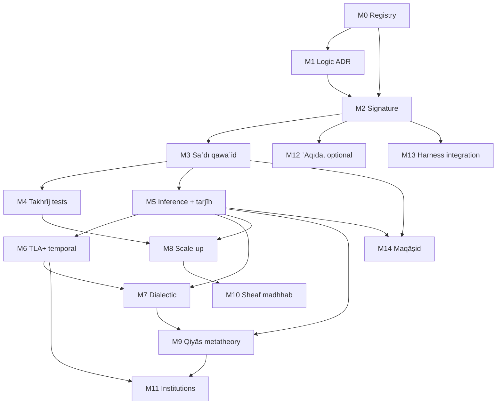

# Ḥanbalī Uṣūl Formalization — Roadmap and Milestones

<!-- BEGIN GENERATED TRACK PATHS -->
**Paths this track owns** (generated from [`roadmap-tracks.json`](roadmap-tracks.json)). A change to one updates this roadmap, or its commit says why not: `Roadmap-Unchanged: <reason>`.

| Under | Paths |
|---|---|
| `formal/lean/` | `Usul.lean`, `UsulTest.lean` |
| `formal/lean/Usul/` | `**` |
| `formal/lean/UsulTest/` | `**` |
| `formal/lean-mathlib/` | `**` |
| `formal/tla/` | `**` |
| `corpus/citations/` | `**` |
| `corpus/dossier/` | `**` |
| `corpus/fatawa/` | `**` |
| `corpus/furuq/` | `**` |
| `corpus/mahall/` | `**` |
| `corpus/nusus/` | `**` |
| `corpus/proposals/` | `**` |
| `corpus/records/` | `**` |
| `corpus/review/` | `**` |
| `corpus/sheaf/` | `**` |
| `corpus/` | `signature_map.json` |
| `corpus/takhrij/` | `**` |
| `corpus/tanaqud/` | `**` |
| `corpus/types/` | `**` |
| `corpus/typing/` | `**` |
| `pipeline/usul_corpus/` | `abwab.py`, `deduction.py`, `dossier.py`, `fatawa*.py`, `furuq.py`, `hudud.py`, `judgement.py`, `istislah_cases.py`, `m5_commands.py`, `m8_worklist.py`, `mahall*.py`, `nusus.py`, `reconcil*.py`, `records.py`, `scope.py`, `sheaf.py`, `signature_routing.py`, `takhrij.py`, `tanaqud.py` |
| `pipeline/usul_corpus/encoders/` | `**` |
| `pipeline/tests/` | `test_abwab.py` |
<!-- END GENERATED TRACK PATHS -->

## 0. Scope and thesis

**Goal.** Build a machine-checkable formalization of Ḥanbalī uṣūl al-fiqh along the silsila

```text
Ḥanbalī uṣūl line (Ibn Qudāma, al-Ṭūfī, Ibn Rajab, Ibn al-Laḥḥām, Ibn al-Najjār)
  → Ibn Taymiyya, Ibn al-Qayyim
  → al-Saʿdī, al-Shinqīṭī
  → Ibn ʿUthaymīn
```

The formalization uses five carriers, and each has one job:

| Carrier | Job | Authority (per `semantic-categorical-oracle/docs/authority-boundary.md`) |
|---|---|---|
| **Type theory** (Lean 4 core) | Signature: ḥudūd, aḥkām, adilla, judgement forms | Proof authority for stated theorems |
| **Lean 4** (+ Mathlib) | Metatheory: consistency, partitions, preference orders, argumentation semantics | Proof authority |
| **Haskell** | Executable reference interpreter, property tests, differential oracle | `advisory_oracle` until a contract is registered as `normative_semantic` |
| **TLA+** (TLC / Apalache) | Temporal and protocol structure: naskh, taklīf state, istiṣḥāb, munāẓara, review pipeline | Model-checked invariants within declared bounds only |
| **Category theory** | Compositional semantics: qiyās as factorization, sheaf gluing of local verdicts, institutions across carriers | Specification language; checked through Lean statements and Haskell laws |

**Non-authority clause.** Every output reads as *"ψ is derivable from sources S under encoding E, version v"*. None is a fatwā. Ikhtilāf is kept as data and is never collapsed by the encoding. This extends the existing repo rule that the LLM may propose but is never the deontic authority (`docs/architecture/deontic-circuits-harness.md`).

### 0.1 The logic-choice constraint (from *al-Radd ʿalā al-Manṭiqiyyīn*)

Ibn Taymiyya's critique fixes three design decisions **before** any axiom is written:

1. **No essentialist ḥadd.** A definition is a *distinguishing mark* (tamyīz). It does not capture an essence. ⇒ Definitions are discriminating predicates `d : Entity → Prop` with decidability and coverage obligations. No "real definition" is built into the kernel.
2. **Qiyās al-tamthīl is not inferior to qiyās al-shumūl.** ⇒ Analogy is a primitive inference rule. It is not encoded as a degraded syllogism. One milestone proves that the two forms are inter-convertible when the ʿilla is general (§3, L-QIY-2).
3. **Uṣūl reasoning is defeasible and proof-relevant.** ⇒ The core is a structured argumentation framework (ASPIC⁺-style) with a preference order from tarjīḥ. It is not a monotone axiomatic theory, and *which* dalīl supports a ḥukm matters, not only *that* one exists.

This rejects Standard Deontic Logic (KD) as the core: it has no defeasibility and is open to the Chisholm/Ross paradoxes. KD remains a possible *fragment*, valid for strict (qaṭʿī) rules only.

### First-principles refactor

Baseline inspected: `57a3b1c`, 2026-10-16. This migration takes priority over
expanding annotation volume. Existing proofs retain their stated scope; legacy
milestone counts below are historical until regenerated. Architecture ownership
and authority rules are in [separated concerns](architecture/separated-concerns.md#repository-wide-authority-boundaries).

| Stage | Deliverable | Acceptance gate | Status |
|---|---|---|---|
| R0 — interpretation/inference seam | Pure reconciliation kernel; shared typed JSON identity; explicit textual range gaps; compatible adapters | Wrong-type q043.f005 mutation rejected at validation and execution; all existing reconciliation outcomes preserved; Python/Lean identity agrees | Implemented in this refactor; full CI required |
| R1 — stable evidence subjects | Case-scoped position IDs, content receipts and legacy index migration | Reordering positions cannot reassign proof/grade/evidence; editing a position invalidates receipts; all associations accounted for | Interim gate implemented: 1,192 per-entry receipts checked before overlays and resolution; stable-ID migration remains open (PR-37 in #91) |
| R2 — evidence admission | Strict weighing schema, per-position search coverage, proof-bound advantages, explicit applicability/strength claims | Typo fields rejected; unsearched sides remain pending; no unsupported qaṭʿī/ijmāʿ promotion; policy changes replay in Lean/Python | Open; PR-34/36 in #91 |
| R3 — source and occurrence completeness | Context-aware quotation verification and occurrence-preserving segmentation | Negation/qualifier/word-boundary mutations rejected; repeated bāb obligations retained; every required witness replayed | Open; PR-35/40 in #91; integrate #86 on its own source gates |
| R4 — application orchestration | Split CLI handlers from source services, admission, inference and output generation | No I/O or corpus dependency enters pure modules; public commands stay compatible; source and semantic checks reported separately | Open; current CLI remains adapter |
| R5 — derived views and evaluation | Explicit generated-output inventory, grouped routing evaluation, receipt-bound explanations | Every generated file checked; held-out qāʿida metrics and prior disclosed; routing cannot assert a ruling | Open; PR-38/39 in #91 |
| R6 — remove legacy authority paths | Retire index adapters after complete migration; review acceptance transitions | No silent coercion, inferred acceptance, source skip counted as verified, or view-to-premise promotion | Open |

R0 and the R1 receipt gate do not close evidence completeness, source fidelity or scholarly acceptance.
The 53 added `outside` annotations only make already-present range gaps explicit;
no reported ruling changes. The combined #92/#93 implementation retains current proof-ranking
semantics, including comparison against a side with no recorded proof. R2 must
separate that conditional computation from evidence adequacy before promoting it.

Each later stage needs its own behavior-preserving replay, negative controls, and
explicitly reviewed semantic changes. Coordinate with open #86 (mutūn/source
restoration) and #91 (audit plan); #88 (source publication) is merged, see below; do not absorb their
content or bypass their blockers as part of this refactor. Full source verification,
Lean, Prolog and generated-output CI remain integration gates.

### Al-Shawkānī sources and the publication gate (PR #88, merged 2026-10-20)

[PR #88](https://github.com/larsbx/usul-al-fiqh-deontic-circuits/pull/88) adds
three works to the registry, each pinned and locked: al-Shawkānī's *al-Durar
al-Bahiyya* (bare matn, ShamAY 34280) and his own sharḥ *al-Darārī al-Muḍiyya*
(Shamela 7264), and Fayṣal Āl Mubārak's *al-Ghurar al-Naqiyya* (ShamAY 36516),
which prints the whole matn with its commentary as closing endnotes.

- **Segmentation (R2 mutūn).** `abwab` gains per-witness options:
  `body_headings`, where headings are body lines and `end` also matches body
  lines; `kitab_headings`, which corrects a kitāb the edition prints as a bāb
  (*al-Ghurar*'s «باب النكاح»); and `masail`, which splits each unit into its
  masāʾil. Numbered body headings («2 - باب الأذان», «5 - فصل») open their units.
  The *Durar*'s tabwīb is read from its *al-Ghurar* witness, ShamAY 36516 (128
  units split into 776 masāʾil, filed under `shawkani.durar_bahiyya` with a
  witness-level segmenter, so the bare-matn witness 34280 is not cut); a split
  unit's masāʾil, not the unit, are its obligations (PRs #118, #120).
  The code path and its owners are set out under R2 in the
  [parallel-derivation roadmap](roadmap-parallel-derivation.md); `records.py` and
  `tests/test_abwab.py` are now explicitly uṣūl paths.
  *al-Darārī* gives 127 units. Both are in the unit inventory and the
  routing index.
- **Reception.** The *Durar* has 5 citations, all in *Tamām al-Minna*; the
  *Darārī* has none. No existing count changed.
- **Publication gate.** A noncommercial label is no longer publication. The 36
  proposed modern text witnesses and the two new modern editions are `cache_only`
  until a witness-level `publication` record shows a complete-file grant bound to
  the locked sha256. The committed corpus stays at 89 legacy texts. See the
  [audit](architecture/pr88-source-publication-audit-2026-10-15.md). Held
  witnesses can be filled into the local cache from history, but never re-staged:
  see [`corpus/texts`](../corpus/texts/README.md#where-the-lfs-objects-are).
- **Fetch.** Truncated Shamela pages are retried, so long page walks no longer
  abort.

Open: edition-level grants for any held witness; splitting the other mutūn into
masāʾil (R2's next step). Nothing here is reviewed or accepted.

### Semantic tagging development follow-up (2026-10-19)

[PR #72](https://github.com/larsbx/usul-al-fiqh-deontic-circuits/pull/72)
merged on 2026-10-14. Its first 12 authored records are preserved unchanged. The
2026-10-19 continuation adds a candidate pass for the other 41 question IDs;
integration does not promote the interpretations to reviewed facts. The committed
[development report](../corpus/fatawa/semantic-propositions-report.json) records:

| Development scope | Current state |
|---|---|
| Distinct questions behind 123 IslamQA cases | 53 |
| Questions with an initial candidate pass / without one | 53 / 0 |
| Act-relative propositions / candidate roles | 365 / 1,074 |
| Proposed bank mappings | 58, all on hold |
| Candidate typed fact values | 2, unreviewed (`trust_loss.hand = trustee`, questions 4652 and 152192) |
| New kernel executions | 0 |
| Semantic accuracy / retrieval improvement | Unmeasured |

The [development protocol](semantic-tagging-development.md) ties evidence to
the pinned Arabic source, question-body spans and individual propositions.
Editorial titles cannot supply factual evidence; actors, negation and hypothetical
branches cannot be pooled to fill a fact map. These checks establish source and
structural integrity, not the correctness of an interpretation. In particular,
four years of possessing a found watch does not establish the bank's required
year of public announcement. All-question coverage is not a claim of exhaustive
segmentation: question 13717 is a general request without a concrete deposit
event, and reported claims or hypothetical events do not become established facts.

**Next work, within the existing source/interpretation/admission boundaries:**

1. Audit segmentation completeness and scope across all 53 candidate-annotated
   questions, including the original 12. Preserve distinct actors, acts,
   conditions, polarity and modality; use each new record's `review_note` as an
   advisory review prompt. The initial pass for the remaining 41 is complete;
   completeness and correctness of its interpretations remain unreviewed.
2. Independently review the authored propositions and field-specific entailment
   rationales. Record corrections and missing evidence before admitting any
   complete typed fact map; merging code or documentation is not that review.
3. Evaluate semantic tags, typed facts, encoder retrieval and kernel agreement
   separately. Preserve all subcases of a question in the same split and freeze a
   different modern question-held-out set before tuning; also check near-duplicate
   questions for leakage. These 53 published questions are development data,
   not a fresh blind test.

The October 19 continuation reverified the complete Arabic archive's size and
SHA-256, passed 58 focused tests, and passed both source-backed deterministic
generation checks. Corpus schema/registry validation also passes. The expanded
workset test rejects any attempted development kernel execution. The October 14
type-export consistency result remains prior evidence; no new formal-kernel proof
run is claimed. Historical retrieval figures, the verified original lexical replay
and later candidate routing experiments remain separate evidence
records. This annotation batch supplies no new retrieval score and does not
overturn the signature proxy's zero-weight selection. The separate typed-situation
routing experiments must not be attributed to this question-body annotation batch.

### Status (2026-10-13)

| Milestone | State | Evidence |
|---|---|---|
| M0 registry | **done for located texts** | `corpus/registry.json` (20 works, pinned witnesses), `corpus/lock.json`, `corpus/audit.json`: Ibn Rajab's 160, Ibn al-Laḥḥām's 66, al-Saʿdī's 60, the *Manẓūma*'s 103 abyāt and *Ṭarīq al-Wuṣūl*'s 1015 paragraphs confirmed (al-Saʿdī via the [OCR pipeline](architecture/ocr-pipeline.md)) |
| M1 logic core | **Abstract Lean exit proved; structured layer proposed** | `Usul.Dung`: admissibility preserved by `F`, grounded ⊆ every complete extension. [ADR 0001](architecture/adr-0001-logic-core.md) chooses structured argumentation over Dung AFs (SDL/KD only for the strict fragment), awaiting review; for finitary AFs `grounded` is proved the unique least complete extension (`grounded_complete`, `grounded_unique`), and for finite AFs every admissible set extends to a preferred one (`exists_preferred_superset`) |
| M2 signature | **seeded** | 26 ḥudūd extracted from *al-Uṣūl*; `Usul.Hukm` / `Usul.Signature`; Σ map checked on both sides |
| M3 qawāʿid | **al-Saʿdī catalogued; 60 of 60 formalised** | `corpus/proposals/sadi_qawaid.json` (all 60: statement, gloss, kind, domain; candidate status, awaiting human review); `Usul.Sadi`: Q1, 2, 4, 6, 8, 11, 16, 22/23, 27, 28, 33, 38, 40, 52, 58, 59, 60, with proved theorems; `Usul.Muamalat`: Q10, 12–14, 18–21, 24–26, 30, 32, 35–37, 42–47, 49, 51, 53–56 (possession, liability, contract), with consistency theorems Q13 ⇔ Q36, Q43 ⊑ Q26, Q51 ∥ Q54 and Q42 as an instance of Q21; `Usul.Kulliyyat`: Q5, 9, 15, 17, 29, 31, 34, 39, 41, 48, 50, 57 (custom, intent, utterance, cause and condition in time); `Usul.Schema`: 39 (rule, schema) pairs, 38 rules, over eight transportable shapes, pinned in `UsulTest/Schemata.lean`; 12 interpretive commitments surfaced for the Sharīʿah-authority gate, each with cited established answers (the cited answers contradict the reading in 2 questions, refine it in 8, agree in 2) and analogies (`corpus/review/`); the review runs on its own principles where stratified (`Usul.Process`); `Usul.Qiyas`: masālik al-ʿilla and qawādiḥ with soundness theorems, disputed points as parameters with established positions cited (IQ-13 to IQ-16), and 23 classical qiyās sources pinned; `Usul.Jadal`: the eighteen objections as one gate with «all reduce to manʿ or muʿāraḍa» proved as `debateGate_holds_iff`; 241 verified citations ground every theorem of the qiyās modules (`corpus/citations/`); `Usul.QiyasLimits`: fallibility, scope, jalī/khafī, tamthīl ≡ shumūl ([`schemata.md`](architecture/schemata.md)); Haskell mirror `Oracle.Usul.Sadi` |
| M4 tests | **first tranche checked** | harness (`usul_corpus/takhrij.py`, Lean-guarded); 204 furūʿ for 15 readings (Ibn Rajab under the qawāʿid al-Saʿdī compresses, Ibn al-Laḥḥām 52–54 for generality): coverage 0.873, madhhab coverage 0.534, after four self-application rounds (ʿahd-aware generality; conservative refinements; the open gaps' own principles, twice, all in `Usul.Refinements`): 214 cases, coverage 0.977, madhhab coverage 0.648, 0 encoding errors (from 7), 5 open gaps in the ledger (naming and policy points, and one case with no transmitted ruling), 29 cases revisited, see [`takhrij.md`](architecture/takhrij.md). Every closure is cited in the [dossier](architecture/dossier.md); terms in the [glossary](glossary.md) (75 terms, 159 verified excerpts). Ibn al-Laḥḥām's uṣūl rules wait for M5 |
| M8 scale-up | **tranches 1–11 and lane A rounds 1–6 encoded; human review open** | lane A round 6 (parallel, five shards): qawāʿid 147, 149–158 (103 records, `rajab_m8_rajab_a21…a25_furu.json`): coverage 1.000, madhhab coverage 0.845, no new gaps, every ikhtilāf with a tarjīḥ; lane A round 5 (parallel, four shards): qawāʿid 132, 134, 136–139, 141–146 (92 records, `rajab_m8_rajab_a17…a20_furu.json`): coverage 1.000, madhhab coverage 0.826, no new gaps, every ikhtilāf with a tarjīḥ; lane A round 4 (parallel, four shards): qawāʿid 119–126, 128–131 (80 records, `rajab_m8_rajab_a13…a16_furu.json`; Q127 in `rajab_m8_q127_furu.json`): coverage 1.000, madhhab coverage 0.738, no new gaps; lane A round 3 (parallel, four shards): qawāʿid 107–118 (89 records, `rajab_m8_rajab_a9…a12_furu.json`): coverage 1.000, madhhab coverage 0.764, no new gaps; lane A round 2 (parallel, four shards): qawāʿid 94–102, 104, 105 (89 records, `rajab_m8_rajab_a5…a8_furu.json`): coverage 1.000, madhhab coverage 0.888, no new gaps; lane A round 1 (parallel, four shards): qawāʿid 53, 60, 67, 69, 71, 72, 73, 74, 77, 78, 79, 80, 81, 90, 92 (91 records, `rajab_m8_rajab_a1…a4_furu.json`): coverage 1.000, madhhab coverage 0.813, no new gaps; tranche 11: qawāʿid 55, 57, 59 (22 records, `rajab_m8_tranche11_furu.json`): coverage 1.000, madhhab coverage 0.909, no new gaps; tranche 10: qawāʿid 52, 54, 56, 58, 61, 62 (19 records, `rajab_m8_tranche10_furu.json`): coverage 1.000, madhhab coverage 0.737, no new gaps; tranche 9: qawāʿid 36, 42, 43, 46, 49, 50, 51 (16 records, `rajab_m8_tranche9_furu.json`): coverage 1.000, madhhab coverage 0.938, no new gaps; tranche 8: qawāʿid 4, 11, 14, 15, 19 (27 records, `rajab_m8_tranche8_furu.json`): coverage 1.000, madhhab coverage 0.852, no new gaps; tranche 7: qawāʿid 3, 5, 9, 10, 12 (24 records, `rajab_m8_tranche7_furu.json`): coverage 1.000, madhhab coverage 0.667 after reconciliation, no new gaps; tranche 6: qawāʿid 35, 37, 38, 39, 41 (24 records, `rajab_m8_tranche6_furu.json`): coverage 1.000, madhhab coverage 0.417 (on 38 the marked madhhab follows the wording), no new gaps; tranche 5: qawāʿid 25, 29, 30, 32, 33, 34 (27 records, `rajab_m8_tranche5_furu.json`): coverage 1.000, madhhab coverage 0.704, no new gaps; tranche 4: qawāʿid 2, 20, 21, 24 (21 records, `rajab_m8_tranche4_furu.json`): coverage 1.000, madhhab coverage 0.571, no new gaps; unified tranche 3: all 29 candidates under qawāʿid 1, 17, 31, 47, 66, 91, 93; PR #32's list-and-division segmentation and PR #31's hash-pinned worklist, source receipts and contrast guards are preserved. Tranche 2 (merged #30): qawāʿid 7, 27, 28, 64, 65, 25 records; tranche 1: qawāʿid 6, 22, 68, 26 records with opening examples. Current aggregate metrics and remaining counts come from the generated scope table below; exact IDs and source obligations are in `corpus/worklists/`. After tranche 3, round 5 applied the bank to its own gaps: 8 of 14 closed, each cited in the dossier (see [`takhrij.md`](architecture/takhrij.md)). All interpretation questions remain open; [reconciliation audit](architecture/m8-tranche3-reconciliation-2026-10-08.md) |
| M5 tarjīḥ | **schemata in; differential exit met** | the carriers agree on 10⁴ generated AFs: Python, Lean (`UsulTest/GroundedStress.lean`, `#guard`) and the Haskell oracle (`usul.af.grounded-stress-v1`) regenerate them from one seeded LCG (`formal/fixtures/grounded-stress-v1.json`) and reproduce the digest of every grounded extension; `Usul.Taarud` resolution order, applied by `Usul.Reconcile` to the bank's own 598 ikhtilāf cases, every one with a tarjīḥ (graded, with 2,118 verbatim items imported from al-Inṣāf, Taṣḥīḥ al-Furūʿ and the later muʿtamad; 325 confirm their on-madhhab annotation: 20 jamʿ (qāʿidas 3, 5, 10, 16, 37, 50, 52, 59, 61, 64–65 refined by cited farqs), 1 naskh, 561 tarjīḥ, 14 tawaqquf; the 171 residues are the refinement worklist, see [`taarud-reconciliation.md`](architecture/taarud-reconciliation.md); lane D verified every earlier on-madhhab side: 90 of 100 agree, 6 entered the ledger); `Usul.Dalala`: ʿahd-aware generality, takhṣīṣ (not naskh), muṭlaq/muqayyad, amr/nahy defaults, al-amr bi'l-shayʾ nahy ʿan ḍiddih from σ, mafhūm with blockers, ≺ strict and well-founded; applied back to M4 (4 gaps closed, see [`takhrij.md`](architecture/takhrij.md#the-bank-applied-to-itself)) |
| M6 TLA+ | started | Istishab, Taklif, Naskh, Review: all pass TLC, and each was mutation-checked |
| Types (T2, judgement form) | **every encoder typed** | `Usul.Typing.Qaida`: one type per qāʿida with exactly the facts it states (the qawāʿid define the types), `Situation` their join, encoders as `Typed S O`; `Usul.Judgement`: the judgement form, and each encoder's sort and question in `corpus/types/encoders.json`, guarded in `UsulTest/EncoderTypes.lean`. See [`judgement.md`](architecture/judgement.md) |
| M9 qiyās metatheory | **both lemmas proved; Haskell laws open** | L-QIY-1 in `Usul.Cat.Factor`: ʿilla valid ⇔ the ruling factors through it (functor `ker e ⥤ disc β`, `Ĥ ∘ e`, and on the given cases), failure ⇔ naqḍ witness, qiyās determined by an attested aṣl and free without one; L-QIY-2 is `QiyasLimits.tamthil_iff_shumul`. Over the types: `Usul.Cat.Typing.judge_factors`, where a typed encoder's ruling factors through its qāʿida type's projection. See [`category-theory.md`](architecture/category-theory.md) |
| M8 maḥall (PR-51) | **every case placed; anchors graded** | every case of the bank names the maḥall its ruling falls on: 1,216 cases under 537 labels in the 57 bābs; 525 labels anchored to a verbatim āya, ḥadīth of the six books or al-Mughnī's ijmāʿ, 12 unanchored as jurists' constructs. `Usul.Mahall` proves a qāʿida's footprint is the least up-closed set of its furūʿ's maḥalls; `UsulTest.MahallGraph` checks all 178 footprints and grounds. The ḥadīth and athar anchors are graded from al-Albānī's works (ḥadīth track, H8), and `Usul.Seam.admitted` gates them: 681 of 725 texts are ḥujja, every qāʿida keeps a ḥujja ground, 18 labels rest only on texts he grades weak. See [`mahall.md`](architecture/mahall.md) |
| M10 sheaf madhhab | **exit met for one-point covers** | `Usul.Cat.Sheaf`: verdict presheaf on contexts, gluing ⇔ matching with unique glue, failure ⇔ ikhtilāf `Obstruction`; finite `obstructions` records, empty ⇔ glues; vector on Ibn Rajab Q2 f2; `positions_glue_iff` (a case's positions glue iff they agree) and `usul_corpus sheaf`: every `genuine_ikhtilaf` case emits obstruction records in `corpus/sheaf/obstructions.json` (totals in its generated summary), each guarded in `UsulTest/Obstructions.lean`. `Usul.Cat.Scales`: σ as `hukmCat ≅ hukmCatᵒᵖ`, the ḥadīth seam as a functor, ḥujja an up-set |
| M11 oracle | started | `semantic-categorical-oracle` `Oracle.Usul.*` advisory laws; three-way agreement on `grounded-v1.json` |
| M11 institutions | **Lean and TLC linked; Haskell open** | `Usul.Cat.Institution`: institutions, comorphisms (composing), borrowing (consequence preserved, and reflected when model maps are onto); `Usul.Cat.Carriers`: `propI` / `traceI` / `execI` on Boolean-state signatures, comorphisms `compile` and `initial`, `□` statewise, `entailsB` complete; `Taklif.tla` invariants and satisfaction conditions checked on fixtures (`UsulTest/Institutions.lean`); the fixture behaviour is replayed by TLC through Taklif's actions (`TaklifTrace.tla`, generated with its Lean twin by `gen_taklif.py`). See [`category-theory.md`](architecture/category-theory.md) |
| M14 maqāṣid | **readings proved, two encoders, seven candidate cases; policy points open** | `Usul.Readings.Maqasid` (PR #119, merged 2026-10-21): three ranks, the five kulliyyāt (four lists proved to agree), preservation from wujūd and ʿadam, the Rawḍa's deterrents, istiṣlāḥ with three stances pinned, al-Shāṭibī's complement condition, the dependence of the ranks, and al-Kawkab's order in tarjīḥ; encoders `istislah`, `maqasid_tarjih`; al-Lajna qa09648, qa06346 plus five source-located al-Mustaṣfā cases (31 conditional istiṣlāḥ completion checks); 0 reviewed new conclusions; 3 dossier entries (39 verbatim excerpts). See M14 in §3 |

<!-- BEGIN GENERATED M8 SCOPE -->
**Current M8 inventory (generated).** 1,189 segmented Ibn Rajab furūʿ records = 1,189 annotated + **0 awaiting annotation**. Of 160 qawāʿid, 154 have segmented records: 154 are fully annotated and **0 await annotation**. The other **6 need source segmentation review**; zero emitted records does not establish zero examples in the text.

The unit is a committed farʿ record, which can contain multiple examples. Annotated gaps and disagreements are already counted as annotated; annotation does not mean independently reviewed or scholarly accepted. No count is imputed for unsegmented examples. The exact ID worklist and input hashes are in `corpus/worklists/rajab_m8.json`; rebuild with `python -m usul_corpus m8-worklist`.

| Current scope (generated) | Cases | Coverage | Decided coverage | Disputed | Encoding errors | Open gaps |
|---|---|---|---|---|---|---|
| Combined M8 tranche 3 | 29 | 1.000 | 1.000 | 21 | 0 | 0 |
| All annotation suites | 1263 | 0.952 | 0.894 | 684 | 0 | 61 |

Coverage counts derivability under the candidate encoding. Decided coverage scores the kernel only on cases that state one ruling; disputed cases are weighed by their evidence, not by who holds a position. Neither metric establishes scholarly acceptance.
<!-- END GENERATED M8 SCOPE -->

Pipeline details: [`architecture/formalization-pipeline.md`](architecture/formalization-pipeline.md).

**M5 command capabilities (2026-10-09).** Four candidate schemata now express the named
readings in Ibn al-Laḥḥām 43.f001, f003, f004 and f007, with full-source replay, original
case receipts and explicit open interpretation questions. The four live command gaps
and the other two gaps remain open; capability fixtures add no annotations to the
generated aggregate above. Writing is not extended to gesture, conditional imitation is
preserved, and command naming does not change a given intended ruling. See the
[source contrasts and replay instructions](architecture/m5-command-schemata-2026-10-09.md).

---

## 1. Source → layer map

| Layer | Primary sources | Formal role |
|---|---|---|
| **Σ — signature** | Ibn ʿUthaymīn, *al-Uṣūl min ʿIlm al-Uṣūl* + sharḥ; Ibn Qudāma, *Rawḍat al-Nāẓir*; al-Ṭūfī, *Sharḥ Mukhtaṣar al-Rawḍa*; Ibn al-Najjār, *Sharḥ al-Kawkab al-Munīr* | Sorts, constructors, ḥudūd as predicates |
| **Ax — qawāʿid** | al-Saʿdī, *al-Qawāʿid wa'l-Uṣūl al-Jāmiʿa* (≈60, + furūq, taqāsīm); Ibn ʿUthaymīn, *Manẓūma* + sharḥ; Ibn Rajab, *Taqrīr al-Qawāʿid* (≈160); Ibn Taymiyya, *al-Qawāʿid al-Nūrāniyya*; al-Saʿdī, *Ṭarīq al-Wuṣūl* | Defeasible rules + exceptions; partitions as proved case splits |
| **⊢ — inference** | *Rawḍa*, *al-Uṣūl*, Ibn al-Qayyim's *Iʿlām* (Aḥmad's five uṣūl, qiyās, ḥiyal) | Rule schemata: qiyās, ʿāmm/khāṣṣ, muṭlaq/muqayyad, naskh, amr/nahy, mafhūm, taʿāruḍ → tarjīḥ |
| **T — tests** | Ibn al-Laḥḥām, *al-Qawāʿid wa'l-Fawāʾid al-Uṣūliyya* (takhrīj al-furūʿ ʿalā al-uṣūl); *Iʿlām* (≈99 sadd al-dharāʾiʿ instances); *al-Sharḥ al-Mumtiʿ* | Golden entailments `rule ⊢ farʿ`; regression corpus with explicit tarjīḥ |
| **Dial — dialectic** | al-Shinqīṭī, *Ādāb al-Baḥth wa'l-Munāẓara*, *Mudhakkira*; qawādiḥ chapter of the *Rawḍa* | Dialogue game; objections as attack types |
| **ʿAq — ʿaqīda** (optional, firewalled) | Ibn ʿUthaymīn, *al-Qawāʿid al-Muthlā*; Ibn Taymiyya, *al-Tadmuriyya* + *Taqrīb* | Separate theory; predication constraints |

**Suggested addition (flagged, not from the source list):** al-Mardāwī, *al-Inṣāf* / *Taṣḥīḥ al-Furūʿ*, as the intra-madhhab tarjīḥ oracle. It distinguishes the riwāyāt from Aḥmad from the muʿtamad. That distinction maps directly onto *preferred extensions* versus a *selection function* (M5).

---

## 2. Formal kernel sketch

### 2.1 Signature (type theory)

Taklīfī status, with an involution for the status of omission (*al-amr bi'l-shayʾ nahy ʿan ḍiddih*):

```text
Ḥukm  ::= W | N | M | K | Ḥ          -- wājib, mandūb, mubāḥ, makrūh, ḥarām
σ : Ḥukm → Ḥukm,  σW = Ḥ, σN = K, σM = M, σK = N, σḤ = W
Law:  σ ∘ σ = id,  σ antitone on the order  Ḥ < K < M < N < W  read off reward and liability for doing and leaving
```

Waḍʿī structure as a dependent precondition:

```text
applies : (a : Act) → (s : Subject) → Sabab a s → Sharṭ a s → ¬ Māniʿ a s → Ḥukm
Mukallaf s  :≡  Bāligh s ∧ ʿĀqil s            -- refinement type, not a flag
```

Judgement form (proof-relevant):

```text
Γ ⊢ d : H(a, s) @ g
  d : Dalīl     -- the evidence term (naṣṣ, ijmāʿ, qawl ṣaḥābī, qiyās, istiṣḥāb, …)
  g : Grade     -- epistemic strength: qaṭʿ > ẓann_ghālib > shakk > wahm
```

`Derivation : Type` is used, not `Prop`. Tarjīḥ compares derivations, so proof irrelevance would erase the object of study.

Formalised as `Usul.Judgement` (question, answer typed by the question, subject, domain, grade, dalīl kinds): see [judgement.md](architecture/judgement.md).
Downstream of the types, `Usul.Cat` gives their compositional semantics (scales, factorization, gluing, institutions): see [category-theory.md](architecture/category-theory.md). Both rest on the qawāʿid ([schemata.md](architecture/schemata.md)).

Sort-indexed defaults: one qāʿida with two domains.

```text
default : Domain → Ḥukm
default ʿĀda   = M     -- al-aṣl fī'l-ashyāʾ al-ibāḥa
default ʿIbāda = Ḥ     -- al-aṣl fī'l-ʿibādāt al-tawqīf
```

### 2.2 Adilla precedence (Aḥmad's uṣūl per *Iʿlām*)

```text
naṣṣ  ≻  fatwā ṣaḥābī (no known dissent)  ≻  closest ṣaḥābī view to naṣṣ
      ≻  mursal / ḍaʿīf (non-fabricated)  ≻  qiyās (by necessity)
istiṣḥāb : fallback default (frame axiom)
```

### 2.3 Argumentation core

```text
AF   = (Args, ⇀, ≺)               -- ⇀ attack, ≺ preference from tarjīḥ
Rule = Strict  (φ₁…φₙ → ψ)        -- qaṭʿī only
     | Defeas  (φ₁…φₙ ⇒ ψ) ∖ E     -- E = mustathnayāt (exceptions)
Semantics:
  grounded extension  ↔  the uncontested core
  preferred extensions ↔  admissible aqwāl / riwāyāt
  selection function  ↔  muʿtamad (al-Mardāwī)
```

### 2.4 Conflict resolution (taʿāruḍ), as an ordered fallback

```text
resolve = jamʿ <|> naskh <|> tarjīḥ <|> tawaqquf
```

In Haskell this is literally an `Alternative` chain. Lean proves that it is total and that `tawaqquf` is reached only when all earlier steps fail.

### 2.5 Qiyās (category-theoretic reading)

```text
Case        -- category of case descriptions; morphisms preserve features
π_e : Case → Feat     -- projection onto the candidate ʿilla e
H   : Case → Ḥukm     -- ruling assignment (partial, from naṣṣ)

ʿilla e is valid  ⇔  H factors through π_e   (H ≅ Ĥ ∘ π_e on the known cases)
qiyās(aṣl, farʿ)  :≡  π_e(aṣl) = π_e(farʿ)  ⇒  H(farʿ) := Ĥ(π_e(farʿ))
naqḍ              :≡  a witness against factorization (e present, H differs)
```

Each qawādiḥ objection (naqḍ, kasr, ʿadam al-taʾthīr, qalb, fasād al-iʿtibār, fasād al-waḍʿ, manʿ wujūd al-ʿilla, farq) becomes a typed attack on one premise of this factorization claim.

---

## 3. Milestones

Notation: **Exit** criteria are machine-checkable unless marked *(review)*. `⟵` lists hard dependencies.

### Phase I — Foundations

#### M0 · Corpus registry and provenance ⟵ —
- Pin editions (publisher, year, taḥqīq) for every source in §1. **Verify the rule counts** (60 / 160 / 7+7+4 / …) against the pinned edition, because the current counts come from recall.
- Locator scheme `src:<work>/<edition>/<vol>:<page>:<rule#>`. Pick one transliteration standard and use it everywhere (ALA-LC or IJMES).
- Extend `schemas/` with `usul_rule.schema.json`: id, locator, Arabic text, gloss, rule-kind, exceptions, cross-refs, status ∈ {candidate, reviewed, accepted, quarantined}.
- **Exit:** a schema-valid registry; every record has a resolvable locator; CI rejects orphans.

#### M1 · Logic decision record ⟵ M0
- An ADR that compares SDL/KD, input/output logic, Governatori's DDL, and ASPIC⁺ against the three constraints in §0.1.
- **Exit:** the ADR is merged *(review)*. Lean has a `Dung` module with these results proved: the grounded extension exists, is unique, and is conflict-free; admissible ⊆ preferred.

**M1 scope review (2026-10-13).** [ADR 0001](architecture/adr-0001-logic-core.md#independently-checked-semantic-boundary-2026-10-13) separates proved abstract AF properties from candidate jurisprudential interpretations. Preferred existence is finite and may yield only the empty set; stable extensions may not exist. Stable semantics is optional and requires an existence check or a separately proved sufficient assumption. Grounded is not a definition of ijmāʿ.

**Remaining integration obligations:** source-linked structured derivation terms; typed attacks and preference-to-defeat compilation; subargument/provenance preservation; preferred-family encoding for M4 disagreements; a versioned selection policy with ties/abstention for muʿtamad if needed; final executable grounded stabilization/equality with endpoint bounds; and M7's dialogue correspondence. Existing graded ruling selection and extensional tamthīl/shumūl equivalence do not discharge these obligations. The 10⁴-case differential exit covers grounded fingerprints only. The ADR remains proposed; development can continue with accurate candidate labels.

#### M2 · Signature kernel (Σ) ⟵ M0, M1
- Base text: Ibn ʿUthaymīn's *al-Uṣūl*. Cross-check against the *Rawḍa* muqaddima and *al-Kawkab*.
- Lean: the `Usul.Signature` sorts from §2.1. Haskell: mirror ADTs. JSON Schema is the interchange format, and the Lean and Haskell types are checked by round-trip conformance on shared fixtures. This keeps DRY at the boundary without fragile code generation.
- **Exit:** these Lean lemmas are proved: `σ_involutive`, `σ_antitone`, `mukallaf_required`. Every ḥadd in *al-Uṣūl* exists as a decidable predicate with ≥1 positive and ≥1 negative fixture. Haskell and Lean agree on 100% of the fixtures.

### Phase II — Kernel

#### M3 · Qawāʿid kernel, al-Saʿdī's set (Ax) ⟵ M2
- Classify each rule: `meta` (over adilla) | `default` (with exceptions) | `taqsīm` (partition) | `farq` (distinction) | `closure`.
- Priority rules, all of which can be checked:
  - *al-yaqīn lā yazūl bi'l-shakk* → a grade-monotonicity law: an override needs grade ≥ the incumbent's.
  - *mā lā yatimm al-wājib illā bihi fa-huwa wājib* → closure under necessary means, *jointly consistent* with *lā wājib maʿa ʿajz* (ought ⇒ can).
  - *al-ḍarūra tubīḥ al-maḥẓūrāt* + *tuqaddar bi-qadarihā* → a defeater with a proportionality bound.
  - *al-wasāʾil lahā aḥkām al-maqāṣid* → a monotone map, means → ends.
  - *al-mashaqqa tajlib al-taysīr* → rukhṣa activation by sabab.
- **Exit:** every rule has a Lean statement, a Haskell executable, and ≥1 test. Every taqsīm is proved **exhaustive ∧ disjoint**. The closure ∧ ought-implies-can fragment is proved consistent: a model exists in Lean.

#### M4 · Takhrīj test suite (T) ⟵ M3
- Encode Ibn al-Laḥḥām's rule → furūʿ pairs as golden entailments.
- Classify each failure as one of `missing_fact` | `missing_rule` | `genuine_ikhtilāf` | `encoding_error`.
- **Exit:** the suite runs in CI and reports coverage = derivable / total. `encoding_error = 0` before Phase III begins. `genuine_ikhtilāf` cases are recorded as multiple preferred extensions, not as failures.

#### M5 · Inference schemata and tarjīḥ (⊢) ⟵ M3
- ʿĀmm/khāṣṣ and muṭlaq/muqayyad as specificity attacks. Amr ⇒ wujūb ∧ fawr and nahy ⇒ taḥrīm ∧ fasād as defeasible defaults. Mafhūm al-mukhālafa with its blocking conditions.
- Tarjīḥ: a preference relation ≺ over derivations.
- **Exit:** `≺` is proved to be a strict partial order and well-founded on finite AFs. Lean proves `resolve` total (§2.4). The *al-amr bi'l-shayʾ nahy ʿan ḍiddih* theorem is proved from σ. Haskell QuickCheck agrees with Lean `#eval` on 10⁴ generated AFs.

#### M6 · Temporal layer (TLA+) ⟵ M5
| Spec | Invariants / properties |
|---|---|
| `Naskh.tla` | An abrogated ruling is never active. nāsikh is later than mansūkh. Ijmāʿ indicates naskh but does not perform it. |
| `Taklif.tla` | `Obligated(a,s) ⇒ Mukallaf(s) ∧ Capable(a,s)`. A rukhṣa is active only while its sabab holds. |
| `Istishab.tla` | A `Doubt` event leaves the state `UNCHANGED` (al-yaqīn lā yazūl bi'l-shakk as a frame axiom). |
| `Tahara.tla` | A worked ʿibāda: nawāqiḍ transitions, validity of ṣalāt conditioned on the ṭahāra state. |
| `Review.tla` | Repo harness rule: `Accepted(r) ⇒ ∃ human review(r)`. Quarantined records never support a derivation. |
- **Exit:** TLC/Apalache pass within the declared bounds in CI. Each spec has a refinement mapping or fixture link to the Haskell interpreter.

### Phase III — Scale and dialectic

#### M7 · Dialectic engine (Dial) ⟵ M5, M6
- al-Shinqīṭī's moves (manʿ, naqḍ, muʿāraḍa, …) plus the qawādiḥ as typed attacks (§2.5). Roles: mustadill (proponent) and sāʾil (opponent), with burden of proof.
- `Munazara.tla`: legal-move safety, plus liveness under fairness (it terminates in ilzām, ifḥām, or ʿajz).
- **Exit:** Lean proves the soundness and completeness link: *the proponent has a winning strategy ⇔ the argument is in the grounded extension* (the dialogue-game correspondence, specialized to this AF). Haskell plays the games on the M4 fixtures.

#### M8 · Corpus scale-up ⟵ M4, M5
- Ibn Rajab's *Taqrīr* (≈160), the *Manẓūma*, *al-Qawāʿid al-Nūrāniyya*, *Ṭarīq al-Wuṣūl*. Deduplicate against M3 with an explicit `same_as` / `refines` / `conflicts` graph.
- Regression corpora: the *Iʿlām* sadd al-dharāʾiʿ instances (≈99) and the ḥiyal cases; the furūʿ from *al-Sharḥ al-Mumtiʿ* with the author's tarjīḥ as expected output.
- Stress test: al-Ṭūfī on maṣlaḥa versus naṣṣ, as a known point of conflict.
- **Seed of the `conflicts` graph (2026-10-10): the bank applied to its own contradictions.** Ten pairs from al-Saʿdī's 60 rule opposite ways on a shared case when each rule is read without its qayd. The pairs are Q13/Q27, Q20/Q25, Q31/Q41, Q55/Q57, Q17/Q39, Q4/Q40, Q21/Q50, Q11/Q52, Q12/Q45 and Q10/Q26. Each is resolved by the bank itself: by `Usul.resolve` and by Q29 (read a rule with what is attached to it). In every pair the qayd is the author's own sentence, quoted from one of the two qawāʿid and located in `corpus/tanaqud/sadi.json`. All ten reach jamʿ, so none needs naskh, tarjīḥ or tawaqquf. `Usul.Tanaqud` proves three things for each pair: the clash is real, the jamʿ is what resolution takes, and the jamʿ coincides with the rules' existing encodings (`obligedParts`, `timelyPerformance`, `discharges`, `zahirPrevails`, the presumption-based burden). Three pairs proved earlier are listed with them: Q13/Q36, Q26/Q43 and Q51/Q54. Checked by `tests/test_tanaqud.py`.
- **al-Saʿdī's furūq, tranche 1 (2026-10-10).** Part two of the same book is the author's own list of masāʾil that look alike but are ruled differently. Each is graded by its aṣl: «الشارع لا يفرق بين المتشابهات من كل وجه، بل لا بد فيها من فوارق معنوية». In `Usul.Furuq` that aṣl is `Schema.Factors`: `alike_unless_farq`, `farq_is_maana`, `suri_farq_idle`. Items F01–F21 are in order, none skipped (`corpus/furuq/sadi_tranche1.json`): 10 sound furūq, 7 weak furūq (ruled alike), and 4 masāʾil the madhhab wrongly treats alike. Where his reason is already a theorem of the bank it is cited and proved:
  - F06 is a naqḍ (`Qiyas.naqd_defeats`);
  - F13 and F15 rest on T-01's qayd (God's right);
  - F18 is Q27;
  - F20 fails the ḥadīth gate (D4).
  Witness: `islamhouse-qj-doc`, the same edition born-digital (the book is not on Shamela). The tanāquḍ quotes were re-anchored on it.
- **Furūq tranche 2 (F22–F41) and a correction to the bank.** 4 sound, 15 weak, 1 wrongly ruled alike. Where his reason is a qāʿida of part one it is cited by its theorem: Q9 (custom: F25, F33, F41), Q22/Q23 (conditions: F23, F26), Q53 (F30), Q10/Q55 (F32, F36) and Q56 (F37). F37 exposed a contradiction between the bank and its author. Q56 had been encoded with khiyār al-sharṭ and an unclaimed shufʿa excepted. But Q56's own statement marks that exception «في قول ضعيف» and concludes «والصحيح: أنها مثل غيرها», and the furūq call it «من الفروق الضعيفة جداً». So Q56 is now a parameter in the repo's manner for a divided madhhab: `inherits .sahih` is al-Saʿdī's reading, with no exception, and `.mashhur` keeps Aḥmad's well-known view; `q56_readings_differ_iff` pins where they part. No other encoding builds in a farq that he grades weak.
- **Furūq tranche 3 (F42–F60).** 15 sound, 4 weak. The section turns from correcting the madhhab to confirming it: most of these furūq rest on a stated wisdom (ḥikma) or on naṣṣ and ijmāʿ. The weak ones are:
  - the slave and the free man in bodily duties: «فظاهر النصوص وعمومها يقتضي مساواة العبد للحر»;
  - khulʿ versus divorce of a part;
  - a waqf in the final illness for an heir: «الخارقة للإجماع … عين الوصية للوارث»;
  - tayammum versus water purity: «قائمة مقام طهارة الماء في كل شيء» (Q28; the bank's Q28 encodes only when the substitute is used).
  F59 rests on Q47 (`q47_vow_as_law`). Running tally over F01–F60: 29 sound, 26 weak, 5 wrongly treated alike. Every item's two rulings are checked by Lean (`UsulTest/FuruqTable.lean`) and by the Prolog oracle.
- **Q28 completed, and furūq tranche 4 (F61–F75).** Q28's first half is now encoded: «يستباح به ما يستباح بالماء … وأنه يقوم مقامه في كل شيء» is `Sadi.q28_stands_in_everything`, and F51 (tayammum) cites it. Tranche 4 has 13 sound items and 2 weak:
  - F64: oaths broken in ignorance or forgetfulness, «والصواب: التسوية وأنه لا يحنث في الجميع … فإن الحق لله، وأيضاً ليس في ذلك إتلاف لمال». This is T-01's qayd again, with Q27.
  - F71: the madhhab's seven washings except on the ground, against «يكفي فيها على الصحيح أن تزول بأي شيء، وبأي عدد».
  Where a reason is a qāʿida of part one, the item cites it: Q47 (F61), Q55/Q57 by way of T-04 (F65: court by the outward words, conscience by intent), Q34 (F66), Q6 and Q54 (F69). Running tally over F01–F75: 42 sound, 28 weak, 5 wrongly treated alike.
- **Furūq tranche 5 (F76–F96).** 19 sound, 2 weak. The weak ones:
  - F88: guardianship of property reserved to the father, against «ما للأقارب من الحنو والشفقة يقتضي أن ولاية المال كغيره من الولايات، بل أولى».
  - F92: pre-emption lost by any delay. Its supporting ḥadīths «كلها ضعيفة، لا تقوم بها حجة», so the ḥadīth gate (D4) decides the farq, as in F20.
  Items grounded in part one: Q30 (F87), Q26/Q43 (F89), Q32 (F90), Q31 (F94, which is Q31's own example of the child following each parent). Running tally over F01–F96: 61 sound, 30 weak, 5 wrongly treated alike.
- **Furūq tranche 6 (F97–F115), and a fourth grade.** Some furūq he only reports («وفرّقوا», «ومن الفروق عند الأصحاب») without grading them. These are now `reported`: his ruling is recorded as theirs and nothing more is attributed to him. F95, earlier recorded as sound, is now reported. `Usul.Furuq.confirms_iff_sahih` now says his ruling matches the madhhab exactly on the sound and the reported items. The tranche has 10 sound, 7 reported, and 1 wrongly treated alike: F114, mixed lawful and unlawful money versus carrion mixed with slaughtered meat, «خبثه لمكسبه … خبثه لذاته، وبين الأمرين فرقٌ ظاهر». Items grounded in part one:
  - Q46 (F108), Q13 (F109), Q2 (F110), Q31 (F111);
  - Q11 (F113: a settled duty in doubt versus whether a duty arose);
  - Q38 (F115, stated in Q38's own words).
  Running tally over F01–F115: 71 sound, 30 weak, 6 wrongly treated alike, 8 reported.
- **Furūq tranche 7 (F116–F136).** 8 sound, 8 reported, 5 weak. The weak ones:
  - F121: tayammum for bodily impurity, «لاستواء النجاسات في عدم ورود النص بها»;
  - F128: the madhhab's extra places where prayer is invalid, «أقرب إلى الصواب … أنها تصح فيها»;
  - F129: the four-day rule for ending travel, «ليس لنا مرتبة ثالثة لا مقيم ولا مسافر»;
  - F134: zakāt to an heir relative;
  - F136: the old man who travels, «عليه الكفارة لظاهر النصوص».
  Running tally over F01–F136: 79 sound, 35 weak, 6 wrongly treated alike, 16 reported.
- **Furūq tranche 8 (F137–F166): the taqāsīm, to the end of part two.** 17 sound, 7 reported, 6 weak. In each weak item he restates the aṣḥāb's division, then calls the other view correct on one branch:
  - F140: unripe fruit sold to the owner of its trees, «أصح المنع … لدخولها في العموم وعدم المعارض»;
  - F142: the mithlī as only the measured and the weighed, «وهو الصحيح: أن المثلي أعم من ذلك»;
  - F144: a pledge before possession, «بلزومه مطلقاً، وهو الصحيح»;
  - F146: the slave's dealings without permission, on his dhimma «على القول الصحيح»;
  - F155: a part freed by an insolvent partner, «يعتق كله، ويستسعى العبد … وهو الصحيح»;
  - F165: a wife under nine, «وظاهر الأدلة وجوبها».
  The closing remark on the twenty-odd furūq of nikāḥ («قد ذكرتها في كتاب الإرشاد») names no cases and is not an item. Final tally over F01–F166: 96 sound, 41 weak, 6 wrongly treated alike, 23 reported. Part two is complete.
- **The register applied to itself (F01–F166, with the qawāʿid and T-01…T-10).** Each place where two entries rule one case differently, read without their qayd, was checked against the bank. None is a contradiction of his:
  - **A report, then his grade (6).** F133→F134, F135→F136, F139→F140, F141→F142, F143→F144 and F145→F146. Each later weak item overturns a case inside the bare report just before it: the heir relative, the travelling old man, the sale to the tree's owner, the narrow mithlī, the pledge before possession, and the slave's dealings. A report attributes nothing to him (the definition of `reported`), so his conclusion on the case is the later grade. The items now say so (`overturns`). `Usul.Furuq.overturn_iff_daif` proves that an overturn needs a bare report followed by his own grade ruling the other way, and that this is exactly reported → daif. It is checked per link in `FuruqTable.lean`, by `test_overturns_only_a_bare_report` and by the oracle (`furuq/<F>/overturns`, plus a mutant killed by the corpus). No sound grade of his is overturned anywhere.
  - **One qayd, several items.** F13, F14, F15, F64 and F109 all fall under T-01's qayd. F109's «في إتلافات النفوس والأموال» for the non-mukallaf is the human side (`Usul.Furuq.f109_adami`). F14 («التفريق بين المعذور وغيره هو الأولى») is Q27 on God's side, and was marked basis `qaida` with no ground; it is now grounded.
  - **The same answer reached twice.**
    - F05 and F128: the obligatory prayer inside the Kaʿba is valid.
    - F37 and F92: pre-emption is like the other rights (Q56's sound reading).
    - F27 and F151: «قدم الأقرب جهة» with the ascendants first.
  - **Scope, in his own words.**
    - Q28 (F51) with F121: the substitute stands in for what it substitutes, «وإنما يتيمم عن الأحداث».
    - F23 with F34: «ما لم تُدخل أهلها في محذور شرعي» against «تدوير العقود … إذهاب لروحها».
  Still open: F27 and F47 rest on an aṣl outside the sixty qawāʿid («الأصل المحكم في كل الأبواب», «الأصول الشرعية») and have no theorem yet. The test pins exactly these two.
- **The contradiction pass extended to Ibn Rajab (`corpus/tanaqud/rajab.json`).** His formalised readings (`Usul.Refinements`, M8 tranches 1–5) were checked against each other and against al-Saʿdī's. Two pairs clash when read without their qayd, and his own sentence resolves each by jamʿ. Pair ids continue from al-Saʿdī's; a rule of another work is named `work:number`.
  - **T-11, Ibn Rajab 66 ⟂ 6: an act done on a belief later shown wrong.** The reading `validWithBasis` voids the act when no valid basis exists in fact, while `errorExcused` upholds it. Where another's right is attached, the clash runs the other way. The qayd «ثم تبين خطؤه فيه وأن السبب المعتمد غيره وهو موجود» confines Q66 to the case where the true basis exists; elsewhere Q6 governs (`t11_jam`).
  - **T-12, al-Saʿdī Q28 ⟂ Ibn Rajab 7: the original found during the substitute.** Q28 switches; Q7 lets a general concession stand. Ibn Rajab's qayd, «الضرب الثاني: أن يكون المتلبس به إنما شرع ضرورة للعجز عن الأصل وتعذره … فهذا يلزمه الانتقال», gives Q28 the necessity substitute. The jamʿ is the existing reading `mustSwitch` (`t12_jam`).
  - **No clash.**
    - Q93 with Q75: what the taker entered on liability for was his own due, so the recourse rule gives nothing either (`rajab_q93_q75_consistent`).
    - Q65 with Q66 (`q65_is_the_unbelieved_basis`, already proved).
  - **Q22 is khilāf, not contradiction.** The `istihlak` reading takes one riwāya, while 22.f003 records the manṣūṣ «أنه اشتراك» for oil mixed with oil. Ibn Rajab states «فيه خلاف» and gives no qayd, so the register does not enter a jamʿ for it.
  Checked by `tests/test_tanaqud.py` (all registers, ids running on, each pair once across works), Lean (`TanaqudTable.lean`) and the oracle (pairs 11–12, two more mutants killed by the corpus).
- **The pass continued over the rest of the formalised readings.** Two more pairs, each resolved by Ibn Rajab's own sentence:
  - **T-13, Ibn Rajab 32 ⟂ 33: an excepted benefit of uncertain extent.** A waqf excepting its benefit for the founder's life is upheld by Q32, but the reading of Q33 voids a stated exception of uncertain extent. The qayd is «لأن جهالة المدة هنا لا تؤثر فإنها لا تزيد على جهالة مدة كل بطن بالنسبة إلى من بعده»: where the transfer already bears an uncertain period Q32 governs, elsewhere Q33 (`t13_jam`). Q33 with Q34 is entered as proved earlier (`binding_is_implicit_exception`).
  - **T-14, Ibn Rajab 1 ⟂ al-Saʿdī Q9: an oath about running water.** The jirya reading says he cannot stand in what keeps changing; custom says the river is one body. The qayd is «والأيمان مرجعها إلى العرف» (1.f003): oaths follow Q9, purity follows Q1 (`t14_jam`).
  - **Ibn al-Laḥḥām 52 is khilāf, not contradiction.** The head says the singular with al- is general; 52.f008 reads «al-ṣalāt» in a tayammum intention as the lowest prayer (`hamlAlaAdna`). He gives the farʿ as «في المسألة قولان أشهرهما عند الأصحاب الثاني», so no jamʿ is entered, as with Ibn Rajab 22.
  The register holds 14 pairs (T-01…T-14), all reaching jamʿ. The oracle checks 625 vectors and kills 31 mutants.
- **M8 tranche 6 checked as it lands.** The new readings were checked against the bank before committing.
  - **T-15, Ibn Rajab 14 ⟂ 15: a breach certain in one of two.** Q14's second riwāya attaches the breach because «الأصل زال يقينا في أحدهما». Q15 keeps each presumption and ignores its consequence for another. Ibn Rajab's qayd is «فينظر إليهما مجتمعين في حكم يتعلق باجتماعهما»: taken together Q14 governs, each alone Q15 (`t15_jam`).
  - **Ibn Rajab 9 with al-Saʿdī Q38: no clash.** Ibn Rajab's four sites map onto al-Saʿdī's three, the two kinds of condition becoming one, and the rulings agree on every site (`q9_refines_q38`).
  The register holds 15 pairs. The oracle checks 633 vectors and kills 32 mutants.
- **The textual foundation, pinned (layer `nusus`), and guards on terms.** The Qurʾān and the ḥadīth collections are now registered witnesses, fetched and pinned by sha256 in `corpus/lock.json`. They are the foundation every other layer rests on. Full texts stay in `.cache`.
  - **The texts.**
    - The Qurʾān: Tanzil's verbatim text (`tanzil-quran-simple`), with its licence footer.
    - The ḥadīth, from OpenITI at fixed commits:
      - al-Bukhārī (Shamela 1681), Muslim (1727), Abū Dāwūd (1726);
      - al-Tirmidhī (7895), al-Nasāʾī's al-Mujtabā (829), Ibn Māja (1198);
      - the Muwaṭṭaʾ (1699), Musnad Aḥmad (25794), al-Dārimī (21795).
  - **`corpus/nusus/foundation.json`.** Each āya is quoted and checked letters-only against the pinned muṣḥaf at its sūra and āya. Each marfūʿ ḥadīth is checked in each cited collection, under its number. Each also carries al-Albānī's verdict from al-Irwāʾ, checked against the «* صحيح» line of that entry, and is admitted only through the D4 gate (`Seam.admitted`). An athar is recorded as an athar, with al-Albānī's word on it, never as a marfūʿ naṣṣ.
  - **Terms resting on it.** The glossary gains al-manī (`maniyy`), al-madhy and al-wadī (`wady`), with rulings that cite foundation ids. The generated `UsulTest/NususTable.lean` checks those rulings against `Usul.Tahara`, and the oracle checks them against `tahara_oracle.pl`.
    - al-manī is ṭāhir and obliges ghusl: al-Māʾida 6, al-Nisāʾ 43; Abū Dāwūd 206 and 372, al-Bukhārī 282; al-Irwāʾ 125, 126, 180.
    - al-madhy is najis and obliges wuḍūʾ: Muslim 303; al-Irwāʾ 108.
    - al-wadī follows the athar of Ibn ʿAbbās, which al-Albānī marks «موقوف».
    - The division itself is al-Saʿdī's F120. `Usul.Tahara.semen_conflates` proves that the English «semen» covers terms whose rulings differ on both counts.
    - al-najāsa and al-ḥadath are entered as distinct, on Ibn al-Qayyim's «ما فرق الله بينه من إزالة النجاسة ورفع الحدث».
    - «إنما الماء من الماء» (Muslim 343) is deliberately not cited: it bears on the naskh question of intercourse without emission.
  - **Guards (`corpus/dossier/term_guards.json`, `tests/test_nusus.py`).** Any English field of the registers, or Lean doc comment, that says «semen» or «impurity» must name the Arabic term it means.
    - The guard found 30 such fields.
    - Two of them were mislabelled by a mechanical replacement and were corrected from the source. Ibn Rajab 18.f015 «الأحداث الموجبة للطهارة» is ḥadath, not najāsa. 159.f007 «لو تيقن حدثا أو نجاسة» names both.
    - The glossary key `mani` is al-māniʿ (المانع). Its ASCII fold collides with al-manī, so homographs must now declare each other in `distinct_from`, and the new term is keyed `maniyy`.
    - One frozen gap case (Ibn Rajab 22.f000) was re-pinned because its English note changed (impurity → najāsa). Its class, facts and needs are unchanged.
  Next, by the same method: give the cited dalīl of the bank's existing terms and qawāʿid their place in the foundation, starting with the qawāʿid that already quote a naṣṣ.
- **Exit:** every new rule is classified and linked; the coverage trend is reported. Disagreement with Ibn ʿUthaymīn's tarjīḥ is classified as in M4, never silently patched.

#### M9 · Qiyās metatheory ⟵ M5, M7
- **L-QIY-1:** the factorization criterion (§2.5) is formalized over finite case categories.
- **L-QIY-2:** the tamthīl ≅ shumūl equivalence (Ibn Taymiyya): given ʿilla e and the generalization `∀x. e(x) → h(x)`, the two derivations are inter-convertible, and conversion preserves grade.
- **Exit:** both lemmas are proved in Lean. Haskell laws check them on randomized finite case categories.

### Phase IV — Categorical integration

#### M10 · Sheaf semantics of the madhhab ⟵ M8, existing Milestone 1b
- Generalize `docs/architecture/sheaf-context-site.md` from ADQ affect facts to uṣūl verdicts. Local verdicts are sections. Context refinement is restriction. Gluing is a consistent madhhab position over a cover.
- Ikhtilāf is a *named obstruction* (finite Čech H¹ witness), not an error.
- **Exit:** obstruction records are emitted for every M4/M8 `genuine_ikhtilāf` case. Lean proves the gluing lemma on finite sites.

#### M11 · Institutions across carriers ⟵ M6, M9
- Treat Lean (CIC), TLA+ (temporal), and Haskell (executable) as institutions. Define signature morphisms and comorphisms for the shared fragment.
- Register `usul.hukm-algebra`, `usul.taarud-resolution`, and `usul.qiyas-factorization` in `semantic-categorical-oracle/registry/` as `advisory_oracle`. Promotion to `normative_semantic` follows that repo's contract gate.
- **Exit:** the satisfaction condition is checked on fixtures for each comorphism. Contracts are registered with laws in `laws.toml`.

### Phase V — Optional and integration tracks

#### M12 · ʿAqīda theory (firewalled) ⟵ M2
- A separate Lean namespace `Aqida.*`. There is **no import edge** into `Usul.*` unless one is declared and reviewed.
- *al-Qawāʿid al-Muthlā*: rules on names (tawqīfiyya, …) and attributes (ithbāt without tamthīl or taʿṭīl) as predication constraints. The *Tadmuriyya* aṣlān, mathalān, and qawāʿid as a parallel theory.
- **Exit:** consistency of the constraint set is proved, and the import firewall is enforced in CI.

#### M13 · Harness integration ⟵ M2 onward, existing Milestones 2–5
- Map uṣūl records onto the canonical schema and Ash resources (existing Milestones 2–3). The LLM extraction contract emits only `candidate` records, which pass through `Review.tla`'s pipeline.
- Explanations are generated from derivation terms `d` (§2.1), never from free text.
- **Exit:** an end-to-end path from source locator → candidate → reviewed → accepted → derivation → explanation, with the trace preserved.


#### M14 · Maqāṣid al-sharīʿa ⟵ M3, M5
- **Sources** (registered and pinned): al-Shāṭibī, [*al-Muwāfaqāt*](https://raw.githubusercontent.com/OpenITI/0800AH/7b745ec7b83d6d4971f937364dbdec2fe0ba2a40/data/0790IbnMusaGharnatiShatibi/0790IbnMusaGharnatiShatibi.Muwafaqat/0790IbnMusaGharnatiShatibi.Muwafaqat.Shamela0011435-ara1), Kitāb al-Maqāṣid v02 p017–033 (newly registered, Shamela 11435); al-Ghazālī, [*al-Mustaṣfā*](https://raw.githubusercontent.com/OpenITI/0525AH/6290621b58e063ed1aa47ffd0a6fc1630191e7cb/data/0505Ghazali/0505Ghazali.Mustasfa/0505Ghazali.Mustasfa.Shamela0005459-ara1) v01 p173–177; Ibn Qudāma, [*Rawḍat al-Nāẓir*](https://raw.githubusercontent.com/OpenITI/0625AH/f1e38210b32fd0d043949ff6471e869d658c3b16/data/0620IbnQudamaMaqdisi/0620IbnQudamaMaqdisi.RawdatNazir/0620IbnQudamaMaqdisi.RawdatNazir.Shamela0012010-ara1) v01 p478–483; Ibn al-Najjār, [*Sharḥ al-Kawkab al-Munīr*](https://raw.githubusercontent.com/OpenITI/0975AH/c47ff1c47a9108eab999d7fa68ef30be16bc0f85/data/0972IbnAhmadIbnNajjarHanbali/0972IbnAhmadIbnNajjarHanbali.SharhKawkabMunir/0972IbnAhmadIbnNajjarHanbali.SharhKawkabMunir.Shamela0012019-ara1) v04 p158–169, p726–728. Cases from [*Fatāwā al-Lajna al-Dāʾima*](https://raw.githubusercontent.com/OpenITI/1450AH/c35eac871bfcb6ff9677d8867ed544b973b7a5be/data/1450LajnaDaima/1450LajnaDaima.Fatawa/1450LajnaDaima.Fatawa.Shamela0008381-ara1) (qa09648 v24 p389–395, qa06346 v17 p087–089).
- **Paths** (this track): `formal/lean/Usul/Readings/Maqasid.lean`; `formal/lean/Usul/Typing/Qaida.lean` (`Istislah`, `MaqasidTarjih`) and `Usul/Typing/Encoders.lean`; `pipeline/usul_corpus/encoders/maqasid.py`; `corpus/takhrij/maqasid_furu.json`, `corpus/takhrij/istislah_furu.json`, `corpus/records/openiti-mustasfa-shamela5459.jsonl`, `corpus/typing/istislah-cases.json` and `pipeline/usul_corpus/istislah_cases.py`; `corpus/dossier/entries/maqasid.json` and the glossary terms `maqasid`, `daruriyyat`, `hajiyyat`, `tahsiniyyat`, `takmila`; `corpus/types/anchors/maqasid.json`; `corpus/types/encoders.json` (sorts). Companion: [`plain-english/Usul/Readings/Maqasid.md`](plain-english/Usul/Readings/Maqasid.md).
- **State (2026-10-21).**
  - Readings, all proved: the ranks and the five (`muwafaqat_same_five`, `rawda_is_mustasfa`, `kawkab_adds_ird`); preservation from two sides (`both_sides`, `wujud_partition`); the deterrents one to one (`deterrents_cover_the_five`); istiṣlāḥ (`hujja`, `dispute_locus`, `stances_nested`, `refines_recognition` into `Usul.Qiyas.Recognition`, al-Ghazālī's furūʿ as theorems); complements (`takmila_never_cancels_asl`, `takmila_dropped`); dependence of the ranks one way only (`daruri_disrupts_all`, `others_need_not_disrupt_daruri`); tarjīḥ order (`taqdim`: `tier_decides`, `taqdim_swap`, `taqdim_trans`, `din_reading_locus`).
  - Encoders `istislah` (108 inputs) and `maqasid_tarjih` (162 inputs), typed; mirror ≡ Lean on all 270. Seven candidate cases: two under `maqasid_tarjih`, five under `istislah`. The latter are the king’s fast (p174), tatarrus (p175–176 with the p177 qualification), fortress, ship and famine (p176). Their exact source spans and quotations replay against the unchanged al-Mustaṣfā byte pin. The source-author `mustasfa` scope gives 31 completion assertions (five conjunctive guards): 12 + 1 + 6 + 6 + 6. Missing attributes are universally checked over the existing typed domains, never filled as source facts. `corpus/typing/istislah-cases.json` records reachable outputs under all three stances. All five remain candidates; no reviewed conclusions or normative stance choices.
  - Not in M5's `Usul.Tarjih.Murajjih`: the maqāṣid order is a separate reading, not yet a murajjiḥ between ʿilal.
- **Open questions** (policy points pinned as facts, never chosen; method §4, invariant 8):
  1. Is the unattested ḍarūrī maṣlaḥa a proof? The Rawḍa: no («والصحيح: أن ذلك ليس بحجة»); al-Ghazālī: only if ḍarūriyya, qaṭʿiyya and kulliyya; Mālik, as the Rawḍa reports him: yes (`Stance`).
  2. Does dīn precede the other ḍarūriyyāt? al-Kawkab: yes; the dissent he reports («وقيل»): the other four first (`DinReading`).
  3. The order among the non-dīn ḍarūriyyāt is read from al-Kawkab's «ف» (`Kulli.rank`), not stated as a tarjīḥ rule; al-ʿirḍ is placed level with wealth.
  4. Annotation choices to review: qa06346's khalwa prohibition classed as a complement of the ḍarūrī, and the traveller's arrangement as a ḥājī; qa09648's relief of carers as a ḥājī.
  5. Judgement sorts chosen: `istislah` epistemic, `maqasid_tarjih` procedure.
  6. Whether the maqāṣid order should enter `Usul.Tarjih.Murajjih` as an advantage between ʿilal (al-Kawkab states it among the murajjiḥāt of qiyās, v04 p726–727).
- **Validation (2026-10-21):** source-span/hash/page/quotation replay and 200 focused Python tests passed; registry/schema validation passed for 53,673 records and roadmap consistency passed. Full local source verification failed closed on 23 unavailable required witnesses (5,196 excerpt checks verified, 135 failed, 2,068 excluded); the new al-Mustaṣfā cases themselves replay without skips. The initial full pytest run was stopped after missing-witness failures. Local Lean could not locate its application path, but CI at `ed9d8a8` passed the full Lean/no-sorry gate and all 270 M14 differential inputs. A broader local selection passed 4,433 tests. The first corpus CI head exposed the one-guard-per-case inventory contract; the generator now conjoins each case’s completion assertions into one guard. Final focused checks: 230 passed, one unrelated SWI-Prolog-dependent skip; routing: six passed, one external-source test deselected. CI at `9fc0e70` subsequently passed Lean/no-sorry, committed and external-source integration, and required locked-source verification. Full corpus pytest reported 8,058 passed, 251 explicit exclusions and four failures (M8 inventory, scope counts, typed-routing receipt and an ambiguous English gloss). These generated artifacts, the fatāwā bank comparison and the gloss are repaired for PR #129; full CI remains the merge gate. See the dated validation history in `docs/m14-istislah-cases.md`. Reproduce with `cd pipeline && python -m usul_corpus.istislah_cases`, `python -m usul_corpus takhrij`, the M14/takhrīj/deduction/typing tests, and `make validate lean` from the root.
- **Interpretation decisions still open:** ratify the five candidate segment boundaries and fact readings; retain the fortress’s explicit denial of necessity (all ranks in the guard are a conservative over-approximation, not an assertion of necessity); keep the ship’s lottery objection outside the five-field encoder; reconcile the conditional tatarrus theorem with p177’s explicit allowance for prohibition within ijtihād. The three-stance comparison is model reachability, not evidence that each author issued each concrete ruling. Whole-unit routing labels are disabled for these scoped epistemic checks. See [case audit](m14-istislah-cases.md).
- **Next:** review these five source-case interpretations; extend coverage beyond the selected examples; al-Ṭūfī's maṣlaḥa discussion (*Sharḥ Mukhtaṣar al-Rawḍa*, already pinned) as a fourth stance; the Muwāfaqāt's later masāʾil (tabaʿiyya of the maqāṣid, intent of the mukallaf).
- **Exit:** every open question above answered at the review gate, and each encoder with source-grounded cases.

---

## 4. Dependency DAG



**Critical path:** M0 → M1 → M2 → M3 → M5 → M7 → M9 → M11.
**Parallel tracks after M3:** tests (M4 → M8 → M10) ∥ temporal (M6) ∥ ʿaqīda (M12) ∥ harness (M13).

**Minimal kernel = M0–M4.** This is the kernel you named: *al-Uṣūl* for Σ, al-Saʿdī's 60 for Ax, Ibn al-Laḥḥām for T. It is the first point where the whole system produces a meaningful, falsifiable result.

---

## 5. Proposed layout

```text
usul-al-fiqh-deontic-circuits/
  corpus/            registry records (M0), JSON per work
  schemas/           + usul_rule.schema.json
  formal/lean/       Usul/{Hukm,Signature}.lean (Σ: the vocabulary the qawāʿid are stated in)
                     Usul/{Qawaid,Sadi,Schema,Muamalat,Kulliyyat,Refinements,Readings/…}.lean (qawāʿid: the foundation)
                     Usul/Typing/, Usul/Judgement.lean (types, defined by the qawāʿid)
                     Usul/Cat/ (categories, downstream of the types), Aqida/
  formal/tla/        Naskh, Taklif, Istishab, Tahara, Munazara, Review
  tests/takhrij/     golden entailments (M4, M8)
semantic-categorical-oracle/
  src/Oracle/Usul/   Haskell interpreter + laws (M2, M5, M9, M11)
  registry/          usul.* contract entries
```

---

## 6. Risks and mitigations

| Risk | Mitigation |
|---|---|
| Edition variance in rule counts and wording | M0 pins editions; locators are edition-qualified |
| Flattening ikhtilāf into one answer | Preferred extensions plus sheaf obstructions; `genuine_ikhtilāf` is a first-class outcome |
| Smuggling Aristotelian assumptions (against §0.1) | ADR in M1; ḥudūd as tamyīz predicates; tamthīl kept primitive |
| Divergence between Lean and Haskell | Shared JSON fixtures; differential testing in CI (M2, M5) |
| Bounded model checking read as a universal guarantee | TLA+ results are labelled with their bounds, per the oracle repo's authority rules |
| LLM-extracted rules accepted unreviewed | `Review.tla` invariant plus existing harness rules |
| ʿAqīda/fiqh cross-contamination | Namespace firewall in M12 |
| Output mistaken for fatwā | Non-authority clause in §0; every output carries (S, E, v) |

---

## 7. Success metrics

- **Coverage:** derivable furūʿ / encoded furūʿ, per source (M4, M8).
- **Agreement:** match rate with Ibn ʿUthaymīn's tarjīḥ in *al-Sharḥ al-Mumtiʿ*, with disagreements classified.
- **Proof debt:** zero `sorry` on `main` for completed milestones.
- **Differential parity:** Lean ↔ Haskell disagreements = 0 on the fixture corpus.
- **Provenance:** 100% of accepted records resolve to a pinned-edition locator.
