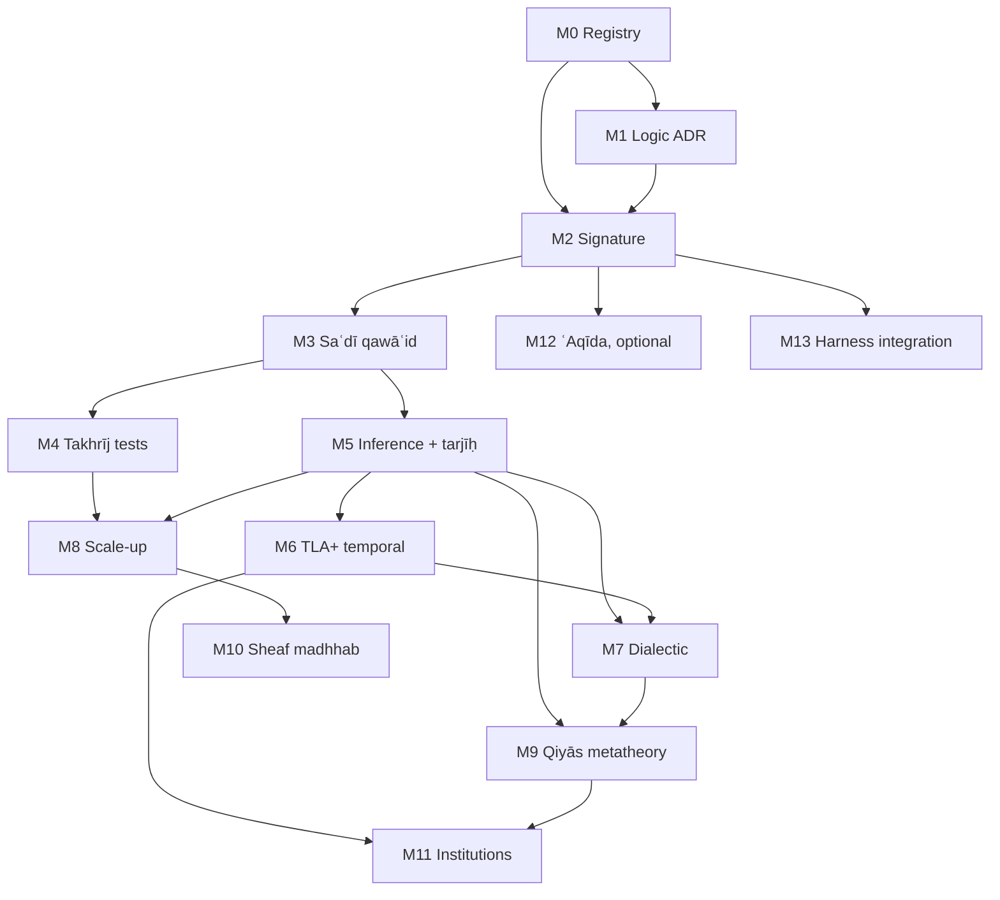

# Ḥanbalī Uṣūl Formalization — Roadmap and Milestones

## 0. Scope and thesis

**Goal.** Build a machine-checkable formalization of Ḥanbalī uṣūl al-fiqh along the silsila

```text
Ḥanbalī uṣūl line (Ibn Qudāma, al-Ṭūfī, Ibn Rajab, Ibn al-Laḥḥām, Ibn al-Najjār)
  → Ibn Taymiyya, Ibn al-Qayyim
  → al-Saʿdī, al-Shinqīṭī
  → Ibn ʿUthaymīn
```

The formalization uses five carriers, and each has one job:

| Carrier | Job | Authority (per `semantic-categorical-oracle/docs/authority-boundary.md`) |
|---|---|---|
| **Type theory** (Lean 4 core) | Signature: ḥudūd, aḥkām, adilla, judgement forms | Proof authority for stated theorems |
| **Lean 4** (+ Mathlib) | Metatheory: consistency, partitions, preference orders, argumentation semantics | Proof authority |
| **Haskell** | Executable reference interpreter, property tests, differential oracle | `advisory_oracle` until a contract is registered as `normative_semantic` |
| **TLA+** (TLC / Apalache) | Temporal and protocol structure: naskh, taklīf state, istiṣḥāb, munāẓara, review pipeline | Model-checked invariants within declared bounds only |
| **Category theory** | Compositional semantics: qiyās as factorization, sheaf gluing of local verdicts, institutions across carriers | Specification language; checked through Lean statements and Haskell laws |

**Non-authority clause.** Every output reads as *"ψ is derivable from sources S under encoding E, version v"*. None is a fatwā. Ikhtilāf is kept as data and is never collapsed by the encoding. This extends the existing repo rule that the LLM may propose but is never the deontic authority (`docs/architecture/deontic-circuits-harness.md`).

### 0.1 The logic-choice constraint (from *al-Radd ʿalā al-Manṭiqiyyīn*)

Ibn Taymiyya's critique fixes three design decisions **before** any axiom is written:

1. **No essentialist ḥadd.** A definition is a *distinguishing mark* (tamyīz). It does not capture an essence. ⇒ Definitions are discriminating predicates `d : Entity → Prop` with decidability and coverage obligations. No "real definition" is built into the kernel.
2. **Qiyās al-tamthīl is not inferior to qiyās al-shumūl.** ⇒ Analogy is a primitive inference rule. It is not encoded as a degraded syllogism. One milestone proves that the two forms are inter-convertible when the ʿilla is general (§3, L-QIY-2).
3. **Uṣūl reasoning is defeasible and proof-relevant.** ⇒ The core is a structured argumentation framework (ASPIC⁺-style) with a preference order from tarjīḥ. It is not a monotone axiomatic theory, and *which* dalīl supports a ḥukm matters, not only *that* one exists.

This rejects Standard Deontic Logic (KD) as the core: it has no defeasibility and is open to the Chisholm/Ross paradoxes. KD remains a possible *fragment*, valid for strict (qaṭʿī) rules only.

### Status (2026-10-05)

| Milestone | State | Evidence |
|---|---|---|
| M0 registry | **done for located texts** | `corpus/registry.json` (20 works, pinned witnesses), `corpus/lock.json`, `corpus/audit.json`: Ibn Rajab's 160, Ibn al-Laḥḥām's 66, al-Saʿdī's 60, the *Manẓūma*'s 103 abyāt and *Ṭarīq al-Wuṣūl*'s 1015 paragraphs confirmed (al-Saʿdī via the [OCR pipeline](architecture/ocr-pipeline.md)) |
| M1 logic core | **kernel proved** | `Usul.Dung`: admissibility preserved by `F`, grounded ⊆ every complete extension. The ADR prose is still open |
| M2 signature | **seeded** | 26 ḥudūd extracted from *al-Uṣūl*; `Usul.Hukm` / `Usul.Signature`; Σ map checked on both sides |
| M3 qawāʿid | **al-Saʿdī catalogued; 60 of 60 formalised** | `corpus/proposals/sadi_qawaid.json` (all 60: statement, gloss, kind, domain; candidate status, awaiting human review); `Usul.Sadi`: Q1, 2, 4, 6, 8, 11, 16, 22/23, 27, 28, 33, 38, 40, 52, 58, 59, 60, with proved theorems; `Usul.Muamalat`: Q10, 12–14, 18–21, 24–26, 30, 32, 35–37, 42–47, 49, 51, 53–56 (possession, liability, contract), with consistency theorems Q13 ⇔ Q36, Q43 ⊑ Q26, Q51 ∥ Q54 and Q42 as an instance of Q21; `Usul.Kulliyyat`: Q5, 9, 15, 17, 29, 31, 34, 39, 41, 48, 50, 57 (custom, intent, utterance, cause and condition in time); `Usul.Schema`: 39 (rule, schema) pairs, 38 rules, over eight transportable shapes, pinned in `UsulTest/Schemata.lean`; 12 interpretive commitments surfaced for the Sharīʿah-authority gate, each with cited established answers (the cited answers contradict the reading in 2 questions, refine it in 8, agree in 2) and analogies (`corpus/review/`); the review runs on its own principles where stratified (`Usul.Process`); `Usul.Qiyas`: masālik al-ʿilla and qawādiḥ with soundness theorems, disputed points as parameters with established positions cited (IQ-13 to IQ-16), and 23 classical qiyās sources pinned; `Usul.Jadal`: the eighteen objections as one gate with «all reduce to manʿ or muʿāraḍa» proved as `debateGate_holds_iff`; 241 verified citations ground every theorem of the qiyās modules (`corpus/citations/`); `Usul.QiyasLimits`: fallibility, scope, jalī/khafī, tamthīl ≡ shumūl ([`schemata.md`](architecture/schemata.md)); Haskell mirror `Oracle.Usul.Sadi` |
| M4 tests | **first tranche checked** | harness (`usul_corpus/takhrij.py`, Lean-guarded); 204 furūʿ for 15 readings (Ibn Rajab under the qawāʿid al-Saʿdī compresses, Ibn al-Laḥḥām 52–54 for generality): coverage 0.873, madhhab coverage 0.534, after four self-application rounds (ʿahd-aware generality; conservative refinements; the open gaps' own principles, twice, all in `Usul.Refinements`): 214 cases, coverage 0.977, madhhab coverage 0.648, 0 encoding errors (from 7), 5 open gaps in the ledger (naming and policy points, and one case with no transmitted ruling), 29 cases revisited, see [`takhrij.md`](architecture/takhrij.md). Every closure is cited in the [dossier](architecture/dossier.md); terms in the [glossary](glossary.md) (75 terms, 159 verified excerpts). Ibn al-Laḥḥām's uṣūl rules wait for M5 |
| M8 scale-up | **tranches 1–6 encoded; human review open** | tranche 6: qawāʿid 3, 9, 14, 15 (15 records, `rajab_m8_tranche6_furu.json`): coverage 1.000, madhhab coverage 0.533, no new gaps; Q9 proved to agree with al-Saʿdī Q38 (`q9_refines_q38`), Q14 ⟂ Q15 resolved as T-15; tranche 5: qawāʿid 25, 29, 30, 32, 33, 34 (27 records, `rajab_m8_tranche5_furu.json`): coverage 1.000, madhhab coverage 0.704, no new gaps; tranche 4: qawāʿid 2, 20, 21, 24 (21 records, `rajab_m8_tranche4_furu.json`): coverage 1.000, madhhab coverage 0.571, no new gaps; unified tranche 3: all 29 candidates under qawāʿid 1, 17, 31, 47, 66, 91, 93; PR #32's list-and-division segmentation and PR #31's hash-pinned worklist, source receipts and contrast guards are preserved. Tranche 2 (merged #30): qawāʿid 7, 27, 28, 64, 65, 25 records; tranche 1: qawāʿid 6, 22, 68, 26 records with opening examples. Current aggregate metrics and remaining counts come from the generated scope table below; exact IDs and source obligations are in `corpus/worklists/`. After tranche 3, round 5 applied the bank to its own gaps: 8 of 14 closed, each cited in the dossier (see [`takhrij.md`](architecture/takhrij.md)). All interpretation questions remain open; [reconciliation audit](architecture/m8-tranche3-reconciliation-2026-10-08.md) |
| M5 tarjīḥ | **schemata in** | `Usul.Taarud` resolution order; `Usul.Dalala`: ʿahd-aware generality, takhṣīṣ (not naskh), muṭlaq/muqayyad, amr/nahy defaults, al-amr bi'l-shayʾ nahy ʿan ḍiddih from σ, mafhūm with blockers, ≺ strict and well-founded; applied back to M4 (4 gaps closed, see [`takhrij.md`](architecture/takhrij.md#the-bank-applied-to-itself)) |
| M6 TLA+ | started | Istishab, Taklif, Naskh, Review: all pass TLC, and each was mutation-checked |
| M11 oracle | started | `semantic-categorical-oracle` `Oracle.Usul.*` advisory laws; three-way agreement on `grounded-v1.json` |

<!-- BEGIN GENERATED M8 SCOPE -->
**Current M8 inventory (generated).** 1,179 segmented Ibn Rajab furūʿ records = 339 annotated + **840 awaiting annotation**. Of 160 qawāʿid, 154 have segmented records: 43 are fully annotated and **111 await annotation**. The other **6 need source segmentation review**; zero emitted records does not establish zero examples in the text.

The unit is a committed farʿ record, which can contain multiple examples. Annotated gaps and disagreements are already counted as annotated; annotation does not mean independently reviewed or scholarly accepted. No count is imputed for unsegmented examples. The exact ID worklist and input hashes are in `corpus/worklists/rajab_m8.json`; rebuild with `python -m usul_corpus m8-worklist`.

| Current scope (generated) | Cases | Coverage | Madhhab coverage | Encoding errors | Open gaps |
|---|---|---|---|---|---|
| Combined M8 tranche 3 | 29 | 1.000 | 0.793 | 0 | 0 |
| All annotation suites | 366 | 0.984 | 0.652 | 0 | 6 |

Coverage counts derivability under the candidate encoding. Madhhab coverage uses candidate source attributions; neither metric establishes scholarly acceptance.
<!-- END GENERATED M8 SCOPE -->

Pipeline details: [`architecture/formalization-pipeline.md`](architecture/formalization-pipeline.md).

**M5 command capabilities (2026-10-09).** Four candidate schemata now express the named
readings in Ibn al-Laḥḥām 43.f001, f003, f004 and f007, with full-source replay, original
case receipts and explicit open interpretation questions. The four live command gaps
and the other two gaps remain open; capability fixtures add no annotations to the
generated aggregate above. Writing is not extended to gesture, conditional imitation is
preserved, and command naming does not change a given intended ruling. See the
[source contrasts and replay instructions](architecture/m5-command-schemata-2026-10-09.md).

---

## 1. Source → layer map

| Layer | Primary sources | Formal role |
|---|---|---|
| **Σ — signature** | Ibn ʿUthaymīn, *al-Uṣūl min ʿIlm al-Uṣūl* + sharḥ; Ibn Qudāma, *Rawḍat al-Nāẓir*; al-Ṭūfī, *Sharḥ Mukhtaṣar al-Rawḍa*; Ibn al-Najjār, *Sharḥ al-Kawkab al-Munīr* | Sorts, constructors, ḥudūd as predicates |
| **Ax — qawāʿid** | al-Saʿdī, *al-Qawāʿid wa'l-Uṣūl al-Jāmiʿa* (≈60, + furūq, taqāsīm); Ibn ʿUthaymīn, *Manẓūma* + sharḥ; Ibn Rajab, *Taqrīr al-Qawāʿid* (≈160); Ibn Taymiyya, *al-Qawāʿid al-Nūrāniyya*; al-Saʿdī, *Ṭarīq al-Wuṣūl* | Defeasible rules + exceptions; partitions as proved case splits |
| **⊢ — inference** | *Rawḍa*, *al-Uṣūl*, Ibn al-Qayyim's *Iʿlām* (Aḥmad's five uṣūl, qiyās, ḥiyal) | Rule schemata: qiyās, ʿāmm/khāṣṣ, muṭlaq/muqayyad, naskh, amr/nahy, mafhūm, taʿāruḍ → tarjīḥ |
| **T — tests** | Ibn al-Laḥḥām, *al-Qawāʿid wa'l-Fawāʾid al-Uṣūliyya* (takhrīj al-furūʿ ʿalā al-uṣūl); *Iʿlām* (≈99 sadd al-dharāʾiʿ instances); *al-Sharḥ al-Mumtiʿ* | Golden entailments `rule ⊢ farʿ`; regression corpus with explicit tarjīḥ |
| **Dial — dialectic** | al-Shinqīṭī, *Ādāb al-Baḥth wa'l-Munāẓara*, *Mudhakkira*; qawādiḥ chapter of the *Rawḍa* | Dialogue game; objections as attack types |
| **ʿAq — ʿaqīda** (optional, firewalled) | Ibn ʿUthaymīn, *al-Qawāʿid al-Muthlā*; Ibn Taymiyya, *al-Tadmuriyya* + *Taqrīb* | Separate theory; predication constraints |

**Suggested addition (flagged, not from the source list):** al-Mardāwī, *al-Inṣāf* / *Taṣḥīḥ al-Furūʿ*, as the intra-madhhab tarjīḥ oracle. It distinguishes the riwāyāt from Aḥmad from the muʿtamad. That distinction maps directly onto *preferred extensions* versus a *selection function* (M5).

---

## 2. Formal kernel sketch

### 2.1 Signature (type theory)

Taklīfī status, with an involution for the status of omission (*al-amr bi'l-shayʾ nahy ʿan ḍiddih*):

```text
Ḥukm  ::= W | N | M | K | Ḥ          -- wājib, mandūb, mubāḥ, makrūh, ḥarām
σ : Ḥukm → Ḥukm,  σW = Ḥ, σN = K, σM = M, σK = N, σḤ = W
Law:  σ ∘ σ = id,  σ antitone on the valence order  Ḥ < K < M < N < W
```

Waḍʿī structure as a dependent precondition:

```text
applies : (a : Act) → (s : Subject) → Sabab a s → Sharṭ a s → ¬ Māniʿ a s → Ḥukm
Mukallaf s  :≡  Bāligh s ∧ ʿĀqil s            -- refinement type, not a flag
```

Judgement form (proof-relevant):

```text
Γ ⊢ d : H(a, s) @ g
  d : Dalīl     -- the evidence term (naṣṣ, ijmāʿ, qawl ṣaḥābī, qiyās, istiṣḥāb, …)
  g : Grade     -- epistemic strength: qaṭʿ > ẓann_ghālib > shakk > wahm
```

`Derivation : Type` is used, not `Prop`. Tarjīḥ compares derivations, so proof irrelevance would erase the object of study.

Sort-indexed defaults: one qāʿida with two domains.

```text
default : Domain → Ḥukm
default ʿĀda   = M     -- al-aṣl fī'l-ashyāʾ al-ibāḥa
default ʿIbāda = Ḥ     -- al-aṣl fī'l-ʿibādāt al-tawqīf
```

### 2.2 Adilla precedence (Aḥmad's uṣūl per *Iʿlām*)

```text
naṣṣ  ≻  fatwā ṣaḥābī (no known dissent)  ≻  closest ṣaḥābī view to naṣṣ
      ≻  mursal / ḍaʿīf (non-fabricated)  ≻  qiyās (by necessity)
istiṣḥāb : fallback default (frame axiom)
```

### 2.3 Argumentation core

```text
AF   = (Args, ⇀, ≺)               -- ⇀ attack, ≺ preference from tarjīḥ
Rule = Strict  (φ₁…φₙ → ψ)        -- qaṭʿī only
     | Defeas  (φ₁…φₙ ⇒ ψ) ∖ E     -- E = mustathnayāt (exceptions)
Semantics:
  grounded extension  ↔  the uncontested core
  preferred extensions ↔  admissible aqwāl / riwāyāt
  selection function  ↔  muʿtamad (al-Mardāwī)
```

### 2.4 Conflict resolution (taʿāruḍ), as an ordered fallback

```text
resolve = jamʿ <|> naskh <|> tarjīḥ <|> tawaqquf
```

In Haskell this is literally an `Alternative` chain. Lean proves that it is total and that `tawaqquf` is reached only when all earlier steps fail.

### 2.5 Qiyās (category-theoretic reading)

```text
Case        -- category of case descriptions; morphisms preserve features
π_e : Case → Feat     -- projection onto the candidate ʿilla e
H   : Case → Ḥukm     -- ruling assignment (partial, from naṣṣ)

ʿilla e is valid  ⇔  H factors through π_e   (H ≅ Ĥ ∘ π_e on the known cases)
qiyās(aṣl, farʿ)  :≡  π_e(aṣl) = π_e(farʿ)  ⇒  H(farʿ) := Ĥ(π_e(farʿ))
naqḍ              :≡  a witness against factorization (e present, H differs)
```

Each qawādiḥ objection (naqḍ, kasr, ʿadam al-taʾthīr, qalb, fasād al-iʿtibār, fasād al-waḍʿ, manʿ wujūd al-ʿilla, farq) becomes a typed attack on one premise of this factorization claim.

---

## 3. Milestones

Notation: **Exit** criteria are machine-checkable unless marked *(review)*. `⟵` lists hard dependencies.

### Phase I — Foundations

#### M0 · Corpus registry and provenance ⟵ —
- Pin editions (publisher, year, taḥqīq) for every source in §1. **Verify the rule counts** (60 / 160 / 7+7+4 / …) against the pinned edition, because the current counts come from recall.
- Locator scheme `src:<work>/<edition>/<vol>:<page>:<rule#>`. Pick one transliteration standard and use it everywhere (ALA-LC or IJMES).
- Extend `schemas/` with `usul_rule.schema.json`: id, locator, Arabic text, gloss, rule-kind, exceptions, cross-refs, status ∈ {candidate, reviewed, accepted, quarantined}.
- **Exit:** a schema-valid registry; every record has a resolvable locator; CI rejects orphans.

#### M1 · Logic decision record ⟵ M0
- An ADR that compares SDL/KD, input/output logic, Governatori's DDL, and ASPIC⁺ against the three constraints in §0.1.
- **Exit:** the ADR is merged *(review)*. Lean has a `Dung` module with these results proved: the grounded extension exists, is unique, and is conflict-free; admissible ⊆ preferred.

#### M2 · Signature kernel (Σ) ⟵ M0, M1
- Base text: Ibn ʿUthaymīn's *al-Uṣūl*. Cross-check against the *Rawḍa* muqaddima and *al-Kawkab*.
- Lean: the `Usul.Signature` sorts from §2.1. Haskell: mirror ADTs. JSON Schema is the interchange format, and the Lean and Haskell types are checked by round-trip conformance on shared fixtures. This keeps DRY at the boundary without fragile code generation.
- **Exit:** these Lean lemmas are proved: `σ_involutive`, `σ_antitone`, `mukallaf_required`. Every ḥadd in *al-Uṣūl* exists as a decidable predicate with ≥1 positive and ≥1 negative fixture. Haskell and Lean agree on 100% of the fixtures.

### Phase II — Kernel

#### M3 · Qawāʿid kernel, al-Saʿdī's set (Ax) ⟵ M2
- Classify each rule: `meta` (over adilla) | `default` (with exceptions) | `taqsīm` (partition) | `farq` (distinction) | `closure`.
- Priority rules, all of which can be checked:
  - *al-yaqīn lā yazūl bi'l-shakk* → a grade-monotonicity law: an override needs grade ≥ the incumbent's.
  - *mā lā yatimm al-wājib illā bihi fa-huwa wājib* → closure under necessary means, *jointly consistent* with *lā wājib maʿa ʿajz* (ought ⇒ can).
  - *al-ḍarūra tubīḥ al-maḥẓūrāt* + *tuqaddar bi-qadarihā* → a defeater with a proportionality bound.
  - *al-wasāʾil lahā aḥkām al-maqāṣid* → a monotone map, means → ends.
  - *al-mashaqqa tajlib al-taysīr* → rukhṣa activation by sabab.
- **Exit:** every rule has a Lean statement, a Haskell executable, and ≥1 test. Every taqsīm is proved **exhaustive ∧ disjoint**. The closure ∧ ought-implies-can fragment is proved consistent: a model exists in Lean.

#### M4 · Takhrīj test suite (T) ⟵ M3
- Encode Ibn al-Laḥḥām's rule → furūʿ pairs as golden entailments.
- Classify each failure as one of `missing_fact` | `missing_rule` | `genuine_ikhtilāf` | `encoding_error`.
- **Exit:** the suite runs in CI and reports coverage = derivable / total. `encoding_error = 0` before Phase III begins. `genuine_ikhtilāf` cases are recorded as multiple preferred extensions, not as failures.

#### M5 · Inference schemata and tarjīḥ (⊢) ⟵ M3
- ʿĀmm/khāṣṣ and muṭlaq/muqayyad as specificity attacks. Amr ⇒ wujūb ∧ fawr and nahy ⇒ taḥrīm ∧ fasād as defeasible defaults. Mafhūm al-mukhālafa with its blocking conditions.
- Tarjīḥ: a preference relation ≺ over derivations.
- **Exit:** `≺` is proved to be a strict partial order and well-founded on finite AFs. Lean proves `resolve` total (§2.4). The *al-amr bi'l-shayʾ nahy ʿan ḍiddih* theorem is proved from σ. Haskell QuickCheck agrees with Lean `#eval` on 10⁴ generated AFs.

#### M6 · Temporal layer (TLA+) ⟵ M5
| Spec | Invariants / properties |
|---|---|
| `Naskh.tla` | An abrogated ruling is never active. nāsikh is later than mansūkh. Ijmāʿ indicates naskh but does not perform it. |
| `Taklif.tla` | `Obligated(a,s) ⇒ Mukallaf(s) ∧ Capable(a,s)`. A rukhṣa is active only while its sabab holds. |
| `Istishab.tla` | A `Doubt` event leaves the state `UNCHANGED` (al-yaqīn lā yazūl bi'l-shakk as a frame axiom). |
| `Tahara.tla` | A worked ʿibāda: nawāqiḍ transitions, validity of ṣalāt conditioned on the ṭahāra state. |
| `Review.tla` | Repo harness rule: `Accepted(r) ⇒ ∃ human review(r)`. Quarantined records never support a derivation. |
- **Exit:** TLC/Apalache pass within the declared bounds in CI. Each spec has a refinement mapping or fixture link to the Haskell interpreter.

### Phase III — Scale and dialectic

#### M7 · Dialectic engine (Dial) ⟵ M5, M6
- al-Shinqīṭī's moves (manʿ, naqḍ, muʿāraḍa, …) plus the qawādiḥ as typed attacks (§2.5). Roles: mustadill (proponent) and sāʾil (opponent), with burden of proof.
- `Munazara.tla`: legal-move safety, plus liveness under fairness (it terminates in ilzām, ifḥām, or ʿajz).
- **Exit:** Lean proves the soundness and completeness link: *the proponent has a winning strategy ⇔ the argument is in the grounded extension* (the dialogue-game correspondence, specialized to this AF). Haskell plays the games on the M4 fixtures.

#### M8 · Corpus scale-up ⟵ M4, M5
- Ibn Rajab's *Taqrīr* (≈160), the *Manẓūma*, *al-Qawāʿid al-Nūrāniyya*, *Ṭarīq al-Wuṣūl*. Deduplicate against M3 with an explicit `same_as` / `refines` / `conflicts` graph.
- Regression corpora: the *Iʿlām* sadd al-dharāʾiʿ instances (≈99) and the ḥiyal cases; the furūʿ from *al-Sharḥ al-Mumtiʿ* with the author's tarjīḥ as expected output.
- Stress test: al-Ṭūfī on maṣlaḥa versus naṣṣ, as a known point of conflict.
- **Seed of the `conflicts` graph (2026-10-10): the bank applied to its own contradictions.** Ten pairs from al-Saʿdī's 60 rule opposite ways on a shared case when each rule is read without its qayd. The pairs are Q13/Q27, Q20/Q25, Q31/Q41, Q55/Q57, Q17/Q39, Q4/Q40, Q21/Q50, Q11/Q52, Q12/Q45 and Q10/Q26. Each is resolved by the bank itself: by `Usul.resolve` and by Q29 (read a rule with what is attached to it). In every pair the qayd is the author's own sentence, quoted from one of the two qawāʿid and located in `corpus/tanaqud/sadi.json`. All ten reach jamʿ, so none needs naskh, tarjīḥ or tawaqquf. `Usul.Tanaqud` proves three things for each pair: the clash is real, the jamʿ is what resolution takes, and the jamʿ coincides with the rules' existing encodings (`obligedParts`, `timelyPerformance`, `discharges`, `zahirPrevails`, the presumption-based burden). Three pairs proved earlier are listed with them: Q13/Q36, Q26/Q43 and Q51/Q54. Checked by `tests/test_tanaqud.py`.
- **al-Saʿdī's furūq, tranche 1 (2026-10-10).** Part two of the same book is the author's own list of masāʾil that look alike but are ruled differently. Each is graded by its aṣl: «الشارع لا يفرق بين المتشابهات من كل وجه، بل لا بد فيها من فوارق معنوية». In `Usul.Furuq` that aṣl is `Schema.Factors`: `alike_unless_farq`, `farq_is_maana`, `suri_farq_idle`. Items F01–F21 are in order, none skipped (`corpus/furuq/sadi_tranche1.json`): 10 sound furūq, 7 weak furūq (ruled alike), and 4 masāʾil the madhhab wrongly treats alike. Where his reason is already a theorem of the bank it is cited and proved:
  - F06 is a naqḍ (`Qiyas.naqd_defeats`);
  - F13 and F15 rest on T-01's qayd (God's right);
  - F18 is Q27;
  - F20 fails the ḥadīth gate (D4).
  Witness: `islamhouse-qj-doc`, the same edition born-digital (the book is not on Shamela). The tanāquḍ quotes were re-anchored on it.
- **Furūq tranche 2 (F22–F41) and a correction to the bank.** 4 sound, 15 weak, 1 wrongly ruled alike. Where his reason is a qāʿida of part one it is cited by its theorem: Q9 (custom: F25, F33, F41), Q22/Q23 (conditions: F23, F26), Q53 (F30), Q10/Q55 (F32, F36) and Q56 (F37). F37 exposed a contradiction between the bank and its author. Q56 had been encoded with khiyār al-sharṭ and an unclaimed shufʿa excepted. But Q56's own statement marks that exception «في قول ضعيف» and concludes «والصحيح: أنها مثل غيرها», and the furūq call it «من الفروق الضعيفة جداً». So Q56 is now a parameter in the repo's manner for a divided madhhab: `inherits .sahih` is al-Saʿdī's reading, with no exception, and `.mashhur` keeps Aḥmad's well-known view; `q56_readings_differ_iff` pins where they part. No other encoding builds in a farq that he grades weak.
- **Furūq tranche 3 (F42–F60).** 15 sound, 4 weak. The section turns from correcting the madhhab to confirming it: most of these furūq rest on a stated wisdom (ḥikma) or on naṣṣ and ijmāʿ. The weak ones are:
  - the slave and the free man in bodily duties: «فظاهر النصوص وعمومها يقتضي مساواة العبد للحر»;
  - khulʿ versus divorce of a part;
  - a waqf in the final illness for an heir: «الخارقة للإجماع … عين الوصية للوارث»;
  - tayammum versus water purity: «قائمة مقام طهارة الماء في كل شيء» (Q28; the bank's Q28 encodes only when the substitute is used).
  F59 rests on Q47 (`q47_vow_as_law`). Running tally over F01–F60: 29 sound, 26 weak, 5 wrongly treated alike. Every item's two rulings are checked by Lean (`UsulTest/FuruqTable.lean`) and by the Prolog oracle.
- **Q28 completed, and furūq tranche 4 (F61–F75).** Q28's first half is now encoded: «يستباح به ما يستباح بالماء … وأنه يقوم مقامه في كل شيء» is `Sadi.q28_stands_in_everything`, and F51 (tayammum) cites it. Tranche 4 has 13 sound items and 2 weak:
  - F64: oaths broken in ignorance or forgetfulness, «والصواب: التسوية وأنه لا يحنث في الجميع … فإن الحق لله، وأيضاً ليس في ذلك إتلاف لمال». This is T-01's qayd again, with Q27.
  - F71: the madhhab's seven washings except on the ground, against «يكفي فيها على الصحيح أن تزول بأي شيء، وبأي عدد».
  Where a reason is a qāʿida of part one, the item cites it: Q47 (F61), Q55/Q57 by way of T-04 (F65: court by the outward words, conscience by intent), Q34 (F66), Q6 and Q54 (F69). Running tally over F01–F75: 42 sound, 28 weak, 5 wrongly treated alike.
- **Furūq tranche 5 (F76–F96).** 19 sound, 2 weak. The weak ones:
  - F88: guardianship of property reserved to the father, against «ما للأقارب من الحنو والشفقة يقتضي أن ولاية المال كغيره من الولايات، بل أولى».
  - F92: pre-emption lost by any delay. Its supporting ḥadīths «كلها ضعيفة، لا تقوم بها حجة», so the ḥadīth gate (D4) decides the farq, as in F20.
  Items grounded in part one: Q30 (F87), Q26/Q43 (F89), Q32 (F90), Q31 (F94, which is Q31's own example of the child following each parent). Running tally over F01–F96: 61 sound, 30 weak, 5 wrongly treated alike.
- **Furūq tranche 6 (F97–F115), and a fourth grade.** Some furūq he only reports («وفرّقوا», «ومن الفروق عند الأصحاب») without grading them. These are now `reported`: his ruling is recorded as theirs and nothing more is attributed to him. F95, earlier recorded as sound, is now reported. `Usul.Furuq.confirms_iff_sahih` now says his ruling matches the madhhab exactly on the sound and the reported items. The tranche has 10 sound, 7 reported, and 1 wrongly treated alike: F114, mixed lawful and unlawful money versus carrion mixed with slaughtered meat, «خبثه لمكسبه … خبثه لذاته، وبين الأمرين فرقٌ ظاهر». Items grounded in part one:
  - Q46 (F108), Q13 (F109), Q2 (F110), Q31 (F111);
  - Q11 (F113: a settled duty in doubt versus whether a duty arose);
  - Q38 (F115, stated in Q38's own words).
  Running tally over F01–F115: 71 sound, 30 weak, 6 wrongly treated alike, 8 reported.
- **Furūq tranche 7 (F116–F136).** 8 sound, 8 reported, 5 weak. The weak ones:
  - F121: tayammum for bodily impurity, «لاستواء النجاسات في عدم ورود النص بها»;
  - F128: the madhhab's extra places where prayer is invalid, «أقرب إلى الصواب … أنها تصح فيها»;
  - F129: the four-day rule for ending travel, «ليس لنا مرتبة ثالثة لا مقيم ولا مسافر»;
  - F134: zakāt to an heir relative;
  - F136: the old man who travels, «عليه الكفارة لظاهر النصوص».
  Running tally over F01–F136: 79 sound, 35 weak, 6 wrongly treated alike, 16 reported.
- **Furūq tranche 8 (F137–F166): the taqāsīm, to the end of part two.** 17 sound, 7 reported, 6 weak. In each weak item he restates the aṣḥāb's division, then calls the other view correct on one branch:
  - F140: unripe fruit sold to the owner of its trees, «أصح المنع … لدخولها في العموم وعدم المعارض»;
  - F142: the mithlī as only the measured and the weighed, «وهو الصحيح: أن المثلي أعم من ذلك»;
  - F144: a pledge before possession, «بلزومه مطلقاً، وهو الصحيح»;
  - F146: the slave's dealings without permission, on his dhimma «على القول الصحيح»;
  - F155: a part freed by an insolvent partner, «يعتق كله، ويستسعى العبد … وهو الصحيح»;
  - F165: a wife under nine, «وظاهر الأدلة وجوبها».
  The closing remark on the twenty-odd furūq of nikāḥ («قد ذكرتها في كتاب الإرشاد») names no cases and is not an item. Final tally over F01–F166: 96 sound, 41 weak, 6 wrongly treated alike, 23 reported. Part two is complete.
- **The register applied to itself (F01–F166, with the qawāʿid and T-01…T-10).** Each place where two entries rule one case differently, read without their qayd, was checked against the bank. None is a contradiction of his:
  - **A report, then his grade (6).** F133→F134, F135→F136, F139→F140, F141→F142, F143→F144 and F145→F146. Each later weak item overturns a case inside the bare report just before it: the heir relative, the travelling old man, the sale to the tree's owner, the narrow mithlī, the pledge before possession, and the slave's dealings. A report attributes nothing to him (the definition of `reported`), so his conclusion on the case is the later grade. The items now say so (`overturns`). `Usul.Furuq.overturn_iff_daif` proves that an overturn needs a bare report followed by his own grade ruling the other way, and that this is exactly reported → daif. It is checked per link in `FuruqTable.lean`, by `test_overturns_only_a_bare_report` and by the oracle (`furuq/<F>/overturns`, plus a mutant killed by the corpus). No sound grade of his is overturned anywhere.
  - **One qayd, several items.** F13, F14, F15, F64 and F109 all fall under T-01's qayd. F109's «في إتلافات النفوس والأموال» for the non-mukallaf is the human side (`Usul.Furuq.f109_adami`). F14 («التفريق بين المعذور وغيره هو الأولى») is Q27 on God's side, and was marked basis `qaida` with no ground; it is now grounded.
  - **The same answer reached twice.**
    - F05 and F128: the obligatory prayer inside the Kaʿba is valid.
    - F37 and F92: pre-emption is like the other rights (Q56's sound reading).
    - F27 and F151: «قدم الأقرب جهة» with the ascendants first.
  - **Scope, in his own words.**
    - Q28 (F51) with F121: the substitute stands in for what it substitutes, «وإنما يتيمم عن الأحداث».
    - F23 with F34: «ما لم تُدخل أهلها في محذور شرعي» against «تدوير العقود … إذهاب لروحها».
  Still open: F27 and F47 rest on an aṣl outside the sixty qawāʿid («الأصل المحكم في كل الأبواب», «الأصول الشرعية») and have no theorem yet. The test pins exactly these two.
- **The contradiction pass extended to Ibn Rajab (`corpus/tanaqud/rajab.json`).** His formalised readings (`Usul.Refinements`, M8 tranches 1–5) were checked against each other and against al-Saʿdī's. Two pairs clash when read without their qayd, and his own sentence resolves each by jamʿ. Pair ids continue from al-Saʿdī's; a rule of another work is named `work:number`.
  - **T-11, Ibn Rajab 66 ⟂ 6: an act done on a belief later shown wrong.** The reading `validWithBasis` voids the act when no valid basis exists in fact, while `errorExcused` upholds it. Where another's right is attached, the clash runs the other way. The qayd «ثم تبين خطؤه فيه وأن السبب المعتمد غيره وهو موجود» confines Q66 to the case where the true basis exists; elsewhere Q6 governs (`t11_jam`).
  - **T-12, al-Saʿdī Q28 ⟂ Ibn Rajab 7: the original found during the substitute.** Q28 switches; Q7 lets a general concession stand. Ibn Rajab's qayd, «الضرب الثاني: أن يكون المتلبس به إنما شرع ضرورة للعجز عن الأصل وتعذره … فهذا يلزمه الانتقال», gives Q28 the necessity substitute. The jamʿ is the existing reading `mustSwitch` (`t12_jam`).
  - **No clash.**
    - Q93 with Q75: what the taker entered on liability for was his own due, so the recourse rule gives nothing either (`rajab_q93_q75_consistent`).
    - Q65 with Q66 (`q65_is_the_unbelieved_basis`, already proved).
  - **Q22 is khilāf, not contradiction.** The `istihlak` reading takes one riwāya, while 22.f003 records the manṣūṣ «أنه اشتراك» for oil mixed with oil. Ibn Rajab states «فيه خلاف» and gives no qayd, so the register does not enter a jamʿ for it.
  Checked by `tests/test_tanaqud.py` (all registers, ids running on, each pair once across works), Lean (`TanaqudTable.lean`) and the oracle (pairs 11–12, two more mutants killed by the corpus).
- **The pass continued over the rest of the formalised readings.** Two more pairs, each resolved by Ibn Rajab's own sentence:
  - **T-13, Ibn Rajab 32 ⟂ 33: an excepted benefit of uncertain extent.** A waqf excepting its benefit for the founder's life is upheld by Q32, but the reading of Q33 voids a stated exception of uncertain extent. The qayd is «لأن جهالة المدة هنا لا تؤثر فإنها لا تزيد على جهالة مدة كل بطن بالنسبة إلى من بعده»: where the transfer already bears an uncertain period Q32 governs, elsewhere Q33 (`t13_jam`). Q33 with Q34 is entered as proved earlier (`binding_is_implicit_exception`).
  - **T-14, Ibn Rajab 1 ⟂ al-Saʿdī Q9: an oath about running water.** The jirya reading says he cannot stand in what keeps changing; custom says the river is one body. The qayd is «والأيمان مرجعها إلى العرف» (1.f003): oaths follow Q9, purity follows Q1 (`t14_jam`).
  - **Ibn al-Laḥḥām 52 is khilāf, not contradiction.** The head says the singular with al- is general; 52.f008 reads «al-ṣalāt» in a tayammum intention as the lowest prayer (`hamlAlaAdna`). He gives the farʿ as «في المسألة قولان أشهرهما عند الأصحاب الثاني», so no jamʿ is entered, as with Ibn Rajab 22.
  The register holds 14 pairs (T-01…T-14), all reaching jamʿ. The oracle checks 625 vectors and kills 31 mutants.
- **M8 tranche 6 checked as it lands.** The new readings were checked against the bank before committing.
  - **T-15, Ibn Rajab 14 ⟂ 15: a breach certain in one of two.** Q14's second riwāya attaches the breach because «الأصل زال يقينا في أحدهما». Q15 keeps each presumption and ignores its consequence for another. Ibn Rajab's qayd is «فينظر إليهما مجتمعين في حكم يتعلق باجتماعهما»: taken together Q14 governs, each alone Q15 (`t15_jam`).
  - **Ibn Rajab 9 with al-Saʿdī Q38: no clash.** Ibn Rajab's four sites map onto al-Saʿdī's three, the two kinds of condition becoming one, and the rulings agree on every site (`q9_refines_q38`).
  The register holds 15 pairs. The oracle checks 633 vectors and kills 32 mutants.
- **The textual foundation, pinned (layer `nusus`), and guards on terms.** The Qurʾān and the ḥadīth collections are now registered witnesses, fetched and pinned by sha256 in `corpus/lock.json`. They are the foundation every other layer rests on. Full texts stay in `.cache`.
  - **The texts.**
    - The Qurʾān: Tanzil's verbatim text (`tanzil-quran-simple`), with its licence footer.
    - The ḥadīth, from OpenITI at fixed commits:
      - al-Bukhārī (Shamela 1681), Muslim (1727), Abū Dāwūd (1726);
      - al-Tirmidhī (7895), al-Nasāʾī's al-Mujtabā (829), Ibn Māja (1198);
      - the Muwaṭṭaʾ (1699), Musnad Aḥmad (25794), al-Dārimī (21795).
  - **`corpus/nusus/foundation.json`.** Each āya is quoted and checked letters-only against the pinned muṣḥaf at its sūra and āya. Each marfūʿ ḥadīth is checked in each cited collection, under its number. Each also carries al-Albānī's verdict from al-Irwāʾ, checked against the «* صحيح» line of that entry, and is admitted only through the D4 gate (`Seam.admitted`). An athar is recorded as an athar, with al-Albānī's word on it, never as a marfūʿ naṣṣ.
  - **Terms resting on it.** The glossary gains al-manī (`maniyy`), al-madhy and al-wadī (`wady`), with rulings that cite foundation ids. The generated `UsulTest/NususTable.lean` checks those rulings against `Usul.Tahara`, and the oracle checks them against `tahara_oracle.pl`.
    - al-manī is ṭāhir and obliges ghusl: al-Māʾida 6, al-Nisāʾ 43; Abū Dāwūd 206 and 372, al-Bukhārī 282; al-Irwāʾ 125, 126, 180.
    - al-madhy is najis and obliges wuḍūʾ: Muslim 303; al-Irwāʾ 108.
    - al-wadī follows the athar of Ibn ʿAbbās, which al-Albānī marks «موقوف».
    - The division itself is al-Saʿdī's F120. `Usul.Tahara.semen_conflates` proves that the English «semen» covers terms whose rulings differ on both counts.
    - al-najāsa and al-ḥadath are entered as distinct, on Ibn al-Qayyim's «ما فرق الله بينه من إزالة النجاسة ورفع الحدث».
    - «إنما الماء من الماء» (Muslim 343) is deliberately not cited: it bears on the naskh question of intercourse without emission.
  - **Guards (`corpus/dossier/term_guards.json`, `tests/test_nusus.py`).** Any English field of the registers, or Lean doc comment, that says «semen» or «impurity» must name the Arabic term it means.
    - The guard found 30 such fields.
    - Two of them were mislabelled by a mechanical replacement and were corrected from the source. Ibn Rajab 18.f015 «الأحداث الموجبة للطهارة» is ḥadath, not najāsa. 159.f007 «لو تيقن حدثا أو نجاسة» names both.
    - The glossary key `mani` is al-māniʿ (المانع). Its ASCII fold collides with al-manī, so homographs must now declare each other in `distinct_from`, and the new term is keyed `maniyy`.
    - One frozen gap case (Ibn Rajab 22.f000) was re-pinned because its English note changed (impurity → najāsa). Its class, facts and needs are unchanged.
  Next, by the same method: give the cited dalīl of the bank's existing terms and qawāʿid their place in the foundation, starting with the qawāʿid that already quote a naṣṣ.
- **Exit:** every new rule is classified and linked; the coverage trend is reported. Disagreement with Ibn ʿUthaymīn's tarjīḥ is classified as in M4, never silently patched.

#### M9 · Qiyās metatheory ⟵ M5, M7
- **L-QIY-1:** the factorization criterion (§2.5) is formalized over finite case categories.
- **L-QIY-2:** the tamthīl ≅ shumūl equivalence (Ibn Taymiyya): given ʿilla e and the generalization `∀x. e(x) → h(x)`, the two derivations are inter-convertible, and conversion preserves grade.
- **Exit:** both lemmas are proved in Lean. Haskell laws check them on randomized finite case categories.

### Phase IV — Categorical integration

#### M10 · Sheaf semantics of the madhhab ⟵ M8, existing Milestone 1b
- Generalize `docs/architecture/sheaf-context-site.md` from ADQ affect facts to uṣūl verdicts. Local verdicts are sections. Context refinement is restriction. Gluing is a consistent madhhab position over a cover.
- Ikhtilāf is a *named obstruction* (finite Čech H¹ witness), not an error.
- **Exit:** obstruction records are emitted for every M4/M8 `genuine_ikhtilāf` case. Lean proves the gluing lemma on finite sites.

#### M11 · Institutions across carriers ⟵ M6, M9
- Treat Lean (CIC), TLA+ (temporal), and Haskell (executable) as institutions. Define signature morphisms and comorphisms for the shared fragment.
- Register `usul.hukm-algebra`, `usul.taarud-resolution`, and `usul.qiyas-factorization` in `semantic-categorical-oracle/registry/` as `advisory_oracle`. Promotion to `normative_semantic` follows that repo's contract gate.
- **Exit:** the satisfaction condition is checked on fixtures for each comorphism. Contracts are registered with laws in `laws.toml`.

### Phase V — Optional and integration tracks

#### M12 · ʿAqīda theory (firewalled) ⟵ M2
- A separate Lean namespace `Aqida.*`. There is **no import edge** into `Usul.*` unless one is declared and reviewed.
- *al-Qawāʿid al-Muthlā*: rules on names (tawqīfiyya, …) and attributes (ithbāt without tamthīl or taʿṭīl) as predication constraints. The *Tadmuriyya* aṣlān, mathalān, and qawāʿid as a parallel theory.
- **Exit:** consistency of the constraint set is proved, and the import firewall is enforced in CI.

#### M13 · Harness integration ⟵ M2 onward, existing Milestones 2–5
- Map uṣūl records onto the canonical schema and Ash resources (existing Milestones 2–3). The LLM extraction contract emits only `candidate` records, which pass through `Review.tla`'s pipeline.
- Explanations are generated from derivation terms `d` (§2.1), never from free text.
- **Exit:** an end-to-end path from source locator → candidate → reviewed → accepted → derivation → explanation, with the trace preserved.

---

## 4. Dependency DAG



**Critical path:** M0 → M1 → M2 → M3 → M5 → M7 → M9 → M11.
**Parallel tracks after M3:** tests (M4 → M8 → M10) ∥ temporal (M6) ∥ ʿaqīda (M12) ∥ harness (M13).

**Minimal kernel = M0–M4.** This is the kernel you named: *al-Uṣūl* for Σ, al-Saʿdī's 60 for Ax, Ibn al-Laḥḥām for T. It is the first point where the whole system produces a meaningful, falsifiable result.

---

## 5. Proposed layout

```text
usul-al-fiqh-deontic-circuits/
  corpus/            registry records (M0), JSON per work
  schemas/           + usul_rule.schema.json
  formal/lean/       Usul/{Signature,Dung,Qawaid,Tarjih,Qiyas,Sheaf}.lean, Aqida/
  formal/tla/        Naskh, Taklif, Istishab, Tahara, Munazara, Review
  tests/takhrij/     golden entailments (M4, M8)
semantic-categorical-oracle/
  src/Oracle/Usul/   Haskell interpreter + laws (M2, M5, M9, M11)
  registry/          usul.* contract entries
```

---

## 6. Risks and mitigations

| Risk | Mitigation |
|---|---|
| Edition variance in rule counts and wording | M0 pins editions; locators are edition-qualified |
| Flattening ikhtilāf into one answer | Preferred extensions plus sheaf obstructions; `genuine_ikhtilāf` is a first-class outcome |
| Smuggling Aristotelian assumptions (against §0.1) | ADR in M1; ḥudūd as tamyīz predicates; tamthīl kept primitive |
| Divergence between Lean and Haskell | Shared JSON fixtures; differential testing in CI (M2, M5) |
| Bounded model checking read as a universal guarantee | TLA+ results are labelled with their bounds, per the oracle repo's authority rules |
| LLM-extracted rules accepted unreviewed | `Review.tla` invariant plus existing harness rules |
| ʿAqīda/fiqh cross-contamination | Namespace firewall in M12 |
| Output mistaken for fatwā | Non-authority clause in §0; every output carries (S, E, v) |

---

## 7. Success metrics

- **Coverage:** derivable furūʿ / encoded furūʿ, per source (M4, M8).
- **Agreement:** match rate with Ibn ʿUthaymīn's tarjīḥ in *al-Sharḥ al-Mumtiʿ*, with disagreements classified.
- **Proof debt:** zero `sorry` on `main` for completed milestones.
- **Differential parity:** Lean ↔ Haskell disagreements = 0 on the fixture corpus.
- **Provenance:** 100% of accepted records resolve to a pinned-edition locator.
